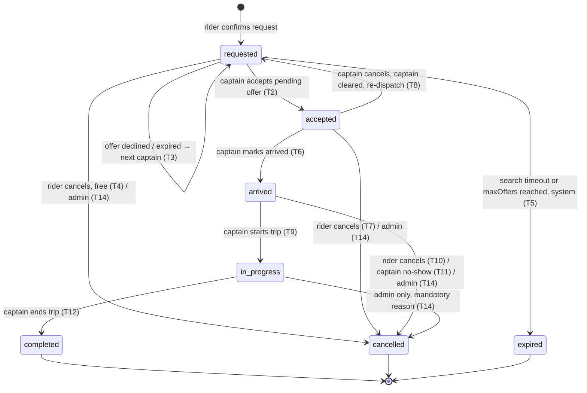

# 04 — Trip Lifecycle Specification

**Status:** Draft for client review — Phase 1
**Source of current behaviour:** `prototype/src/store.tsx` (ride simulation), `prototype/src/config/market.ts` (fee rules), `prototype/src/Driver.tsx` (offer UI)
**Production rule:** the backend owns the trip state. Apps send *commands*. The server validates them, changes the state and broadcasts *events*. No client timer may change a trip's state in production.

Status tags: **[P]** works in the prototype (simulated) · **[D]** designed or documented only · **[X]** production, not yet implemented.

**[Proposal — technical, recommended]** The state set, transitions, offer statuses, accept transaction, `tripVersion` ordering and exactly-once settlement in this document are technical decisions taken by the delivery team and applied consistently in 06, 07, 08 and 11. Timer **values** (search timeout, grace, no-show, fees) remain open business decisions for the client.

---

## 1. States

| State | Arabic label (UI) | Meaning | Terminal | In prototype |
|---|---|---|---|---|
| `requested` | جاري البحث | The rider has confirmed; the system is looking for a captain | No | [P] |
| `accepted` | في الطريق | A captain has accepted and is driving to pickup | No | [P] |
| `arrived` | وصل الكابتن | The captain is at pickup and waiting for the rider | No | [P] |
| `in_progress` | الرحلة جارية | The rider is on board and the trip has started | No | [P] |
| `completed` | مكتملة | The trip has ended at the destination. Settlement follows | Yes | [P] |
| `cancelled` | ملغاة | Cancelled by the rider before start (prototype). In production also by the captain (rider no-show from `arrived`) or by admin from any non-terminal state, including `in_progress` (T14). A captain cancelling from `accepted` does **not** cancel the trip: it returns to `requested` (T8) | Yes | [P] (rider only) |
| `expired` | لا يوجد كابتن | Terminal "no captain found": no captain accepted before the search timeout or `maxOffers` was reached. Set by the system actor | Yes | [X] |

**Offer status (production, per captain):** `pending → accepted | declined | expired | cancelled`. The same five values are used in 06 (`ride.trip_offers.status`), 07 and 08. `cancelled` means the offer was withdrawn because the trip was accepted by someone else, cancelled or expired. Offers sit inside `requested` and are tracked in the `trip_offers` table. Rules:

- One `pending` offer per trip at a time and one `pending` offer per captain at a time (partial unique indexes, see 06).
- A captain who declined or let an offer expire is **not** re-offered the same trip.
- Dispatch stops after `maxOffers` offers or the search timeout (proposed **3 min**, open business decision), whichever comes first, and the trip moves to `expired`.

The prototype has one implicit offer, with a single `rejected` flag on the trip.

## 2. State diagram

## 3. Transitions

| # | From → To | Command (prototype function) | Actor | Guards (server-side in production) | Side effects |
|---|---|---|---|---|---|
| T1 | ∅ → `requested` | `requestRide` | Rider | Rider authenticated and not blocked [X]. No other active trip for this rider [P]. Pickup inside an enabled service area [X]. A valid quote token that has not expired [X]. Coupon valid: active, under its limit [P], not expired [P], per-user limit [X]. Payment method valid; card pre-authorization succeeds [X] | Trip created with a **locked fare quote** [P]. Coupon usage reserved [P counts immediately]. Dispatch starts [X]. Notify: captain(s) (offer), admin (new request) [P] |
| T2 | `requested` → `accepted` | `acceptRide` | Captain | Captain approved, online, not on another trip, category eligible [X]. The captain's offer is `pending` and not past `expires_at` [X]. **First accept wins**: one database transaction (section 8) [X] | `driverId` and `acceptedAt` set [P]. Captain status → `enroute` [P]. Any other `pending` offer for the trip → `cancelled` [X]. Notify: rider ("Captain X accepted"), admin [P] |
| T3 | `requested` → `requested` (re-offer) | `rejectRide` | Captain (decline) or System (timeout) | The offer belongs to this captain and is `pending` | Offer → `declined` / `expired` [X]. Next eligible captain who has not yet been offered this trip is offered, unless `maxOffers` or the search timeout is reached (then T5) [X]. The prototype marks `rejected` and auto-assigns demo captain `d4` after **3 s** [P]. Notify: admin ("reassigned") [P], rider (optional) |
| T4 | `requested` → `cancelled` | `cancelRide` | Rider | Status is `requested` | Fee = 0 [P]. Pre-authorization voided [X]. Pending offer → `cancelled` [X]. Coupon reservation released [X; prototype keeps the use]. Notify: admin [P], offered captain [X] |
| T5 | `requested` → `expired` | — | System | Search timeout (proposed 3 min) or `maxOffers` reached with no acceptance | Pending offer → `cancelled`. Pre-authorization voided. Coupon released. Notify rider ("No captains available"), admin. [X] |
| T6 | `accepted` → `arrived` | `arrive` | Captain (manual) or simulated captain (auto) | Status `accepted`. In production, the captain is within an *X m* geofence of pickup (proposed 100–150 m) [X] | `arrivedAt` set (starts the waiting clock) [P]. Notify: rider ("Your captain has arrived") [P for manual only] |
| T7 | `accepted` → `cancelled` | `cancelRide` | Rider | Status `accepted` | Fee = 0 if `now − acceptedAt ≤ graceMins`, else `riderAfterGrace` [P]. Captain → `available` [P]. Notify: admin [P], **captain [X — missing in prototype]** |
| T8 | `accepted` → `requested` | — | Captain cancels | Status `accepted`, captain is the assigned captain | `captain_id` and `acceptedAt` cleared, `version` +1. Captain → `available` and is not re-offered this trip. Re-dispatch keeping the original quote; the search timeout keeps running from the original request (to confirm). Captain penalty or acceptance-rate impact (business decision). Notify the rider ("Finding another captain"). [X] |
| T9 | `arrived` → `in_progress` | `startRide` | Captain (manual) or simulated captain (auto, 4 s after arrival) | Status `arrived`. Optional rider PIN / verification (decision) [X] | `startedAt` set. **Waiting fee computed and frozen** from `startedAt − arrivedAt` [P]. Captain → `ontrip` [P manual only]. Notify: admin [P], rider [X] |
| T10 | `arrived` → `cancelled` | `cancelRide` | Rider | Status `arrived` | Fee = `riderAfterArrival` [P]. Captain → `available` [P]. Notify: admin [P], captain [X] |
| T11 | `arrived` → `cancelled` *(proposed)* | — | Captain (rider no-show) | Status `arrived` and `now − arrivedAt ≥ noShowMins` (decision). Captain inside the geofence | No-show fee charged to the rider (decision; see 05). Captain compensated (decision). [X] |
| T12 | `in_progress` → `completed` | `endRide` | Captain (manual) or simulated captain (auto) | Status `in_progress`. In production, a location sanity check near the destination or a confirmation prompt [X] | `endedAt` set [P]. Final fare: locked quote, or recalculated from the actual route (decision) [X]. Settlement (section 6). Captain → `available`, rides +1 [P]. Rider rides +1 and spend + total [P]. Notify: rider ("Rate your trip"), admin [P] |
| T13 | `completed` (rating) | `rate` | Rider | Trip `completed`, not already rated, by the trip's rider | Rating and review stored [P]. Captain average updated [X]. Notify: captain, admin [P]. Low rating flags support [X] |
| T14 | Any non-terminal (`requested`, `accepted`, `arrived`, `in_progress`) → `cancelled` | — | Admin | Admin role with permission. A reason code and free-text reason are **mandatory** | Fee override (none / standard / custom). Pending offers → `cancelled`. Pre-authorization voided or partially captured per the override. Audit-log entry. Notify both parties. [X] |

**Not allowed:** riders and captains cannot cancel from `in_progress` (the prototype hides the button and the guard rejects it). Only admin can cancel an `in_progress` trip (T14, mandatory reason). Whether a captain may also *end a trip early* for safety or breakdown (completing it with the fare so far, via T12) is an open business decision.

**Invalid commands.** A command that is not allowed from the trip's current state (for example `arrive` on a `requested` trip, or `cancel` by the rider on an `in_progress` trip) returns `409 INVALID_TRANSITION` with the current `status` and `version` in the body and has **no side effects** (no event, no notification, no payment call).

**Prototype note.** The demo panel's "Fast finish" (`fastForward`) jumps a trip straight to `completed`. This is a demo-only invalid transition and has no production equivalent.

## 4. Timeouts and timers

| Timer | Value (current / proposed) | Owner in production | Prototype behaviour |
|---|---|---|---|
| Captain offer window | **30 s** | Server (offer `expires_at`) | Countdown shown [P]; at 0 the offer expires and is passed on like a decline [P] (G1, fixed) |
| Reassignment after decline | Immediate re-offer (proposed) | Server dispatch | Fixed 3 s delay, then always captain `d4` [P] |
| Total search timeout → `expired` | Proposed **3 min** (open business decision) | Server | Not implemented. The request waits indefinitely |
| Max offers per request | To be decided (for example 5–10 captains) | Server | — |
| Rider free-cancellation grace after acceptance | **2 min** (`graceMins`) | Server | [P] |
| Free waiting after arrival | **3 min** (`freeMins`) | Server | [P] |
| Waiting fee rate | **0.5 SAR per started minute** after free time | Server | [P] |
| Rider no-show threshold | To be decided (for example 5 min after arrival) | Server | Not implemented |
| Quote validity (quote → request) | To be decided (for example 2–5 min) | Server | Fare is locked at request. No expiry |
| Rating window | To be decided (for example 72 h) | Server | Unlimited, until dismissed |
| Simulated approach to pickup | ~14.5 s (`+0.035` every 500 ms) | — | [P] simulation only |
| Simulated auto-start after arrival | 4 s (non-demo captains only) | — | [P] simulation only |
| Simulated trip progress | ~23 s (`+0.022` every 500 ms) | — | [P] simulation only |

## 5. Cancellation paths

| Path | Actor | State at cancel | Fee to rider (current rule) | Captain compensation | Status |
|---|---|---|---|---|---|
| Cancel while searching | Rider | `requested` | 0 | — | [P] |
| Cancel within grace | Rider | `accepted`, ≤ 2 min since accept | 0 | — | [P] |
| Cancel after grace | Rider | `accepted`, > 2 min since accept | 5 SAR (`riderAfterGrace`) | Decision | [P] fee · [X] compensation |
| Cancel after arrival | Rider | `arrived` | 10 SAR (`riderAfterArrival`), regardless of time waited | Decision | [P] fee · [X] compensation |
| Rider no-show | Captain | `arrived`, ≥ threshold | Decision | Decision | [X] |
| Captain cancels | Captain | `accepted` | 0 (trip returns to `requested` and is re-dispatched; not a cancellation) | Penalty decision | [X] |
| No captain found | System | `requested` → `expired` (not `cancelled`) | 0 | — | [X] |
| Admin cancels | Admin | any non-terminal, including `in_progress` (mandatory reason) | Admin chooses | Admin chooses | [X] |

All values are **provisional** (see `05-fare-and-fee-rules.md`). Every cancellation records `cancelled_by`, `reason_code` and `cancelled_at`. The prototype records none of these.

## 6. Settlement on completion

Settlement runs **exactly once** per trip. Exactly-once is enforced by the ledger: the settlement writes one `finance.ledger_transactions` row with `idempotency_key = 'trip:{id}:settle'` (unique). A repeat attempt hits the unique constraint and becomes a no-op. There is no separate `settlements` table. All amounts are integer halalas (see 05).

1. Compute the rider total: `fare − discount + waitingFee` (see 05; the discount is recomputed on the final fare and capped by `maxOff`).
2. **Card:** capture against the pre-authorization (or the remainder of a partial capture). Issue the e-invoice / receipt.
3. **Cash:** the captain collects the total. The platform's commission is booked as a captain debt in the cash ledger (see 10).
4. Credit the captain's earnings with `captainNet`. Record the platform commission and the promotion cost.
5. Update the rider and captain aggregates (rides, spend). Release the captain to `available`.
6. Emit `trip.completed` and `trip.settled` events.

**Settlement for a cancellation with a fee** (T7 after grace, T10, T11, or T14 with a fee) uses the same ledger rule with `idempotency_key = 'trip:{id}:settle'`:

1. **Card:** capture the fee amount against the pre-authorization and void the remainder. If capture fails, record a rider debt (business decision on collection).
2. **Cash:** the fee is recorded as a rider debt, collected on the next trip (business decision; see 05).
3. Credit the captain's share of the fee per 05 D7, with commission on the fee per 05 D19.
4. Issue one invoice / receipt per fee (VAT placement per 05 §5a, open decision D5).

Prototype: a React effect settles the live trip when `settled` is false. `endRide` marks it settled inline [P]. There is no capture, no invoice and no ledger.

## 7. Side effects and notification matrix

| Event | Rider | Captain | Admin | Prototype |
|---|---|---|---|---|
| Request created | Toast "finding a captain" | Offer (push + in-app) | Feed item | [P] (in-app only) |
| Offer declined / reassigned | (optional) "Still searching" | Next captain offered | Feed item | [P] admin only |
| Accepted | Push "Captain X is on the way" | — | Feed item | [P] |
| Arrived | Push "Your captain has arrived" | Waiting timer | — | [P] manual captain only |
| Started | "Trip started" | — | Feed item | [P] admin only |
| Completed | Push "Rate your trip" and receipt | Earnings summary | Feed item | [P] |
| Rated | — | "You received N stars" | Feed item | [P] |
| Cancelled by rider | Toast with fee | **Push "Rider cancelled"** | Feed item | [P] admin only (gap G3) |
| Expired | "No captains available" | Pending offer withdrawn | Feed item | [X] |
| Captain cancelled (T8) | "Finding another captain" | — | Feed item | [X] |
| Admin cancelled (T14) | Push with reason | Push with reason | Audit entry | [X] |

Captain status changes: `available → enroute` (T2), `enroute → ontrip` (T9), `→ available` (T7, T8, T10, T11, T12, T14). T4 does not change any captain's status (no captain is assigned in `requested`). Suspending a captain forces `offline` [P in admin data only]. Suspending a captain forces `offline` [P in admin data only].

## 8. Idempotency and concurrency (production)

| Concern | Rule |
|---|---|
| Duplicate commands (retries, double taps) | Every mutating request carries an `Idempotency-Key` (UUID). The server stores the key with its result for ≥ 24 h and returns the same result on a repeat |
| Accept race (two captains) | One transaction: (1) `update ride.trip_offers set status='accepted' where id=$offer and captain_id=$captain and status='pending' and expires_at > now()`; (2) only if that updated 1 row, `update ride.trips set status='accepted', captain_id=$captain, version=version+1 where id=$trip and status='requested'`. If step 1 updates 0 rows the API returns `410 Gone` (offer expired or withdrawn); if step 2 updates 0 rows the transaction rolls back and the API returns `409`. No `expectedVersion` is needed for accept |
| Stale clients | Each trip has a `version` (`tripVersion` on the wire). Other commands may carry `expectedVersion`; a mismatch gives `409 Conflict` with the current state and the client refreshes |
| Invalid transition | `409 INVALID_TRANSITION` with current `status` and `version`; no side effects |
| Rider cancels as the captain arrives | Transitions are serialised per trip (row lock). Whichever commits first wins, and the other gets `409` with the current state |
| Event delivery | Transactional outbox. Events carry `tripId`, `tripVersion` and `occurredAt`. Clients ignore events with `tripVersion` ≤ the last applied one. Delivery is at least once |
| Settlement | Exactly once via the unique `finance.ledger_transactions.idempotency_key = 'trip:{id}:settle'` (no `settlements` table). The PSP idempotency key is derived from the `finance.payments` row id (see 10) |
| Offer expiry safety net | Offer expiry is scheduled as a BullMQ delayed job. A periodic DB sweeper also expires overdue offers (`select … from ride.trip_offers where status='pending' and expires_at < now() for update skip locked`) and expires overdue searches, so a Redis / BullMQ loss cannot leave a trip stuck in `requested` |
| Reconnect | On WebSocket reconnect the client fetches `GET /trips/{id}` (snapshot) and then resumes the event stream |

## 8a. Failure and recovery

| Failure | Detection | Server timer | Transition | Notification |
|---|---|---|---|---|
| Captain does not move / no-show while `accepted` | No location progress toward pickup; ETA exceeded by a margin (value to decide) | Pickup-ETA watchdog job | Admin or rider cancel (T7 / T14); optional automatic T8 re-dispatch (business decision) | Rider: "Your captain is delayed"; admin alert |
| Captain app killed / GPS lost while `in_progress` | No location update for N s (proposed 60 s) | Location-staleness check | None automatic. Trip stays `in_progress`; admin may end or cancel (T12 / T14) | Captain push "Reopen the app"; admin alert after threshold |
| Rider app killed | — (server state is unaffected) | — | None | On relaunch the app calls `GET /v1/trips/active` and restores the trip screen |
| Captain goes offline with a `pending` offer | Captain sets offline or socket disconnects | Offer `expires_at` | Offer → `expired` (treated as timeout, T3) | Next captain offered |
| Connectivity loss / reconnect (either app) | Socket disconnect | — | None | On reconnect: snapshot `GET /trips/{id}`, then resume events by `tripVersion` |
| Duplicate or out-of-order events | `tripVersion` ≤ last applied | — | None (event ignored) | — |
| Redis / BullMQ data lost | Missing jobs | DB sweeper (section 8) | Overdue offers → `expired`; overdue searches → `expired` | As for T3 / T5 |
| Captain tries to complete while offline | App has no connection | — | Blocked in the app with a retry message; the server stamps `endedAt` when the command arrives | — |

## 9. Server-authoritative rules (production)

1. **State lives only on the server.** Apps render server state and never advance it locally. This replaces the prototype's `setInterval` movement and auto-advance.
2. **Timers run on the server** (offer expiry, search timeout, grace, waiting, no-show) using durable scheduled jobs, not app timers.
3. **Prices are computed only on the server.** The app shows the quote returned by `POST /quotes`. The request references the quote ID. Fees and commission are applied server-side.
4. **Location is evidence, not authority.** Captain GPS feeds geofence checks (arrived, ended) and fraud signals. The server decides.
5. **Every transition is logged** to an append-only `trip_events` table: actor, command, previous / next state, timestamp and metadata.
6. **Permissions per actor:** riders can only create, cancel and rate their own trips; captains can only act on trips assigned to them; admin actions require RBAC and an audit entry.

## 10. Prototype simulation summary

| Behaviour | How the prototype simulates it |
|---|---|
| Single shared state | A React Context in one browser tab acts as "backend", rider, captain and admin |
| Demo captain `d1` | The user drives every step manually in the Captain app |
| Other captains (for example `d4` after a decline) | Auto-arrive when the approach reaches 100 %, auto-start after 4 s, auto-complete at 100 % progress |
| Movement | Interpolated `approach` / `progress` values on an SVG map. No GPS |
| Demo panel | "Next step" (`advance`) calls the next transition. "Fast finish" (`fastForward`) jumps to `completed` or creates a completed trip. "Reset" restores the seed data |
| Persistence | None. A reload resets everything |

**Known prototype gap G21.** After a decline, the prototype's 3 s reassignment timer can mark captain `d4` en route and notify the rider even if the rider cancelled within those 3 s; only the trip-row guard protects the trip itself (`prototype/src/store.tsx` `rejectRide`). Production has no client timers and uses the accept transaction in section 8, so this cannot occur.
