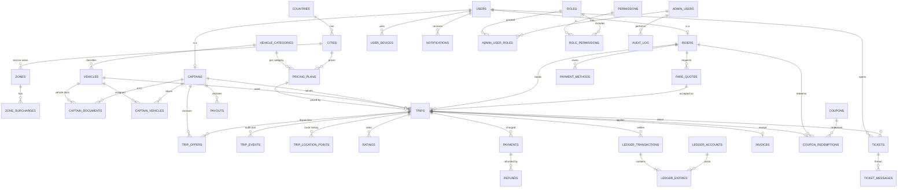
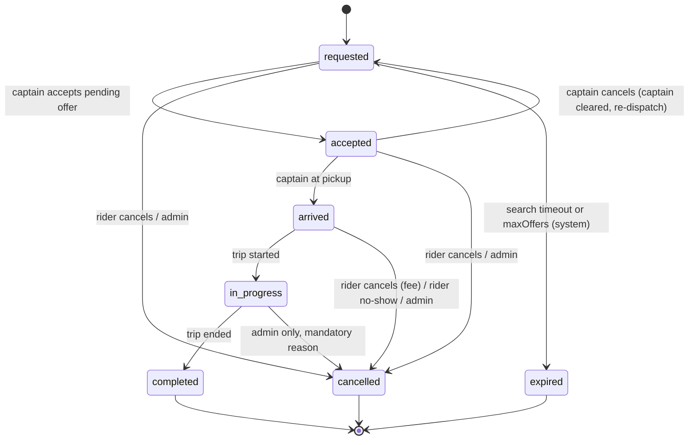

# 06 — Database Architecture

Status: Draft for client review — Phase 1

| | |
|---|---|
| Scope | Preliminary relational schema for the MASHWAR production platform (rider app, captain app, admin dashboard, backend) |
| Engine | **PostgreSQL 17 + PostGIS 3.5** **[Proposal — technical, recommended]**; Redis for live, short-lived state |
| Source material | React prototype (`prototype/src/store.tsx`, `prototype/src/config/market.ts`, `prototype/src/Admin.tsx`), `HANDOFF.md`, `DESIGN_SYSTEM.md` |
| Implementation state | The schema is implemented as SQL migrations: `backend/db/migrations/0001_initial_schema.sql` (schema) and `backend/db/migrations/0002_reference_data.sql` (reference data), verified by the `backend` migration tests against PostgreSQL + PostGIS in Docker. No application code uses it yet, and no production database exists. The DDL excerpts below are illustrative; the migration files are authoritative. |
| Contract scope | No table partitioning, no row-level security, no read replica. These are post-contract options (§8, §10, `11` backlog). |

Legend used throughout: **[Decided]** = agreed direction for Phase 2 unless the client objects; **[Proposal]** = recommended, needs client or team sign-off; **[Proposal — technical, recommended]** = technical decision taken by the delivery team, applied consistently in 04, 07, 08 and 11; **[Open]** = listed in section 14.

---

## 1. Design principles

1. **The server is authoritative.** Fares, commission, fees, trip state and balances are computed and stored only on the backend. Apps display quotes. (Matches `HANDOFF.md` §8.) **[Decided]**
2. **One database, one owner.** The NestJS backend is the only component that connects to PostgreSQL. Admin and mobile clients never connect directly. **[Decided]**
3. **Append-only history** for anything legally or financially relevant: trip events, ledger entries, admin audit log. Rows are never updated or deleted by the application role. **[Proposal]**
4. **Minimise personal data** (PDPL): collect only what a feature needs, keep it only as long as needed, encrypt the most sensitive fields at the application layer. **[Proposal]**
5. **Lowercase `snake_case` identifiers**, no quoted identifiers; the ORM / query builder is configured to map to snake_case. **[Decided]**
6. **Hot, ephemeral data lives in Redis** (live captain positions, offer locks, OTP challenges, rate-limit counters). PostgreSQL stores the durable record. **[Decided]**

## 2. Core type choices

| Concern | Choice | Justification |
|---|---|---|
| Primary keys of entities exposed in APIs (users, trips, tickets, payments, vehicles…) | `uuid` **UUIDv7** via `uuidv7()`. Migration 0001 creates a `public.uuidv7()` SQL fallback function for PostgreSQL 17; on PostgreSQL 18 the native `pg_catalog.uuidv7()` takes precedence **[Proposal — technical, recommended]** | Non-guessable in URLs (reduces enumeration / BOLA risk), can be generated by clients for idempotent creates, and — unlike random UUIDv4 — time-ordered, so B-tree inserts stay sequential and indexes do not fragment. |
| Primary keys of internal, high-volume, append-only tables (trip_events, location points, ledger_entries, audit_log, outbox, notifications) | `bigint generated always as identity` **[Proposal]** | 8 bytes, sequential, SQL-standard (preferred over `serial`), never exposed externally. |
| Human-readable references | Separate `text` column with unique index, e.g. trips `MS-48210`, tickets `TK-1042` (same format as prototype) | Support staff and riders quote these; they are not keys. |
| Timestamps | `timestamptz` everywhere, stored in UTC; market timezone (`Asia/Riyadh`) applied in presentation. City-local day boundaries (daily earnings, daily reports) are computed in SQL with `at time zone cities.timezone`, never with the server's timezone | Avoids ambiguity; `timestamp` without zone is never used. |
| Money | **`bigint` in halalas** (SAR minor unit, 1 SAR = 100 halalas), columns suffixed `_halalas`, plus a `currency char(3)` on financial tables **[Proposal]** | Exact integer arithmetic, no rounding drift when summing millions of ledger lines, fast comparisons, and maps 1:1 to PSP APIs which take minor units. `numeric(12,2)` would also be exact but is slower, larger, and invites mixing units. Rates that are not money (per-km rate with sub-halala precision, multipliers) use `numeric` (see below). |
| Rates and multipliers | Per-km / per-min rates as `numeric(10,4)` SAR; category multiplier `numeric(5,3)`; commission and VAT as integer **basis points** (`2000` = 20%) | Keeps fractional tariffs exact; the computed fare is rounded once, by a documented rule, into halalas. |
| Locations | `geography(Point, 4326)` for pickup, drop-off, location points (and saved places, see note) | Distances in metres without projection handling; GiST-indexable. |

Note: rider saved places (R-06) are not in migration 0001. A `core.saved_places` table (`rider_id`, `label`, `position geography(Point,4326)`) is to be added in a Phase 2 migration if saved places stay in scope.
| Service areas / zones | `geography(MultiPolygon, 4326)`, queried with `ST_Covers` / `ST_Intersects` | Point-in-zone checks for "is this pickup served?", airport surcharge, reporting by area. |
| Text | `text` (no arbitrary `varchar(n)`), with `check` constraints where a format or length matters | Same performance as `varchar`, constraints are explicit. |
| Phone numbers | `text` in E.164 (`+9665XXXXXXXX`) with a check constraint | Matches `market.ts` (`callingCode`, `phoneDigits`). |
| Flags | `boolean` | |
| Flexible payloads | `jsonb` only for event payloads, fare breakdown snapshots and PSP raw responses — never for data that is filtered or joined on | Keeps relational integrity for core data. |

### Enums vs lookup tables **[Proposal]**

| Kind of value | Mechanism | Examples |
|---|---|---|
| Fixed, code-driven states that the backend logic switches on | `text` + `check (col in (...))` | `trips.status`, `trip_offers.status`, `payments.status`, `captains.approval_status`, `riders.status` |
| Values the business/admin team configures, with Arabic/English labels | Lookup table with FK | `vehicle_categories` (economy / comfort / family), `ticket_categories`, `cancellation_reasons`, `document_types` |

Rationale: a `check` constraint can be changed in a migration without the restrictions of `ALTER TYPE ... ENUM` (values cannot be removed or reordered), and lookup tables give admins bilingual labels and an `is_active` switch without a deployment.

## 3. Schema map

Schemas (namespaces) separate responsibility and make privileges easier to grant:

| Schema | Contents |
|---|---|
| `core` | users, riders, captains, vehicles, KYC documents, devices |
| `market` | countries, cities, zones, vehicle categories, pricing plans |
| `ride` | fare quotes, trips, trip offers, trip events, location points, ratings |
| `finance` | payment methods, payments, refunds, ledger accounts/transactions/entries, payouts, invoices |
| `promo` | coupons, coupon redemptions |
| `support` | tickets, ticket messages, categories |
| `notify` | templates, notifications, delivery attempts |
| `admin` | admin users, roles, permissions, audit log |
| `infra` | outbox, idempotency keys, schema migrations |

## 4. Entity-relationship diagram (preliminary)



## 5. Tables

Column lists are representative, not exhaustive. Every table has `created_at timestamptz not null default now()`; mutable tables also have `updated_at timestamptz not null` maintained by the application (or a trigger). **Every foreign-key column gets an index** (PostgreSQL does not create them automatically); only non-obvious indexes are listed.

### 5.1 Market, city, zones, pricing (`market`)

Mirrors `MarketConfig` in `prototype/src/config/market.ts`, but versioned and server-owned.

| Table | Key columns | Notes |
|---|---|---|
| `countries` | `iso2 char(2) pk`, `name_ar`, `name_en`, `currency char(3)`, `calling_code`, `phone_digits smallint`, `default_lang`, `vat_bps int` | Only `SA` seeded. |
| `cities` | `id uuid pk`, `country_iso2 fk`, `slug text unique` (`riyadh`), `name_ar`, `name_en`, `timezone text`, `is_active` | Tenant/market boundary (see §10). |
| `zones` | `id uuid pk`, `city_id fk`, `code`, `name_ar`, `name_en`, `kind text check (kind in ('service_area','airport','restricted','surge'))`, `boundary geography(MultiPolygon,4326) not null`, `is_active` | Replaces the prototype's `areas` list (North/Central/East/West Riyadh, KKIA). GiST on `boundary`. |
| `vehicle_categories` | `id text pk` (`economy`,`comfort`,`family`), `name_ar/en`, `desc_ar/en`, `seats smallint`, `sort_order`, `is_active` | Lookup table. |
| `pricing_plans` | `id uuid pk`, `city_id fk`, `category_id fk`, `base_fare numeric(10,4)`, `per_km numeric(10,4)`, `per_min numeric(10,4)`, `min_fare_halalas bigint`, `waiting_free_mins smallint`, `waiting_per_min numeric(10,4)`, `cancel_grace_mins smallint`, `cancel_after_grace_halalas`, `cancel_after_arrival_halalas`, `commission_bps int`, `approval_status text check in ('provisional','approved')`, `effective tstzrange not null`, `created_by admin fk` | One row per city × category × validity period. The prototype's `mult` per category is folded into per-category plans. `approval_status` carries the prototype's "provisional" flag (all current values are unapproved demo values). |
| `zone_surcharges` | `zone_id fk`, `category_id fk null`, `pickup_halalas`, `dropoff_halalas`, `effective tstzrange` | E.g. airport fees — **[Open]** whether needed. |

Constraint: no two **approved** plans for the same city and category may overlap in time. A `provisional` draft may overlap an approved plan, so that a four-eyes change (§5.9) can be prepared before it is approved: **[Proposal — technical, recommended]**

```sql
create extension if not exists btree_gist;

alter table market.pricing_plans
  add constraint pricing_plans_no_overlap
  exclude using gist (city_id with =, category_id with =, effective with &&)
  where (approval_status = 'approved');
```

Price changes are made by closing the current range and inserting a new plan, never by editing a plan already referenced by trips.

### 5.2 Identity, riders, captains, devices (`core`)

| Table | Key columns | Notes |
|---|---|---|
| `users` | `id uuid pk`, `phone_e164 text unique null check (phone_e164 ~ '^\+[1-9][0-9]{7,14}$')`, `phone_hash bytea`, `display_name text`, `preferred_lang text check in ('ar','en') default 'ar'`, `email text null`, `status text check in ('active','blocked','deleted')`, `deleted_at timestamptz`; `check (phone_e164 is not null or status = 'deleted')` | One identity per phone. The same person can be a rider and a captain. `phone_e164` may be null **only** when `status = 'deleted'` (anonymisation, §9); `phone_hash` (keyed HMAC) is kept for fraud and re-registration checks. |
| `riders` | `user_id uuid pk fk users`, `rating_avg numeric(3,2)`, `rating_count int`, `trips_completed int`, `status text check in ('active','blocked')`, `blocked_reason`, `blocked_by admin fk` | Counters are denormalised, updated in the trip-completion transaction (prototype "settle exactly once"). |
| `captains` | `user_id uuid pk fk users`, `city_id fk`, `approval_status text check in ('pending','approved','suspended','rejected')`, `national_id_enc bytea`, `national_id_hash bytea unique`, `date_of_birth date`, `iban_enc bytea`, `rating_avg`, `rating_count`, `acceptance_rate numeric(5,4)`, `approved_at`, `approved_by` | Live availability (`available/enroute/ontrip/offline` in the prototype) is **not** stored here — it lives in Redis (§11). National ID / Iqama and IBAN are application-encrypted (§9). |
| `vehicles` | `id uuid pk`, `plate_ar text`, `plate_latin text`, `make`, `model`, `year smallint check (year between 1990 and 2100)`, `color_name_ar/en`, `color_hex`, `category_id fk`, `seats smallint`, `status text check in ('pending','approved','suspended')` | Unique `(plate_latin)` among non-deleted vehicles (partial unique index). |
| `captain_vehicles` | `captain_id fk`, `vehicle_id fk`, `is_primary boolean`, `valid tstzrange` | Partial unique index: one primary vehicle per captain. |
| `user_devices` | `id uuid pk`, `user_id fk`, `app text check in ('rider','captain')`, `platform text check in ('ios','android')`, `device_fingerprint_hash`, `push_token text`, `app_version`, `last_seen_at`, `revoked_at` | Device binding and push targeting. |
| `refresh_tokens` | `id uuid pk`, `user_id fk`, `device_id fk`, `token_hash bytea unique`, `family_id uuid`, `expires_at`, `revoked_at`, `replaced_by uuid` | Only hashes stored; rotation with reuse detection (see 07). |

OTP challenges are **not** stored in PostgreSQL; they live in Redis with a short TTL. Only aggregate OTP-delivery metrics are persisted.

### 5.3 KYC documents (`core`)

| Table | Key columns | Notes |
|---|---|---|
| `document_types` | `id text pk` (`national_id`, `iqama`, `driving_licence`, `vehicle_registration`, `vehicle_insurance`, `vehicle_inspection`, `profile_photo`, …), `applies_to text check in ('captain','vehicle')`, `requires_expiry boolean`, `name_ar/en` | Final list depends on TGA requirements — **[Open]**. |
| `captain_documents` | `id uuid pk`, `captain_id fk`, `vehicle_id fk null`, `type_id fk`, `storage_key text` (object storage, never the file bytes), `sha256 bytea`, `number_enc bytea null`, `issued_on date`, `expires_on date`, `status text check in ('submitted','approved','rejected','expired')`, `reviewed_by admin fk`, `reviewed_at`, `rejection_reason` | Files live in an encrypted, private object-storage bucket and are served via short-lived signed URLs to authorised admins only. Partial index `(expires_on) where status = 'approved'` drives expiry-reminder jobs. |

### 5.4 Trips, offers, events, locations, ratings (`ride`)

| Table | Key columns | Notes |
|---|---|---|
| `fare_quotes` | `id uuid pk`, `rider_id fk`, `city_id fk`, `category_id fk`, `pricing_plan_id fk`, `pickup geography(Point,4326)`, `dropoff geography(Point,4326)`, `distance_m int`, `duration_s int`, `fare_halalas bigint`, `breakdown jsonb`, `expires_at timestamptz` | Quote locked for a short window (**[Open]**: proposed 5 minutes). A trip must reference a valid, unexpired quote. |
| `trips` | see DDL excerpt below | Central aggregate. |
| `trip_offers` | `id bigint identity pk`, `trip_id fk`, `captain_id fk`, `attempt smallint`, `eta_s int`, `distance_m int`, `offered_at`, `expires_at`, `status text check in ('pending','accepted','declined','expired','cancelled')`, `responded_at` | One row per offer. Two partial unique indexes: at most one `pending` offer per trip **and** at most one `pending` offer per captain. A captain is never offered the same trip twice (enforced by dispatch). |
| `trip_events` | `id bigint identity pk`, `trip_id uuid`, `occurred_at timestamptz`, `type text`, `from_status`, `to_status`, `actor_type text check in ('rider','captain','system','admin')`, `actor_id uuid`, `trip_version int`, `payload jsonb` | **Append-only**. Not partitioned in contract scope (§8). `trip_version` is the ordering field sent to clients as `tripVersion`. |
| `trip_location_points` | `id bigint identity pk`, `trip_id uuid`, `captain_id uuid`, `recorded_at timestamptz`, `position geography(Point,4326)`, `speed_mps real`, `heading smallint`, `accuracy_m real` | Only stored **while a captain is assigned to a trip** (minimisation). B-tree on `(trip_id, recorded_at)`; not partitioned in contract scope (§8). |
| `cancellation_reasons` | `id text pk` (`rider_changed_mind`, `rider_no_show`, `admin_safety`, `admin_other`, …), `actor text`, `name_ar/en`, `fee_applies boolean` | Lookup table. "No captain found" is not a cancellation reason: it is the terminal state `expired`. A captain cancelling from `accepted` returns the trip to `requested` (04 T8) and is logged as a trip event, not a cancellation. |
| `trip_status_transitions` | `from_status`, `to_status`, `allowed_actors text[]`, pk on both statuses | Reference data used by the guard trigger (§6). |
| `ratings` | `id uuid pk`, `trip_id fk`, `rater_role text check in ('rider','captain')`, `rater_id`, `ratee_id`, `stars smallint check (stars between 1 and 5)`, `comment text check (length(comment) <= 500)`, `tags text[]` | `unique (trip_id, rater_role)`: one rating per direction per trip. Ratings allowed only for completed trips (enforced in the service + trigger). |

Trip DDL excerpt:

```sql
create table ride.trips (
  id                 uuid primary key default uuidv7(),
  code               text not null unique,                 -- 'MS-48210'
  city_id            uuid not null references market.cities(id),
  rider_id           uuid not null references core.riders(user_id),
  captain_id         uuid references core.captains(user_id),
  vehicle_id         uuid references core.vehicles(id),
  category_id        text not null references market.vehicle_categories(id),
  quote_id           uuid not null unique references ride.fare_quotes(id),  -- one trip per quote
  pricing_plan_id    uuid not null references market.pricing_plans(id),

  status             text not null default 'requested'
                     check (status in ('requested','accepted','arrived','in_progress',
                                       'completed','cancelled','expired')),
  version            integer not null default 1,           -- optimistic locking; sent to clients as tripVersion

  pickup             geography(Point,4326) not null,
  pickup_label_ar    text, pickup_label_en text,
  dropoff            geography(Point,4326) not null,
  dropoff_label_ar   text, dropoff_label_en text,

  payment_type       text not null check (payment_type in ('cash','card')),  -- wallet is post-MVP
  payment_method_id  uuid references finance.payment_methods(id),

  quoted_fare_halalas    bigint not null check (quoted_fare_halalas >= 0),
  final_fare_halalas     bigint check (final_fare_halalas >= 0),
  discount_halalas       bigint not null default 0 check (discount_halalas >= 0),
  waiting_fee_halalas    bigint not null default 0,
  cancellation_fee_halalas bigint not null default 0,
  commission_bps         integer not null,
  fare_breakdown         jsonb,                            -- frozen snapshot at completion

  cancelled_by       text check (cancelled_by in ('rider','captain','system','admin')),
  cancellation_reason_id text references ride.cancellation_reasons(id),

  requested_at timestamptz not null default now(),
  accepted_at  timestamptz, arrived_at timestamptz,
  started_at   timestamptz, completed_at timestamptz, cancelled_at timestamptz,
  created_at   timestamptz not null default now(),
  updated_at   timestamptz not null default now(),

  constraint trips_captain_required
    check (status in ('requested','cancelled','expired') or captain_id is not null),
  constraint trips_completed_has_fare
    check (status <> 'completed' or (final_fare_halalas is not null and completed_at is not null)),
  constraint trips_discount_le_fare
    check (discount_halalas <= coalesce(final_fare_halalas, quoted_fare_halalas))
);
```

The prototype computes `total = fare − discount + waitFee` (or the cancellation fee for a cancelled trip); the same rule is applied server-side and frozen into `fare_breakdown`.

### 5.5 Payments and ledger (`finance`)

Card data never touches MASHWAR servers: the apps tokenise with the PSP SDK (mada, Apple Pay and cards are required; STC Pay / Google Pay optional — see 10), and the backend stores only the PSP token. This keeps PCI DSS scope minimal. **[Proposal]**

| Table | Key columns | Notes |
|---|---|---|
| `payment_methods` | `id uuid pk`, `rider_id fk`, `psp text`, `psp_token text`, `brand text`, `last4 char(4)`, `exp_month smallint`, `exp_year smallint`, `is_default`, `revoked_at` | Partial unique index: one default per rider where `revoked_at is null`. |
| `payments` | `id uuid pk`, `trip_id fk`, `payment_method_id fk null`, `psp text not null`, `amount_halalas bigint check (> 0)`, `captured_halalas bigint`, `currency char(3)`, `status text check in ('requires_action','authorized','captured','partially_captured','voided','failed')`, `psp_reference text`, `idempotency_key text unique`, `failure_code`, `raw jsonb` | `unique (psp, psp_reference)`. The PSP idempotency key is derived from the payment row id (e.g. `pay:{payments.id}:authorize`, `pay:{payments.id}:capture`) **[Proposal — technical, recommended]**. Status model aligned with 10 §5. |
| `refunds` | `id uuid pk`, `payment_id fk`, `amount_halalas`, `reason`, `status text check in ('pending','succeeded','failed')`, `idempotency_key text unique`, `psp_reference`, `requested_by admin fk`, `ticket_id fk null` | Links refunds to support tickets (e.g. prototype TK-1040 "charged for a cancelled trip"). |
| `psp_webhook_events` | `id bigint identity pk`, `psp text`, `event_id text`, `payload jsonb`, `received_at timestamptz`, `processed_at timestamptz null`, `unique (psp, event_id)` | Webhook de-duplication: a webhook is stored first, then processed once; a repeat delivery hits the unique key. |
| `ledger_accounts` | `id bigint identity pk`, `owner_type text check in ('captain','rider','platform','psp','tax')`, `owner_id uuid null`, `code text` (`captain_earnings`, `captain_cash_held`, `rider_wallet` (reserved; wallet is post-MVP), `platform_commission`, `promo_expense`, `psp_clearing`, `vat_payable`), `currency`, `unique (owner_type, owner_id, code, currency)` | Chart of accounts. |
| `ledger_transactions` | `id bigint identity pk`, `kind text` (`trip_settlement`, `refund`, `payout`, `adjustment`), `trip_id fk null`, `payout_id fk null`, `idempotency_key text unique`, `posted_at`, `posted_by` | One business event = one transaction. `idempotency_key` (e.g. `trip:{id}:settle`) guarantees a trip is settled exactly once. |
| `ledger_entries` | `id bigint identity pk`, `transaction_id fk`, `account_id fk`, `amount_halalas bigint not null check (amount_halalas <> 0)` (positive = debit, negative = credit) | **Double-entry invariant:** the entries of a transaction sum to zero, enforced by a deferred constraint trigger. Append-only. |
| `account_balances` | `account_id pk`, `balance_halalas bigint`, `last_entry_id bigint` | Materialised running balance updated in the same transaction (rows locked in ascending `account_id` order to prevent deadlocks). |
| `payouts` | `id uuid pk`, `captain_id fk`, `amount_halalas`, `iban_last4`, `status`, `bank_reference`, `period tstzrange` | Payout schedule **[Open]**. |
| `invoices` | `id uuid pk`, `trip_id fk unique`, `number text unique`, `issued_at`, `zatca_uuid`, `zatca_status`, `qr_payload text`, `xml_storage_key` | ZATCA e-invoicing receipt; exact fields depend on the Fatoora integration phase (to verify with the client's tax advisor) — **[Open]**. ZATCA production integration is post-contract (see 11). One invoice per fee (05 §5a) may require relaxing `trip_id unique` — **[Open]**. |

Example settlement of a 40.00 SAR card trip with 20% commission (illustrative only; VAT treatment **[Open]** with the client's tax advisor):

| Account | Amount (halalas) |
|---|---|
| `psp_clearing` (debit — money to be received from PSP) | +4000 |
| `captain_earnings` (credit) | −3200 |
| `platform_commission` (credit) | −800 |

For a **cash** trip the captain already holds the money, so the platform's commission becomes a receivable from the captain: debit `captain_cash_held` / credit `platform_commission`; the captain's net balance can go negative and is netted against card earnings at payout. Coupons are booked to `promo_expense`; how the discount is split between platform and captain follows 05 decision **D2** (open), so the posting rule is not fixed here.

**Captain earnings are derived from the ledger** (`captain_earnings` / `captain_cash_held` entries, or `account_balances` for the running balance). There is no separate mutable earnings column; the captain app's Earnings screen and admin Payments read from ledger-based queries, grouped by city-local day.

### 5.6 Promotions (`promo`)

| Table | Key columns | Notes |
|---|---|---|
| `coupons` | `id uuid pk`, `code text not null`, `city_id fk null`, `discount_type text check in ('percent','fixed')`, `percent_bps int`, `fixed_halalas bigint`, `max_discount_halalas bigint`, `global_limit int`, `per_rider_limit int default 1`, `first_trip_only boolean`, `category_ids text[]`, `valid tstzrange not null`, `is_active`, `desc_ar`, `desc_en`, `created_by admin fk` | `unique (upper(code))` (codes are case-insensitive). Mirrors prototype `Coupon` (pct, maxOff, limit, expires). Usage count is derived from redemptions, not a mutable counter, to avoid hot-row contention. |
| `coupon_redemptions` | `id bigint identity pk`, `coupon_id fk`, `rider_id fk`, `trip_id fk unique`, `discount_halalas`, `status text check in ('reserved','applied','released')`, `created_at` | Reserved at request, applied at completion, released on cancellation. Limits checked inside the trip-request transaction with `select ... for update` on the coupon row. |

### 5.7 Support (`support`)

| Table | Key columns | Notes |
|---|---|---|
| `ticket_categories` | `id text pk`, `name_ar/en`, `default_priority` | Prototype: vehicle quality, driver delay, refund request, lost item. |
| `tickets` | `id uuid pk`, `code text unique` (`TK-1042`), `opened_by_user_id fk`, `opened_by_role`, `trip_id fk null`, `category_id fk`, `priority text check in ('high','medium','low')`, `status text check in ('open','review','resolved','closed')`, `assigned_admin_id fk null`, `sla_due_at`, `resolved_at` | |
| `ticket_messages` | `id bigint identity pk`, `ticket_id fk`, `author_type text check in ('user','admin','system')`, `author_id`, `body text`, `is_internal boolean` | Internal notes (not persisted in the prototype) are `is_internal = true`. |

### 5.8 Notifications (`notify`)

| Table | Key columns | Notes |
|---|---|---|
| `notification_templates` | `key text pk` (`trip.accepted`, `captain.docs_approved`…), `channel text check in ('push','sms','inbox','email')`, `title_ar/en`, `body_ar/en`, `version` | |
| `notifications` | `id bigint identity pk`, `recipient_type text check in ('user','admin')`, `recipient_id uuid`, `template_key fk`, `params jsonb`, `read_at timestamptz`, `created_at` | In-app inbox (prototype `Notice`). Partial index for unread. Retained 90 days **[Proposal]**. |
| `notification_deliveries` | `id bigint identity pk`, `notification_id fk`, `channel`, `provider`, `status`, `provider_message_id`, `attempts smallint`, `last_error` | Delivery tracking for FCM/APNs/SMS. |

### 5.9 Admin, RBAC, audit (`admin`)

| Table | Key columns | Notes |
|---|---|---|
| `admin_users` | `id uuid pk`, `email citext unique` (the `citext` extension is created in migration 0001), `name`, `status`, `mfa_enrolled boolean`, `last_login_at` | Separate from app `users`; authenticated through SSO or password + MFA (see 07). Password hash only if SSO is not used. |
| `roles` | `id text pk` (`super_admin`, `operations`, `captain_onboarding`, `support_agent`, `finance`, `marketing`, `read_only_analyst`) | Proposed starting set **[Proposal]**. |
| `permissions` | `id text pk` (`captains.approve`, `captains.suspend`, `riders.block`, `coupons.manage`, `pricing.edit`, `pricing.approve`, `zones.edit`, `refunds.issue`, `tickets.manage`, `reports.view`, `pii.view`, `admins.manage`) | Derived from the 12 prototype admin sections. |
| `role_permissions` | `role_id fk`, `permission_id fk`, pk on both | |
| `admin_user_roles` | `admin_user_id fk`, `role_id fk`, `city_id fk null` | Optional city scope (an operator for Riyadh only). |
| `audit_log` | `id bigint identity`, `occurred_at`, `admin_user_id`, `action text`, `entity_type`, `entity_id`, `before jsonb`, `after jsonb`, `reason text`, `ip inet`, `user_agent`, `request_id` | **Append-only** (not partitioned in contract scope, §8), application role has `insert` + `select` only. Every admin mutation (approve/suspend captain, block rider, edit pricing, issue refund, view PII document) writes one row. |

Sensitive actions such as pricing changes can require four-eyes approval: `pricing.edit` creates a `provisional` plan, `pricing.approve` (a different admin) marks it `approved`. **[Proposal]**

### 5.10 Infrastructure (`infra`)

| Table | Key columns | Notes |
|---|---|---|
| `outbox_events` | `id bigint identity pk`, `aggregate_type`, `aggregate_id uuid`, `event_type`, `payload jsonb`, `created_at`, `published_at timestamptz null`, `attempts smallint` | Written in the same transaction as the state change; relayed by a worker (see 07). Partial index `(id) where published_at is null`. |
| `idempotency_keys` | `key text`, `user_id uuid`, `endpoint text`, `request_hash bytea`, `response_status smallint`, `response_body jsonb`, `created_at`, `expires_at`, pk `(user_id, endpoint, key)` | Durable idempotency for money-moving and trip-creating endpoints; others may use Redis. |

## 6. Trip state machine enforced in the database layer

Allowed transitions (same as 04 §2) **[Proposal — technical, recommended]**:



Decline / expiry of an offer does **not** change trip status; the trip stays `requested` and dispatch makes the next offer (prototype: `rejectRide` reassigns).

Enforcement, three layers:

1. **Service layer** (NestJS `TripsService`): validates the transition against a transition table and actor permissions (only the assigned captain can mark `arrived`). An invalid command returns `409 INVALID_TRANSITION` with the current state and version and has no side effects.
2. **Conditional updates**: every transition is a conditional `update` on the expected current status. If zero rows are returned, the caller lost a race and receives `409 Conflict` with the current trip. Accept is one transaction over the offer and the trip (no `expectedVersion` needed):

   ```sql
   begin;
   update ride.trip_offers
      set status = 'accepted', responded_at = now()
    where id = $offer_id and captain_id = $captain
      and status = 'pending' and expires_at > now();
   -- if 0 rows: rollback, 410 Gone (offer expired or withdrawn)
   update ride.trips
      set status = 'accepted', captain_id = $captain, vehicle_id = $vehicle,
          accepted_at = now(), version = version + 1, updated_at = now()
    where id = $trip_id and status = 'requested'
   returning id, version;
   -- if 0 rows: rollback, 409 Conflict
   commit;
   ```
   In the same short transaction: insert into `trip_events`, mark other pending offers `cancelled`, insert `outbox_events`. No external calls (PSP, maps, push) are made while the transaction is open.

   **Safety net:** a periodic sweeper expires overdue offers and searches directly in the database (`… where status = 'pending' and expires_at < now() for update skip locked`), so a lost Redis / BullMQ job cannot leave a trip stuck (04 §8).
3. **Database guard** (defence in depth): a `before update of status` trigger rejects transitions not present in `ride.trip_status_transitions(from_status, to_status)` and terminal-state changes.

Concurrency invariants enforced by partial unique indexes:

```sql
-- a rider can have at most one active trip
create unique index trips_one_active_per_rider on ride.trips (rider_id)
  where status in ('requested','accepted','arrived','in_progress');

-- a captain can serve at most one active trip
create unique index trips_one_active_per_captain on ride.trips (captain_id)
  where status in ('accepted','arrived','in_progress');

-- a trip has at most one outstanding offer
create unique index trip_offers_one_pending on ride.trip_offers (trip_id)
  where status = 'pending';

-- a captain holds at most one outstanding offer
create unique index trip_offers_one_pending_per_captain on ride.trip_offers (captain_id)
  where status = 'pending';
```

## 7. Index plan

| Table | Index | Type | Serves |
|---|---|---|---|
| `zones` | `(boundary)` | GiST | Point-in-service-area, zone lookup on pickup |
| `trips` | `(city_id, status, requested_at) where status in ('requested','accepted','arrived','in_progress')` | B-tree, **partial** | Admin "Live operations", stuck-trip sweeper; stays tiny because almost all trips are terminal |
| `trips` | `(rider_id, requested_at desc, id)` | B-tree, composite | Rider trip history with keyset pagination |
| `trips` | `(captain_id, requested_at desc, id)` | B-tree, composite | Captain history and earnings |
| `trips` | `(pickup)` | GiST | Demand heatmaps, area reports |
| `trips` | `(city_id, completed_at) where status = 'completed'` | B-tree, partial | Daily revenue reports |
| `trip_offers` | `(captain_id, offered_at desc)` | B-tree | Acceptance-rate metrics |
| `trip_events` | `(trip_id, occurred_at)` | B-tree | Trip timeline |
| `trip_location_points` | `(trip_id, recorded_at)` | B-tree | Route replay |
| `captain_documents` | `(expires_on) where status = 'approved'` | partial | Expiry reminder job |
| `captains` | `(city_id, approval_status)` | composite | Admin captain list filtered by Approved / Pending / Suspended |
| `tickets` | `(status, priority, created_at) where status in ('open','review')` | partial | Support queue |
| `notifications` | `(recipient_id, created_at desc) where read_at is null` | partial | Unread badge |
| `coupons` | `unique (upper(code))` | expression | Code lookup |
| `outbox_events` | `(id) where published_at is null` | partial | Relay worker |
| `ledger_entries` | `(account_id, id)` | composite | Account statement |

Rules: equality columns first, range columns last in composite indexes; all list endpoints use **keyset (cursor) pagination** on `(timestamp, id)`, never `OFFSET`; indexes are validated with `EXPLAIN (ANALYZE, BUFFERS)` against realistic seed volumes before launch and `pg_stat_statements` is enabled in every environment.

## 8. Retention (and partitioning as a post-contract option)

**Contract scope: no table is partitioned.** **[Proposal — technical, recommended]** At launch volumes, plain tables with B-tree indexes are sufficient, and retention is applied by batched scheduled deletes.

| Table | Expected volume driver | Retention **[Proposal — confirm with legal/TGA]** |
|---|---|---|
| `trip_location_points` | ~1 point / 3–5 s per on-trip captain | Raw points 90 days, then deleted in batches; a simplified route polyline and distance are kept on the trip |
| `trip_events` | ~10–20 events per trip | Hot 24 months; then archived to encrypted cold storage |
| `audit_log` | Admin actions | Per regulatory requirement (proposed ≥ 5 years, to verify) |
| `notifications`, `notification_deliveries` | Push volume | 90 days |
| `ledger_*`, `payments`, `invoices` | Trips | Financial records retained per ZATCA / commercial law (to verify) |

**Post-contract note.** When a table approaches roughly 100 million rows (most likely `trip_location_points`, then `trip_events`), it can be converted to range partitioning by time (daily / weekly for location points, monthly for events and audit log), with a BRIN index on the time column and partitions detached and dropped for retention. This needs a migration and is listed in the post-contract backlog in 11.

## 9. PDPL data protection

The Saudi Personal Data Protection Law (PDPL, supervised by SDAIA) applies. The points below are engineering proposals; the legal interpretation must be confirmed by the client's counsel.

| Area | Proposal |
|---|---|
| Minimisation | Riders: phone, display name, language, optional email. No national ID for riders. Captains: only the KYC fields TGA requires. Location history only during an assigned trip; idle "available" positions are kept in Redis only, with TTL, never persisted. |
| Classification | Each column tagged in the schema catalogue as `public`, `internal`, `personal`, `sensitive` (national ID/Iqama, IBAN, KYC images, precise location history). |
| Encryption in transit | TLS for every client, internal service and database connection. |
| Encryption at rest | Disk/volume encryption on the managed database, Redis and backups (provider managed keys or CMK). |
| Application-level encryption | `sensitive` fields (`national_id_enc`, `iban_enc`, document numbers) encrypted with envelope encryption (KMS-held key, per-record data key). A keyed HMAC (`*_hash`) supports uniqueness checks and lookup without decryption. |
| Access | Admin PII views require the `pii.view` permission and are written to `audit_log`; phone numbers masked in lists (`+966 55 *** **73`). Rider ↔ captain calls use a masked-number / in-app calling provider **[Open]**, so neither side sees the other's real number. |
| Data subject rights | Export and deletion endpoints. Deletion = anonymisation of `users` (`phone_e164` set to null with `phone_hash` kept, name cleared, `status='deleted'`), while trips, ledger and invoices are kept for legal retention with the person de-identified. |
| Retention | Table-level retention policy (§8) executed by scheduled jobs; documented in a retention register. |
| Residency | Production data stored in the Kingdom of Saudi Arabia — to be confirmed against PDPL cross-border transfer rules and the hosting decision (see 07). |
| Breach handling | Incident runbook including regulator and data-subject notification within the legally required window (to confirm with counsel). |
| Logs | Application logs never contain OTPs, tokens, full phone numbers, national IDs or precise coordinates of non-trip activity (redaction at the logger). |

## 10. Tenancy and row-level security

- **Tenant model:** MASHWAR is a single operator; the meaningful partition is the **city/market** (Riyadh first; the prototype's `market.ts` separates country values, but production multi-market support is not built — see 09). Core tables carry `city_id` so data can be scoped per market and admins can be scoped per city via `admin_user_roles.city_id`. **[Proposal]**
- **Primary authorisation lives in the backend** (rider sees only own trips, captain only assigned trips, admin by permission and city). Every query is filtered by the authenticated principal — this is the main defence against broken object-level authorisation.
- **RLS: not in contract scope.** D8 is closed as recommended: authorization is enforced in the backend and covered by automated tests (object-level checks per endpoint). **[Proposal — technical, recommended]** This stays open for the client only if they specifically want database-level RLS, which would be a post-contract change. For reference, the post-contract design would be: enable and `force` RLS on the most sensitive tables (`trips`, `captain_documents`, `payments`, `tickets`) with policies based on `current_setting('app.user_id', true)` / `app.role` / `app.city_ids`, set per transaction with `set_config(..., true)` (`SET LOCAL` semantics, compatible with PgBouncer transaction pooling). Policy functions are wrapped in `(select ...)` so they are evaluated once per statement, and every column used in a policy is indexed. Background workers would use a separate role with explicit, narrow `bypassrls` only where required.
- **Least privilege roles:**

| Role | Privileges |
|---|---|
| `mashwar_owner` | Owns schemas; used only by migrations |
| `mashwar_app` | `select/insert/update` on operational tables; `insert/select` only on append-only tables (`trip_events`, `ledger_entries`, `audit_log`); no `delete`, no DDL |
| `mashwar_worker` | Same as app plus retention clean-up jobs |
| `mashwar_reporting` | `select` on reporting views that exclude or mask PII (BI / exports) |

  `public` schema privileges are revoked; no application component connects as superuser.

## 11. What lives in Redis instead

| Key (illustrative) | Type | TTL | Purpose |
|---|---|---|---|
| `geo:captains:available:{city}:{category}` | GEO set | entries pruned when heartbeat stale | Dispatch candidate search (`GEOSEARCH ... BYRADIUS 3 km ASC COUNT 20`) |
| `captain:{id}:state` | Hash (`status`, `lat`, `lng`, `heading`, `speed`, `ts`, `trip_id`, `vehicle_id`, `category`) | 60 s, refreshed by heartbeats | Live state: `available / enroute / ontrip / offline` |
| `captain:{id}:offer_lock` | String, `SET NX PX 30000` | 30 s | Fast pre-check; the authoritative guard is the partial unique index "one pending offer per captain" |
| `trip:{id}:dispatch` | Hash / sorted set of tried captains | trip lifetime | Excludes captains who declined / timed out |
| `otp:{phone_hash}` | Hash (HMAC of the code with a server secret, attempts) | 2–5 min | OTP challenge |
| `rl:{scope}:{key}` | Counter | window | Rate limiting |
| `idem:{user}:{key}` | String | 24 h | Idempotency for non-financial endpoints |
| `ws:presence:{user}` | Set of socket IDs | short | Realtime presence, Socket.IO adapter |

Redis is treated as **rebuildable**: if it is lost, captains re-appear on their next location heartbeat, active trips are reloaded from PostgreSQL, and the DB sweeper (§6) expires any offers or searches whose BullMQ jobs were lost. Redis GEO gives straight-line distance only; dispatch ranks a short-list by road ETA from the maps provider (see 07).

## 12. Operational practices

- **Connection pooling:** PgBouncer (or the provider's pooler) in transaction mode between the API/workers and PostgreSQL; small fixed pools; prepared-statement behaviour of the chosen driver verified against transaction pooling.
- **Timeouts:** `statement_timeout` (e.g. 5 s for API role), `idle_in_transaction_session_timeout`, `lock_timeout` for migrations.
- **Short transactions:** PSP, maps, SMS and push calls happen outside database transactions; results are recorded in a second short transaction.
- **Deadlock avoidance:** ledger postings lock `account_balances` rows in ascending `account_id`; trip transitions lock only the trip row.
- **Queues in Postgres:** the outbox relay and the offer / search sweeper claim rows with `for update skip locked`; singleton jobs (daily settlement, retention clean-up) take `pg_try_advisory_xact_lock`.
- **Batch writes:** location points are buffered and inserted in multi-row batches (or `COPY`), not one insert per ping.
- **Migrations:** versioned SQL migrations in `backend/db/migrations/` (currently `0001_initial_schema.sql` and `0002_reference_data.sql`), expand/contract for zero-downtime changes, idempotent constraint creation (PostgreSQL has no `add constraint if not exists`; use guarded `do $$` blocks or `not valid` + `validate constraint`), `create index concurrently` on large tables.
- **Backups:** managed point-in-time recovery from the database provider; a restore drill before launch. A read replica for reporting is a post-contract option.
- **Monitoring:** `pg_stat_statements` and the provider's autovacuum / bloat metrics on hot tables (`trips`, `trip_offers`, `outbox_events`).

## 13. Mapping from the prototype

| Prototype (`store.tsx`) | Production |
|---|---|
| `Driver` (incl. `status`, `approval`, `x/y`) | `core.captains` + `core.vehicles` + Redis `captain:{id}:state`; earnings derived from the ledger (§5.5) |
| `Rider` (`rides`, `spent`, `status`) | `core.users` + `core.riders`; `spent` derived from ledger / reporting |
| `Trip` (`fare`, `discount`, `waitFee`, `cancelFee`, `settled`) | `ride.trips` + `ride.trip_events` + `finance.ledger_transactions` (settled exactly once via idempotency key) |
| `Coupon` (`uses`, `limit`) | `promo.coupons` + `promo.coupon_redemptions` |
| `Ticket` | `support.tickets` + `support.ticket_messages` |
| `Notice` | `notify.notifications` |
| `PricingConfig` / `MarketConfig` | `market.*` tables, versioned, served to apps as read-only config |
| `ChatMsg` | **[Open]** — persist chat (and for how long) or relay only in real time |

## 14. Open questions and decisions

| # | Question | Owner |
|---|---|---|
| D1 | PostgreSQL 17 + PostGIS 3.5 **[Proposal — technical, recommended]** (PostgreSQL 18 also works; its native `uuidv7()` takes precedence). Open only: managed provider with PostGIS and the hosting region (PDPL residency). | Client / tech lead |
| D2 | Money representation: `bigint` halalas **[Proposal — technical, recommended]**, same rule as 05 §0. | Tech lead |
| D3 | Rounding rule for fares — see 05 D10. | Client (commercial) |
| D4 | VAT treatment of fares and commission; ZATCA e-invoicing phase and who issues the invoice (platform or captain) — see 05 D5 / §5a. | Client tax advisor |
| D5 | Who funds coupon discounts (platform vs captain) — see 05 D2. | Client |
| D6 | Exact KYC document list and data fields required by TGA; vehicle age/inspection rules. | Client / compliance |
| D7 | Retention periods for location history, trip events, chat, audit log, KYC images after offboarding. | Client counsel |
| D8 | RLS: closed as recommended — not in contract scope; authorization in the backend with tests (§10). Reopen only if the client asks for database-level RLS. | Tech lead |
| D9 | Persist in-trip chat? Masked calling provider? | Client / product |
| D10 | Partition tooling (native + custom job vs `pg_partman`) — post-contract only (§8). | Backend team |
| D11 | Query layer: Kysely/Drizzle (typed SQL, easy PostGIS) vs Prisma/TypeORM (PostGIS needs raw SQL). | Backend team |
| D12 | Quote validity window and whether the final fare can differ from the quote (metered vs fixed upfront price). | Client (product) |
| D13 | Wallet / stored value for riders: post-MVP (`payment_type` is `cash` or `card` only). Reopen if the client wants it at launch (affects licensing). | Client |
