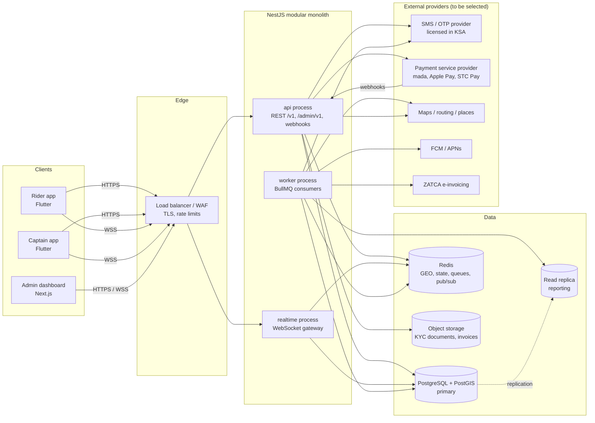
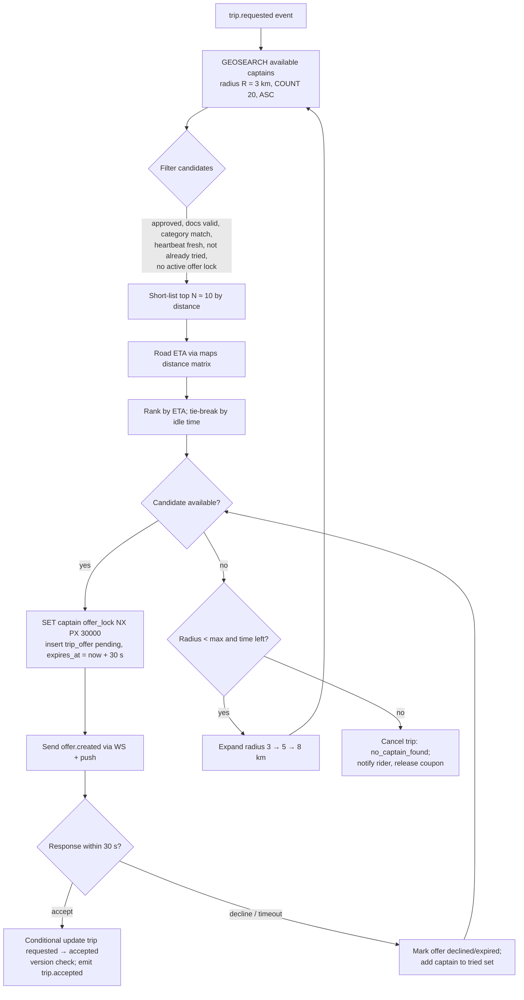
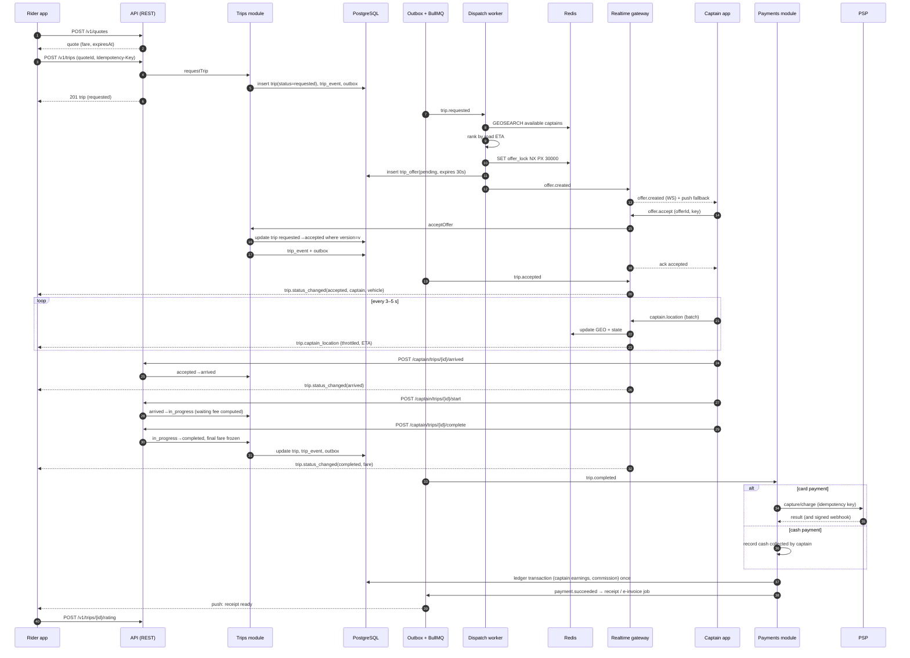

# 07 — Backend Architecture

Status: Draft for client review — Phase 1

| | |
|---|---|
| Scope | Server side of MASHWAR: APIs for the rider app, captain app and admin dashboard; dispatch; real-time tracking; payments; background processing |
| Stack | Node.js (LTS) + TypeScript + NestJS, PostgreSQL + PostGIS, Redis, WebSockets, BullMQ |
| Related | 06 — Database Architecture, 08 — Flutter Architecture, 11 — Project Structure and Roadmap |
| Implementation state | **Not built.** The React prototype simulates every backend behaviour in the browser (`src/store.tsx`). This document describes the proposed production design. |

Legend: **[Decided]** agreed direction · **[Proposal]** recommended, needs sign-off · **[Open]** see section 15.

---

## 1. Architectural style: modular monolith first **[Proposal]**

One deployable NestJS codebase, split into strictly bounded modules, run as **three process roles** from the same image:

| Process role | Responsibility | Scales with |
|---|---|---|
| `api` | REST endpoints for rider, captain and admin clients; webhooks (PSP, SMS) | Request rate |
| `realtime` | WebSocket gateway: captain location ingest, trip rooms, offer delivery, admin live map | Connected sockets |
| `worker` | BullMQ consumers: dispatch, offer timeouts, notifications, payments, receipts, outbox relay, scheduled jobs | Queue depth |

Why not microservices now:

| Factor | Modular monolith | Microservices |
|---|---|---|
| Team size at launch (small team) | One repo, one pipeline, one deploy | Many pipelines, on-call per service |
| Trip, dispatch, payment consistency | Local ACID transactions + outbox | Sagas and distributed failure handling from day one |
| Speed to MVP | High | Lower (infra, contracts, tracing needed before features) |
| Independent scaling of hot paths | Covered by process roles above | Native |
| Later extraction | Module boundaries + events make dispatch/realtime extractable | — |

Rules that keep extraction possible: modules communicate through exported service interfaces and domain events, never by reading each other's tables; each module owns its schema (see 06 §3); no cross-module ORM relations.

## 2. Component diagram

## 3. Modules

| Module | Responsibilities | Owns (schema, see 06) | Publishes events |
|---|---|---|---|
| `auth` | Phone OTP for riders/captains, JWT issue/refresh, device binding, admin SSO/MFA | `core.refresh_tokens`, `core.user_devices`, Redis OTP | `user.signed_in` |
| `riders` | Profile, saved places, block/unblock | `core.riders` | `rider.blocked` |
| `captains` | Profile, onboarding, KYC submission/review, approval/suspension, online/offline | `core.captains`, `core.captain_documents` | `captain.approved`, `captain.suspended`, `captain.document_expiring` |
| `vehicles` | Vehicle registration, category, assignment | `core.vehicles`, `core.captain_vehicles` | `vehicle.approved` |
| `markets` | Countries, cities, zones (PostGIS), vehicle categories, pricing plans, fare quotes, app config | `market.*`, `ride.fare_quotes` | `pricing.plan_approved` |
| `dispatch` | Candidate search, ETA ranking, offers, timeouts, reassignment | `ride.trip_offers`, Redis GEO/locks | `offer.created`, `offer.expired`, `dispatch.failed` |
| `trips` | Server-authoritative state machine, fees (waiting, cancellation), trip timeline | `ride.trips`, `ride.trip_events` | `trip.requested`, `trip.accepted`, `trip.arrived`, `trip.started`, `trip.completed`, `trip.cancelled` |
| `tracking` | Location ingest, validation, live fan-out, route history | Redis captain state, `ride.trip_location_points` | `captain.location_updated` (internal) |
| `realtime` | WebSocket gateway, auth, rooms, delivery acks | — | — |
| `payments` | Payment methods (PSP tokens), authorise/capture, refunds, ledger, payouts, receipts | `finance.*` | `payment.succeeded`, `payment.failed`, `refund.issued` |
| `promotions` | Coupons, validation, reservation/redemption | `promo.*` | `coupon.redeemed` |
| `ratings` | Two-way ratings, rating aggregates | `ride.ratings` | `rating.submitted` |
| `support` | Tickets, messages, assignment, SLA | `support.*` | `ticket.created`, `ticket.resolved` |
| `notifications` | Templates (ar/en), inbox, push/SMS delivery | `notify.*` | — |
| `admin` | Admin users, RBAC, audit log, admin-facing aggregates | `admin.*` | — |
| `reporting` | KPIs, exports, daily aggregates (from read replica) | reporting views/materialised tables | — |
| `platform` (shared kernel) | Config, logging, tracing, idempotency, outbox, errors, i18n of server messages | `infra.*` | — |

Internal layering inside each module: `controller / gateway` → `application service` (use cases, transactions) → `domain` (pure state machine, pricing, fee rules — no framework imports) → `repository` (SQL). The trip state machine and fare/fee calculators are pure TypeScript functions with exhaustive unit tests, ported from the prototype's guards and `config/market.ts` helpers (`waitingFee`, `cancellationFee`, `captainNet`).

## 4. API outline

### 4.1 Conventions **[Proposal]**

- REST + JSON, versioned paths: `/v1/...` for mobile apps, `/admin/v1/...` for the dashboard (separate guard, separate rate limits).
- Contract-first **OpenAPI 3.1** generated from NestJS decorators and published as an artifact; Dart (Flutter) and TypeScript (admin) clients are generated from it.
- `Accept-Language: ar | en` selects server-generated text (errors, receipts). Default `ar`.
- Errors follow RFC 9457 (`application/problem+json`) with a stable `code` (e.g. `TRIP_INVALID_TRANSITION`, `QUOTE_EXPIRED`, `COUPON_LIMIT_REACHED`).
- Money in responses as integer halalas plus currency (`{"amount": 4000, "currency": "SAR"}`); the client formats with market config.
- Lists use cursor pagination (`?cursor=...&limit=20`).
- `Idempotency-Key` header required on the endpoints marked ★.
- Mutating trip endpoints accept `expectedVersion`; a stale version returns `409` with the current trip.

### 4.2 Example endpoints

| Method & path | Caller | Purpose |
|---|---|---|
| `POST /v1/auth/otp/request` | rider, captain | Send OTP to `+966…` (rate limited) |
| `POST /v1/auth/otp/verify` | rider, captain | Verify OTP, register device, return access + refresh tokens |
| `POST /v1/auth/refresh` | rider, captain | Rotate refresh token |
| `POST /v1/auth/logout` | rider, captain | Revoke device session |
| `GET /v1/config` | all | Market config (cities, categories, currency, feature flags, min app version) |
| `GET /v1/me` · `PATCH /v1/me` | all | Profile, preferred language |
| `POST /v1/quotes` | rider | Fare quote for pickup/drop-off/category (server-side pricing) |
| ★ `POST /v1/trips` | rider | Request a trip from a quote (+ optional coupon, payment method) |
| `GET /v1/trips/{id}` | rider, captain | Current trip snapshot (used for resync after reconnect) |
| ★ `POST /v1/trips/{id}/cancel` | rider, captain | Cancel with reason; server computes cancellation fee |
| `GET /v1/trips?cursor=` | rider, captain | Trip history |
| ★ `POST /v1/trips/{id}/rating` | rider, captain | Rate the other party |
| `GET /v1/trips/{id}/receipt` | rider | Receipt / e-invoice |
| `POST /v1/coupons/validate` | rider | Preview a coupon on a quote |
| `GET /v1/payment-methods` · ★ `POST /v1/payment-methods` | rider | Save PSP token |
| `POST /v1/captain/online` · `POST /v1/captain/offline` | captain | Availability (requires approved status and valid documents) |
| ★ `POST /v1/captain/offers/{offerId}/accept` · `/decline` | captain | Respond to an offer (also possible over WebSocket) |
| ★ `POST /v1/captain/trips/{id}/arrived` · `/start` · `/complete` | captain | Trip transitions |
| `GET /v1/captain/earnings?period=` | captain | Earnings, commission, balance |
| `POST /v1/captain/documents` (signed upload URL) | captain | KYC upload |
| `POST /v1/support/tickets` · `GET /v1/support/tickets` | rider, captain | Support |
| `GET /v1/notifications` · `POST /v1/notifications/read` | all | Inbox |
| `GET /admin/v1/trips` · `/trips/live` | admin | Trips list, live operations |
| `POST /admin/v1/captains/{id}/approve` · `/suspend` · `/reactivate` | admin | Captain approval lifecycle (audited) |
| `POST /admin/v1/riders/{id}/block` · `/unblock` | admin | Rider blocking (audited) |
| `GET/POST/PATCH /admin/v1/coupons` | admin | Promotions |
| `GET/POST /admin/v1/pricing-plans` · `POST .../{id}/approve` | admin | Pricing with four-eyes approval |
| `GET/PUT /admin/v1/zones` | admin | Service areas (GeoJSON) |
| `GET/PATCH /admin/v1/tickets` · ★ `POST /admin/v1/refunds` | admin | Support, refunds |
| `GET /admin/v1/reports/{name}` · `POST .../exports` | admin | Reports and CSV exports |
| `POST /webhooks/psp` · `POST /webhooks/sms` | providers | Signed webhooks |

### 4.3 WebSocket protocol **[Proposal]**

Transport: **Socket.IO** on the NestJS gateway with the Redis adapter (rooms across instances, acknowledgements, built-in reconnection), connected over `wss://`. A plain-WebSocket protocol is the alternative if the Dart Socket.IO client proves unreliable — **[Open]**, to be decided after a spike.

- Authentication: access token in the handshake; the server re-validates on token expiry and disconnects revoked sessions.
- Rooms: `trip:{id}` (rider, assigned captain, ops admins), `captain:{id}` (private offers), `admin:city:{id}` (live map).
- Every server event carries an envelope `{ eventId, type, tripId, tripVersion, occurredAt, data }`. Clients drop events whose `tripVersion` is older than what they already have and resync over REST if they detect a gap.

| Direction | Event | Payload (summary) |
|---|---|---|
| captain → server | `captain.location` | batch of `{lat, lng, accuracy, speed, heading, ts}` (ack) |
| captain → server | `captain.heartbeat` | app state, battery saver flag |
| server → captain | `offer.created` | offer id, pickup, drop-off, category, estimated fare, ETA, `expiresAt` (30 s) |
| server → captain | `offer.expired` / `offer.cancelled` | offer id |
| captain → server | `offer.accept` / `offer.decline` | offer id, idempotency key (ack carries result) |
| server → rider | `trip.status_changed` | new status, captain + vehicle summary on `accepted` |
| server → rider | `trip.captain_location` | throttled to ~1 / 2–3 s, with ETA |
| server → rider/captain | `trip.fare_updated` | waiting fee, final fare |
| both | `chat.message` | if in-app chat is in scope **[Open]** |
| server → admin | `ops.trip_updated`, `ops.captain_positions` | sampled live map data |

Push notifications (FCM/APNs) duplicate the critical events (`offer.created`, `trip.accepted`, `trip.arrived`) for when the app is backgrounded or the socket is down.

## 5. Dispatch algorithm (outline) **[Proposal]**

Inputs: trip in `requested`, pickup point, category, city. Captain positions come from Redis (`geo:captains:available:{city}:{category}`), updated by location heartbeats.

Details:

- **Offer timeout 30 s:** implemented as a BullMQ delayed job per offer (`offer-expiry`, delay 30 s, job id = offer id so it can be removed on response). The captain app shows a countdown derived from `expiresAt` (server time), not a local timer.
- **Sequential offers** (one captain at a time) for MVP; broadcast to several captains is a later optimisation **[Open]**.
- **Race safety:** a captain's accept succeeds only if the offer is still `pending`, not expired, and the conditional trip update (`status = 'requested' and version = $v`) affects one row. The partial unique index "one active trip per captain" (06 §6) is the final guard.
- **Accept after expiry** returns `410 Gone` with `OFFER_EXPIRED`.
- **Reassignment** after captain cancels post-accept: trip returns to dispatch only if product rules allow it **[Open]**; otherwise the trip is cancelled and the rider may re-request. (The prototype reassigns on decline only.)
- **Overall dispatch window** (proposed 2–3 minutes) and radius steps are configuration per city.
- **Fairness and quality signals** (acceptance rate, rating, daily earnings balancing) are Phase 3+ refinements, not MVP.

## 6. Location ingest and tracking

- Captain app sends batched points over the socket every 3–5 s on trip, 10–15 s while available (see 08). Server validates: timestamp skew, accuracy threshold, impossible speed (GPS spoofing indicator), city bounds.
- Hot path writes only to Redis (`GEOADD`, state hash, TTL). If the captain has an active trip, the point is fanned out to `trip:{id}` (throttled) and appended to an in-memory buffer flushed to `ride.trip_location_points` in multi-row batches.
- Stale captains (no heartbeat for 60 s) are removed from the available GEO set by a sweeper job.

## 7. Reliability patterns

### 7.1 Idempotency keys **[Proposal]**

- Client generates a UUID per user intent (e.g. one "Request ride" tap) and resends it on retries.
- Server stores `(user, endpoint, key) → request hash, response` (PostgreSQL `infra.idempotency_keys` for money-moving and trip-creating endpoints, Redis for the rest, 24 h).
- Same key + same body → stored response replayed. Same key + different body → `422 IDEMPOTENCY_KEY_REUSED`. Concurrent duplicate → `409` until the first completes.
- Outbound calls to the PSP carry our own idempotency key derived from the payment id.

### 7.2 Transactional outbox **[Proposal]**

1. A use case (e.g. accept trip) updates `ride.trips`, appends `ride.trip_events` and inserts `infra.outbox_events` **in one short transaction**.
2. The `outbox-relay` worker claims unpublished rows (`for update skip locked`, small batches), publishes them to BullMQ queues and Redis pub/sub (for the realtime gateway), then marks `published_at`.
3. Consumers are idempotent on `eventId` (at-least-once delivery).

This guarantees that no WebSocket message, push, receipt or ledger posting is emitted for a change that was rolled back, and none is lost for a change that committed.

### 7.3 Background jobs (BullMQ on Redis)

| Queue | Jobs | Notes |
|---|---|---|
| `dispatch` | find-candidates, make-offer | Concurrency tuned per city |
| `offer-expiry` | expire-offer (delayed 30 s) | Removed when the captain responds |
| `trip-timers` | waiting-fee checkpoints, stuck-trip sweeper | |
| `notifications` | push, SMS, inbox | Retries with backoff; provider failover **[Open]** |
| `payments` | capture after completion, retry failed captures, refunds, PSP reconciliation | |
| `ledger` | trip settlement posting (exactly once via idempotency key) | |
| `invoicing` | generate receipt / ZATCA e-invoice | |
| `payouts` | periodic captain payout batches | Schedule **[Open]** |
| `kyc` | document expiry reminders, auto-suspension on expiry | |
| `maintenance` | partition creation/drop, data-retention purge, anonymisation | Singleton via advisory lock |
| `reporting` | daily aggregates, CSV exports | Reads from replica |

Failed jobs land in a dead-letter queue with alerting; BullMQ dashboard is exposed only on the internal network to ops.

## 8. End-to-end sequence: request → accept → track → complete → pay

Whether the card is pre-authorised at request time (hold) or charged only at completion depends on the PSP's capabilities for mada / Apple Pay / STC Pay — **[Open]**.

## 9. Security

| Area | Proposal |
|---|---|
| OWASP API Top 10 | Object-level authorisation on every resource (rider owns trip, captain assigned to trip, admin permission + city scope); DTO validation with whitelisting (no mass assignment); response DTOs never leak internal fields; pagination limits; SSRF-safe outbound HTTP (allow-listed providers only). |
| OTP | 6-digit code **[Open — prototype uses 4]**, stored hashed in Redis, TTL 2–5 min, max 5 attempts, resend cooldown; rate limits per phone, per device and per IP; SMS-pumping protection (country allow-list `+966` initially, anomaly alerts). |
| Tokens | Short-lived access JWT (≈10–15 min, asymmetric signing, `kid` rotation); opaque refresh token (30–60 days) stored hashed, rotated on every use, **reuse detection** revokes the whole token family. |
| Device binding | Refresh tokens bound to a registered device id; captain app additionally uses platform attestation (Play Integrity / App Attest) and mock-location detection **[Proposal]**; new-device sign-in for captains may require re-verification. |
| Admin | Separate authentication (SSO with the client's identity provider or email + password), **mandatory MFA**, short sessions, optional IP allow-list, permission checks per endpoint, every mutation in `admin.audit_log`. |
| Rate limiting | Edge (WAF) + application (Redis sliding window) per route class: auth, quotes, trip creation, location ingest. |
| Transport and headers | TLS 1.2+ everywhere, HSTS, Helmet headers for admin, strict CORS (admin origin only). |
| Secrets | Secret manager, never in the repo or images; separate credentials per environment. |
| Webhooks | Signature verification, timestamp tolerance, replay protection, idempotent processing. |
| Data protection | PII redaction in logs, application-level encryption of sensitive fields, signed short-lived URLs for KYC files (see 06 §9). |
| Supply chain | Lockfile, dependency scanning, SAST, container image scanning, SBOM in CI. |
| Assurance | Threat model during Phase 2; independent penetration test before launch. |

## 10. Observability

- **Tracing:** OpenTelemetry across HTTP, WebSocket handlers, BullMQ jobs and SQL; trace id propagated from apps via header and stored with trip events.
- **Logging:** structured JSON (pino) with request id, user id (pseudonymous), trip id; PII redaction.
- **Metrics (Prometheus-compatible)** — key service indicators:

| Indicator | Why |
|---|---|
| Time from request to accept (p50/p95), dispatch success rate | Core marketplace health |
| Offer acceptance / timeout rate | Captain supply quality |
| Connected captains (online, available) per zone | Supply |
| Location ingest lag and drop rate | Tracking quality |
| API latency / error rate per route | Reliability |
| Payment capture failure rate, webhook lag | Revenue |
| Queue depth and job age per queue | Backlogs |
| WebSocket reconnect rate | Mobile network quality |

- **Errors:** Sentry (or equivalent) for backend, Flutter apps and admin.
- **Alerting:** on-call alerts for dispatch failure spikes, payment failures, queue backlog, database replication lag, error budget burn.

## 11. Deployment **[Proposal]**

- **Containers:** one Docker image, three process roles (`api`, `realtime`, `worker`) as separate deployments; horizontal autoscaling; WebSocket nodes behind a load balancer that supports long-lived connections (sticky sessions or Socket.IO with WebSocket-only transport).
- **Orchestration:** managed Kubernetes or a managed container platform — chosen with the hosting provider.
- **Managed services:** PostgreSQL with PostGIS (HA, PITR, read replica), Redis (HA, persistence for BullMQ), object storage (private, encrypted), secret manager, KMS.
- **Environments:** `local` (Docker Compose), `dev`, `staging` (production-like, PSP/SMS sandboxes), `production`. Staging and production fully isolated (accounts, networks, keys).
- **KSA data residency — to confirm:** PDPL and possibly sector or TGA requirements may require production personal data to be stored and processed in the Kingdom. Candidate hosting must be evaluated for an in-Kingdom region **and** availability of managed PostgreSQL with PostGIS and Redis in that region. Third-party SaaS (error tracking, logging, maps, push) also process data and must be reviewed for cross-border transfer. This is an open decision for the client and counsel.
- **Zero-downtime releases:** rolling deployments, readiness probes, graceful WebSocket drain (clients reconnect and resync), expand/contract database migrations run as a separate pre-deploy step.

## 12. CI/CD **[Proposal]**

| Stage | Steps |
|---|---|
| Pull request | Lint, format, typecheck, unit tests, integration tests with Testcontainers (PostGIS + Redis), OpenAPI diff check (breaking-change detection), migration dry run, SAST, dependency scan |
| Main branch | Build and scan image, generate SBOM, publish OpenAPI and generated clients, deploy to `dev` automatically |
| Release | Tag → deploy to `staging` → automated smoke + end-to-end tests → manual approval → `production` (rolling) |
| Post-deploy | Smoke tests, error-rate and latency watch, one-click rollback to the previous image (migrations are backward compatible by design) |

Tooling (GitHub Actions, GitLab CI or the client's platform) is **[Open]**.

## 13. Testing strategy

| Level | Focus | Tools (proposal) |
|---|---|---|
| Unit | Trip state machine (every allowed and forbidden transition), pricing and fee calculators (waiting fee per started minute, cancellation grace and arrival fees), commission split, coupon rules, ledger balancing | Jest or Vitest |
| Integration | Repositories against real PostgreSQL + PostGIS and Redis; concurrency tests (two captains accepting, double settlement, duplicate idempotency keys) | Testcontainers |
| Contract | OpenAPI schema validation; generated Dart/TS clients compile; WebSocket event schemas | OpenAPI tooling, JSON Schema |
| End-to-end | Scripted flows: request → offer → accept → track → complete → pay → rate; cancellation paths; no-captain path | Supertest + socket client |
| Load | Location ingest at target captain count, dispatch under burst, WebSocket fan-out | k6 or Artillery |
| Resilience | Redis failover, worker restarts, PSP timeouts, WebSocket node drain | Staging game days |
| Security | Authorisation matrix tests (BOLA), rate limits, OTP abuse, penetration test before launch | Automated suites + external tester |

Target scale for load tests (concurrent online captains, peak trips per hour in Riyadh) must come from the client's business plan — **[Open]**.

## 14. Mapping from the prototype

| Prototype behaviour (`store.tsx`) | Production equivalent |
|---|---|
| `requestRide` / `acceptRide` / `arrive` / `startRide` / `endRide` / `rate` guarded by status checks | `trips` module transitions with version check + DB guard |
| `rejectRide` reassigns after 3 s | Dispatch offer decline → next candidate; 30 s timeout |
| Auto-advancing simulated captain | Real captain events; no server-side auto-advance |
| Effect that settles a completed trip exactly once | Ledger posting with idempotency key `trip:{id}:settle` |
| `waitingFee`, `cancellationFee`, `captainNet` in `config/market.ts` | Server-side pricing domain functions using `market.pricing_plans` |
| OTP always `1234`, one-tap captain login | Real OTP via licensed SMS provider, device-bound sessions |
| Toast "no real payment" | PSP integration, receipts, e-invoices |

## 15. Open questions and decisions

| # | Question | Owner |
|---|---|---|
| B1 | Confirm modular monolith with three process roles for launch. | Tech lead / client |
| B2 | Hosting provider and in-Kingdom region; managed PostGIS and Redis availability there. | Client / counsel |
| B3 | PSP selection (mada, Apple Pay, STC Pay coverage, pre-authorisation support, payouts, webhooks). | Client |
| B4 | SMS/OTP provider licensed in KSA and sender-ID registration; OTP length (4 vs 6). | Client |
| B5 | Maps, places and routing provider (Arabic place quality in Riyadh, distance matrix pricing). | Client / tech lead |
| B6 | Socket.IO vs plain WebSocket after a Flutter client spike. | Tech lead |
| B7 | Sequential vs broadcast offers; dispatch radius steps and overall window. | Product |
| B8 | Behaviour when a captain cancels after accepting (re-dispatch or cancel). | Product |
| B9 | Upfront fixed price vs metered final fare; handling of route deviations. | Product |
| B10 | In-app chat and masked calling in launch scope. | Product |
| B11 | Payout frequency and method for captains; negative balance policy for cash trips. | Client (finance) |
| B12 | Admin identity provider (SSO) and MFA method. | Client IT |
| B13 | Load targets: concurrent captains, peak requests per minute, launch zones. | Client (business) |
| B14 | ZATCA e-invoicing integration approach (direct or through a provider). | Client tax advisor |
| B15 | TGA integration or reporting requirements for ride-hailing platforms. | Client / compliance |
