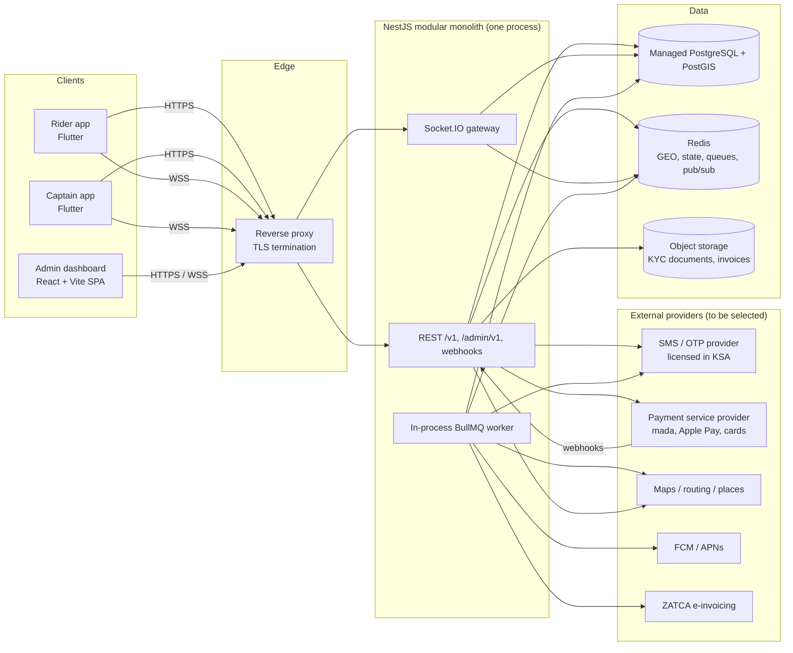
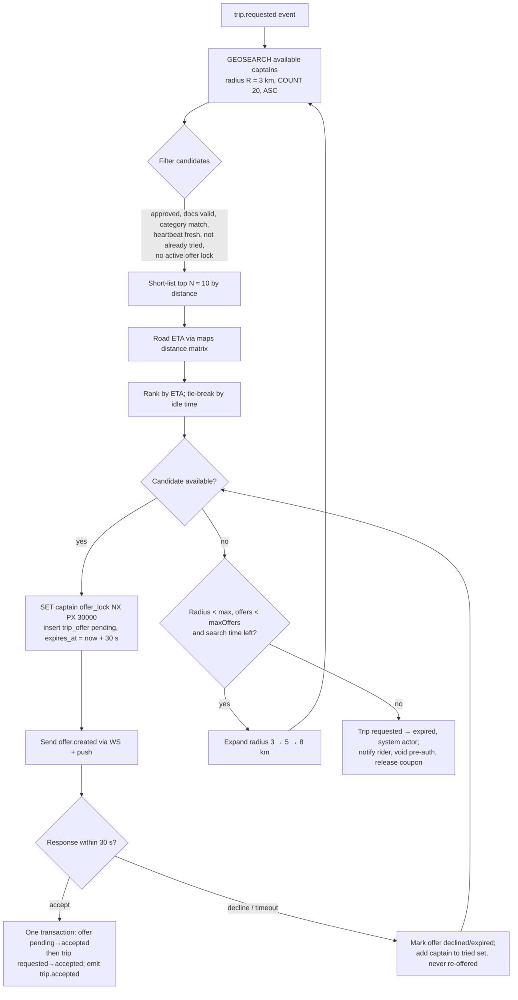
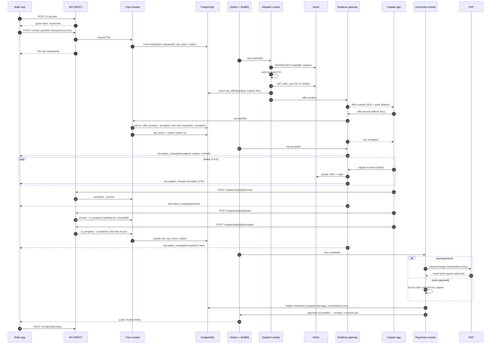

# 07 — Backend Architecture

Status: Draft for client review — Phase 1

| | |
|---|---|
| Scope | Server side of MASHWAR: APIs for the rider app, captain app and admin dashboard; dispatch; real-time tracking; payments; background processing |
| Stack | Node.js (LTS) + TypeScript + NestJS, PostgreSQL 17 + PostGIS 3.5, Redis, Socket.IO, BullMQ |
| Related | 06 — Database Architecture, 08 — Flutter Architecture, 11 — Project Structure and Roadmap |
| Implementation state | **Production modules not built.** The Phase 1 technical foundation in `backend/` contains the NestJS scaffold with a health endpoint, the trip state machine and RBAC map as pure TypeScript with unit tests, and the SQL migrations (see 06 and 11 §4). The React prototype simulates every other backend behaviour in the browser (`prototype/src/store.tsx`). This document describes the proposed production design. |

Legend: **[Decided]** agreed direction · **[Proposal]** recommended, needs sign-off · **[Proposal — technical, recommended]** technical decision taken by the delivery team, consistent with 04, 06, 08 and 11 · **[Open]** see section 15.

---

## 1. Architectural style: modular monolith, one process **[Proposal — technical, recommended]**

One deployable NestJS codebase, split into strictly bounded modules, run as **one process** for the contract scope:

| Part of the process | Responsibility |
|---|---|
| REST API | Endpoints for rider, captain and admin clients; webhooks (PSP, SMS) |
| Socket.IO gateway | Captain location ingest, trip rooms, offer delivery, admin live map |
| In-process BullMQ worker | Dispatch, offer timeouts, notifications, payments, receipts, outbox relay, scheduled jobs (including the offer / search DB sweeper, 04 §8) |

The same image can later be started as separate `api`, `realtime` and `worker` roles (one environment variable per role) if load requires it. That split is a post-contract option.

Why not microservices now:

| Factor | Modular monolith | Microservices |
|---|---|---|
| Team size at launch (small team) | One repo, one pipeline, one deploy | Many pipelines, on-call per service |
| Trip, dispatch, payment consistency | Local ACID transactions + outbox | Sagas and distributed failure handling from day one |
| Speed to MVP | High | Lower (infra, contracts, tracing needed before features) |
| Independent scaling of hot paths | Possible later by splitting the process roles | Native |
| Later extraction | Module boundaries + events make dispatch/realtime extractable | — |

Rules that keep extraction possible: modules communicate through exported service interfaces and domain events, never by reading each other's tables; each module owns its schema (see 06 §3); no cross-module ORM relations.

## 2. Component diagram

ZATCA e-invoicing production integration is a post-contract item (see 11); it is shown for completeness.

## 3. Modules

| Module | Responsibilities | Owns (schema, see 06) | Publishes events |
|---|---|---|---|
| `auth` | Phone OTP for riders/captains, JWT issue/refresh, device binding, admin SSO/MFA | `core.refresh_tokens`, `core.user_devices`, Redis OTP | `user.signed_in` |
| `riders` | Profile, saved places, block/unblock | `core.riders` | `rider.blocked` |
| `captains` | Profile, onboarding, KYC submission/review, approval/suspension, online/offline | `core.captains`, `core.captain_documents` | `captain.approved`, `captain.suspended`, `captain.document_expiring` |
| `vehicles` | Vehicle registration, category, assignment | `core.vehicles`, `core.captain_vehicles` | `vehicle.approved` |
| `markets` | Countries, cities, zones (PostGIS), vehicle categories, pricing plans, fare quotes, app config | `market.*`, `ride.fare_quotes` | `pricing.plan_approved` |
| `dispatch` | Candidate search, ETA ranking, offers, timeouts, reassignment, expiry of unanswered searches | `ride.trip_offers`, Redis GEO/locks | `offer.created`, `offer.expired`, `offer.cancelled` |
| `trips` | Server-authoritative state machine, fees (waiting, cancellation), trip timeline | `ride.trips`, `ride.trip_events` | `trip.requested`, `trip.accepted`, `trip.redispatched`, `trip.arrived`, `trip.started`, `trip.completed`, `trip.cancelled`, `trip.expired` |
| `tracking` | Location ingest, validation, live fan-out, route history | Redis captain state, `ride.trip_location_points` | `captain.location_updated` (internal) |
| `realtime` | WebSocket gateway, auth, rooms, delivery acks | — | — |
| `payments` | Payment methods (PSP tokens), authorise/capture, refunds, ledger, payouts, receipts | `finance.*` | `payment.succeeded`, `payment.failed`, `refund.issued` |
| `promotions` | Coupons, validation, reservation/redemption | `promo.*` | `coupon.redeemed` |
| `ratings` | Two-way ratings, rating aggregates | `ride.ratings` | `rating.submitted` |
| `support` | Tickets, messages, assignment, SLA | `support.*` | `ticket.created`, `ticket.resolved` |
| `notifications` | Templates (ar/en), inbox, push/SMS delivery | `notify.*` | — |
| `admin` | Admin users, RBAC, audit log, admin-facing aggregates | `admin.*` | — |
| `reporting` | KPIs, exports, daily aggregates (from the primary database via reporting views; a read replica is post-contract) | reporting views/materialised tables | — |
| `platform` (shared kernel) | Config, logging, health checks, idempotency, outbox, errors, i18n of server messages | `infra.*` | — |

Internal layering inside each module: `controller / gateway` → `application service` (use cases, transactions) → `domain` (pure state machine, pricing, fee rules — no framework imports) → `repository` (SQL). The trip state machine and fare/fee calculators are pure TypeScript functions with exhaustive unit tests, ported from the prototype's guards and `prototype/src/config/market.ts` helpers (`waitingFee`, `cancellationFee`, `captainNet`), computing in integer halalas (05 §0).

## 4. API outline

### 4.1 Conventions **[Proposal]**

- REST + JSON, versioned paths: `/v1/...` for mobile apps, `/admin/v1/...` for the dashboard (separate guard, separate rate limits).
- Contract-first **OpenAPI 3.1** generated from NestJS decorators and published as an artifact; Dart (Flutter) and TypeScript (admin) clients are generated from it.
- `Accept-Language: ar | en` selects server-generated text (errors, receipts). Default `ar`.
- Errors follow RFC 9457 (`application/problem+json`) with a stable `code` (e.g. `INVALID_TRANSITION`, `QUOTE_EXPIRED`, `COUPON_LIMIT_REACHED`). `409 INVALID_TRANSITION` includes the trip's current `status` and `version` and has no side effects (04 §3).
- Money in responses as integer halalas plus currency (`{"amount": 4000, "currency": "SAR"}`); the client formats with market config.
- Lists use cursor pagination (`?cursor=...&limit=20`).
- `Idempotency-Key` header required on the endpoints marked ★.
- Mutating trip endpoints (other than offer accept) accept an optional `expectedVersion`; a stale version returns `409` with the current trip. Offer accept needs no `expectedVersion`: it is one transaction over the offer and the trip (04 §8, 06 §6).
- Access tokens carry an `app` claim (`rider` | `captain`). Every `/v1/captain/*` route checks `app = captain` in addition to the user's captain approval status.

### 4.2 Example endpoints

| Method & path | Caller | Purpose |
|---|---|---|
| `POST /v1/auth/otp/request` | rider, captain | Send OTP to `+966…` (rate limited) |
| `POST /v1/auth/otp/verify` | rider, captain | Verify OTP, register device, return access + refresh tokens |
| `POST /v1/auth/refresh` | rider, captain | Rotate refresh token |
| `POST /v1/auth/logout` | rider, captain | Revoke device session |
| `GET /v1/config` | all | Market config (cities, categories, currency, feature flags, min app version) |
| `GET /v1/me` · `PATCH /v1/me` | all | Profile, preferred language |
| `POST /v1/quotes` | rider | Fare quote for pickup/drop-off/category (server-side pricing) |
| ★ `POST /v1/trips` | rider | Request a trip from a quote (+ optional coupon, payment method) |
| `GET /v1/trips/active` | rider, captain | The caller's active trip, if any (used to restore state after an app restart) |
| `GET /v1/trips/{id}` | rider, captain | Current trip snapshot (used for resync after reconnect) |
| ★ `POST /v1/trips/{id}/cancel` | rider | Cancel with reason from `requested`, `accepted` or `arrived`; server computes cancellation fee. Not allowed from `in_progress` |
| ★ `POST /v1/captain/trips/{id}/cancel` | captain | From `accepted`: trip returns to `requested` and is re-dispatched (04 T8). From `arrived` after the threshold: rider no-show (T11) |
| `GET /v1/trips?cursor=` | rider, captain | Trip history |
| ★ `POST /v1/trips/{id}/rating` | rider, captain | Rate the other party |
| `GET /v1/trips/{id}/receipt` | rider | Receipt / e-invoice |
| `POST /v1/coupons/validate` | rider | Preview a coupon on a quote |
| `GET /v1/payment-methods` · ★ `POST /v1/payment-methods` | rider | Save PSP token |
| `POST /v1/captain/online` · `POST /v1/captain/offline` | captain | Availability (requires approved status and valid documents) |
| ★ `POST /v1/captain/offers/{offerId}/accept` · `/decline` | captain | Respond to an offer (also possible over WebSocket) |
| ★ `POST /v1/captain/trips/{id}/arrived` · `/start` · `/complete` | captain | Trip transitions |
| `GET /v1/captain/earnings?period=` | captain | Earnings, commission, balance |
| `POST /v1/captain/documents` (signed upload URL) | captain | KYC upload |
| `POST /v1/support/tickets` · `GET /v1/support/tickets` | rider, captain | Support |
| `GET /v1/notifications` · `POST /v1/notifications/read` | all | Inbox |
| `GET /admin/v1/trips` · `/trips/live` | admin | Trips list, live operations |
| ★ `POST /admin/v1/trips/{id}/cancel` | admin | Cancel any non-terminal trip, including `in_progress`; reason mandatory; audited (04 T14) |
| `POST /admin/v1/captains/{id}/approve` · `/suspend` · `/reactivate` | admin | Captain approval lifecycle (audited) |
| `POST /admin/v1/riders/{id}/block` · `/unblock` | admin | Rider blocking (audited) |
| `GET/POST/PATCH /admin/v1/coupons` | admin | Promotions |
| `GET/POST /admin/v1/pricing-plans` · `POST .../{id}/approve` | admin | Pricing with four-eyes approval |
| `GET/PUT /admin/v1/zones` | admin | Service areas (GeoJSON) |
| `GET/PATCH /admin/v1/tickets` · ★ `POST /admin/v1/refunds` | admin | Support, refunds |
| `GET /admin/v1/reports/{name}` · `POST .../exports` | admin | Reports and CSV exports |
| `POST /webhooks/psp` · `POST /webhooks/sms` | providers | Signed webhooks |

### 4.3 WebSocket protocol **[Proposal]**

Transport: **Socket.IO** on the NestJS gateway, connected over `wss://` **[Proposal — technical, recommended]**. With one process no Redis adapter is needed; it is added only if the process is later split. A plain-WebSocket protocol is the fallback if the Dart Socket.IO client proves unreliable in the Phase 3 spike.

- Authentication: access token in the handshake. The server records the token's `exp` and **disconnects the socket at token expiry** (and immediately on revocation). The client refreshes its token (single-flight, see §9) and reconnects with the fresh token, then resyncs over REST.
- Rooms: `trip:{id}` (rider, assigned captain, ops admins), `captain:{id}` (private offers), `admin:city:{id}` (live map).
- Every server event carries an envelope `{ eventId, type, tripId, tripVersion, occurredAt, data }`. Clients drop events whose `tripVersion` is older than what they already have and resync over REST if they detect a gap.

| Direction | Event | Payload (summary) |
|---|---|---|
| captain → server | `captain.location` | batch of `{lat, lng, accuracy, speed, heading, ts}` (ack) |
| captain → server | `captain.heartbeat` | app state, battery saver flag |
| server → captain | `offer.created` | offer id, pickup, drop-off, category, estimated fare, ETA, `expiresAt` (30 s) |
| server → captain | `offer.expired` / `offer.cancelled` | offer id |
| captain → server | `offer.accept` / `offer.decline` | offer id, idempotency key (ack carries result) |
| server → rider | `trip.status_changed` | new status, captain + vehicle summary on `accepted` |
| server → rider | `trip.captain_location` | throttled to ~1 / 2–3 s, with ETA |
| server → rider/captain | `trip.fare_updated` | waiting fee, final fare |
| both | `chat.message` | if in-app chat is in scope **[Open]** |
| server → admin | `ops.trip_updated`, `ops.captain_positions` | sampled live map data |

Push notifications (FCM/APNs) duplicate the critical events (`offer.created`, `trip.accepted`, `trip.arrived`) for when the app is backgrounded or the socket is down.

## 5. Dispatch algorithm (outline) **[Proposal]**

Inputs: trip in `requested`, pickup point, category, city. Captain positions come from Redis (`geo:captains:available:{city}:{category}`), updated by location heartbeats.

Details:

- **Offer timeout 30 s:** implemented as a BullMQ delayed job per offer (`offer-expiry`, delay 30 s, job id = offer id so it can be removed on response). The captain app shows a countdown derived from `expiresAt` (server time), not a local timer. A periodic **DB sweeper** (`for update skip locked` on overdue `pending` offers and overdue searches) is the safety net if Redis / BullMQ data is lost.
- **Sequential offers** (one captain at a time, one pending offer per captain) for MVP; broadcast to several captains is a later optimisation.
- **Race safety:** accept is one transaction — `update ride.trip_offers set status='accepted' where id=$offer and captain_id=$captain and status='pending' and expires_at > now()`; only if that updates one row, `update ride.trips set status='accepted', captain_id=$captain, version=version+1 where id=$trip and status='requested'`. Otherwise `410` (offer gone) or `409` (trip no longer requested). The partial unique index "one active trip per captain" (06 §6) is the final guard.
- **Accept after expiry** returns `410 Gone` with `OFFER_EXPIRED`.
- **Captain cancels after accepting:** the trip returns to `requested` with the captain cleared and is re-dispatched (04 T8); that captain is not offered the trip again.
- **Dispatch failure:** when the search timeout (proposed **3 minutes**, open business decision) or `maxOffers` is reached, the trip moves to the terminal state `expired` — it is not cancelled. Radius steps and `maxOffers` are configuration per city.
- **Fairness and quality signals** (acceptance rate, rating, daily earnings balancing) are Phase 3+ refinements, not MVP.

## 6. Location ingest and tracking

- Captain app sends batched points over the socket every 3–5 s on trip, 10–15 s while available (see 08). Server validates: timestamp skew, accuracy threshold, impossible speed (GPS spoofing indicator), city bounds.
- Hot path writes only to Redis (`GEOADD`, state hash, TTL). If the captain has an active trip, the point is fanned out to `trip:{id}` (throttled) and appended to an in-memory buffer flushed to `ride.trip_location_points` in multi-row batches (every few seconds).
- **Accepted loss:** if the process restarts, points still in the in-memory buffer (at most a few seconds) are lost. This affects route history only, not trip state or fares (fares come from the quote, 05 D12). If the client later requires a metered fare from the actual route, the buffer must be made durable first.
- Stale captains (no heartbeat for 60 s) are removed from the available GEO set by a sweeper job.

## 7. Reliability patterns

### 7.1 Idempotency keys **[Proposal]**

- Client generates a UUID per user intent (e.g. one "Request ride" tap) and resends it on retries.
- Server stores `(user, endpoint, key) → request hash, response` (PostgreSQL `infra.idempotency_keys` for money-moving and trip-creating endpoints, Redis for the rest, 24 h).
- Same key + same body → stored response replayed. Same key + different body → `422 IDEMPOTENCY_KEY_REUSED`. Concurrent duplicate → `409` until the first completes.
- Outbound calls to the PSP carry our own idempotency key derived from the `finance.payments` row id (for example `pay:{payments.id}:capture`), the same rule as 06 §5.5 and 10. Incoming webhooks are de-duplicated by `finance.psp_webhook_events (psp, event_id)`.

### 7.2 Transactional outbox **[Proposal]**

1. A use case (e.g. accept trip) updates `ride.trips`, appends `ride.trip_events` and inserts `infra.outbox_events` **in one short transaction**.
2. The `outbox-relay` job claims unpublished rows (`for update skip locked`, small batches), publishes them to BullMQ queues and to the in-process Socket.IO gateway, then marks `published_at`.
3. Consumers are idempotent on `eventId` (at-least-once delivery).

This guarantees that no WebSocket message, push, receipt or ledger posting is emitted for a change that was rolled back, and none is lost for a change that committed.

### 7.3 Background jobs (BullMQ on Redis)

| Queue | Jobs | Notes |
|---|---|---|
| `dispatch` | find-candidates, make-offer | Concurrency tuned per city |
| `offer-expiry` | expire-offer (delayed 30 s), search-timeout → `expired` | Removed when the captain responds |
| `trip-timers` | waiting-fee checkpoints, DB sweeper for overdue offers / searches, stuck-trip alerts | Repeatable job; safety net if Redis jobs are lost |
| `notifications` | push, SMS, inbox | Retries with backoff; provider failover **[Open]** |
| `payments` | capture after completion, retry failed captures, refunds, PSP reconciliation | |
| `ledger` | trip settlement posting (exactly once via idempotency key) | |
| `invoicing` | generate receipt / ZATCA e-invoice | |
| `payouts` | periodic captain payout batches | Schedule **[Open]** |
| `kyc` | document expiry reminders, auto-suspension on expiry | |
| `maintenance` | data-retention purge (batched deletes), anonymisation | Singleton via advisory lock |
| `reporting` | daily aggregates, CSV exports | Reads the primary through reporting views |

Failed jobs are kept in BullMQ's failed set and reported to Sentry; the BullMQ dashboard, if enabled, is reachable only by ops (not public).

## 8. End-to-end sequence: request → accept → track → complete → pay

The proposed card flow is a pre-authorisation at request time and capture at completion (10 §4); per-method support for mada, Apple Pay and cards is to confirm with the selected PSP — **[Open]**. During the contract only the PSP **sandbox** is integrated (Phase 3); production activation is a configuration change (10).

## 9. Security

| Area | Proposal |
|---|---|
| OWASP API Top 10 | Object-level authorisation on every resource (rider owns trip, captain assigned to trip, admin permission + city scope); DTO validation with whitelisting (no mass assignment); response DTOs never leak internal fields; pagination limits; SSRF-safe outbound HTTP (allow-listed providers only). |
| OTP | 6-digit code **[Open — prototype uses 4]**, stored in Redis as an **HMAC of the code with a server secret** (never the plain code), TTL 2–5 min, max 5 attempts, resend cooldown; rate limits per phone, per device and per IP; SMS-pumping protection (country allow-list `+966` initially, anomaly alerts). |
| Tokens | Short-lived access JWT (≈10–15 min, asymmetric signing, `kid` rotation); opaque refresh token (30–60 days) stored hashed, rotated on every use, **reuse detection** revokes the whole token family. The immediately previous refresh token stays valid for a **~10 s grace window** so parallel requests do not trigger false reuse detection; the apps also perform **single-flight refresh** (one refresh in flight, other requests wait for it). The access JWT carries an `app` claim (`rider` \| `captain`), checked on `/v1/captain/*`. |
| Device binding | Refresh tokens bound to a registered device id; captain app additionally uses platform attestation (Play Integrity / App Attest) and mock-location detection **[Proposal]**; new-device sign-in for captains may require re-verification. |
| Admin | Separate authentication (SSO with the client's identity provider or email + password), **mandatory MFA**, short sessions, optional IP allow-list, permission checks per endpoint, every mutation in `admin.audit_log`. |
| Rate limiting | Application level (Redis sliding window) per route class: auth, quotes, trip creation, location ingest. An edge WAF is a post-contract option. |
| Transport and headers | TLS 1.2+ everywhere, HSTS, Helmet headers for admin, strict CORS (admin origin only). |
| Secrets | Secret manager, never in the repo or images; separate credentials per environment. |
| Webhooks | Signature verification, timestamp tolerance, replay protection, idempotent processing. |
| Data protection | PII redaction in logs, application-level encryption of sensitive fields, signed short-lived URLs for KYC files (see 06 §9). |
| Supply chain | Lockfile and dependency audit in CI (contract scope). SAST, container image scanning and SBOM are post-contract options. |
| Assurance | Authorisation-matrix tests in CI (contract scope). An independent penetration test before launch is recommended and is a post-contract option (see 11). |

## 10. Observability

**Contract scope [Proposal — technical, recommended]:**

- **Errors:** Sentry for the backend, both Flutter apps and the admin dashboard (projects under the client's account).
- **Health checks:** `/health` (liveness) and `/health/ready` (PostgreSQL and Redis reachable), used by the container restart policy and an external uptime monitor.
- **Logging:** structured JSON (pino) with request id, user id (pseudonymous), trip id; PII redaction.
- **Basic indicators:** the indicators below are computed from the database (admin reports) rather than a metrics stack.

**Post-contract options:** OpenTelemetry tracing, a Prometheus / Grafana metrics stack, on-call alerting and error-budget tracking.

| Indicator | Why |
|---|---|
| Time from request to accept (p50/p95), dispatch success rate | Core marketplace health |
| Offer acceptance / timeout rate | Captain supply quality |
| Connected captains (online, available) per zone | Supply |
| Location ingest lag and drop rate | Tracking quality |
| API latency / error rate per route | Reliability |
| Payment capture failure rate, webhook lag | Revenue |
| Queue depth and job age per queue | Backlogs |
| WebSocket reconnect rate | Mobile network quality |

- **Alerting (contract scope):** Sentry alerts on new errors and the uptime monitor on `/health`.

## 11. Deployment **[Proposal — technical, recommended]**

- **Contract scope:** one VM or PaaS host per environment, running the NestJS container (REST + Socket.IO + in-process worker) and a reverse proxy with **Docker Compose**; **managed PostgreSQL + PostGIS** (automated backups, point-in-time recovery where the provider offers it); **one Redis** instance with persistence enabled for BullMQ; private object storage; secrets in the host's or provider's secret store. All accounts are owned by the client (03 assumption 3).
- **Environments:** `local` (`infra/docker-compose.yml`: PostGIS + Redis), `staging` (PSP / SMS sandboxes) and `production`. Staging and production use separate credentials and databases.
- **Post-contract options:** Kubernetes or a managed container platform with autoscaling, separate process roles, Terraform, a read replica, high-availability Redis, an edge WAF.
- **KSA data residency — to confirm:** PDPL and possibly sector or TGA requirements may require production personal data to be stored and processed in the Kingdom. Candidate hosting must be evaluated for an in-Kingdom region **and** availability of managed PostgreSQL with PostGIS and Redis in that region. Third-party SaaS (error tracking, logging, maps, push) also process data and must be reviewed for cross-border transfer. This is an open decision for the client and counsel.
- **Releases:** short planned restarts are acceptable at launch volumes. Clients reconnect and resync on restart (04 §8a); migrations are backward compatible and run before the new container starts.

## 12. CI/CD **[Proposal — technical, recommended]**

GitHub Actions in the client-owned GitHub repository (when provided):

| Stage | Steps |
|---|---|
| Pull request | Lint, format, typecheck, unit tests (backend, admin, Dart packages and apps), migration tests against PostgreSQL + PostGIS in Docker, dependency audit |
| Main branch | Build the backend image and the admin bundle |
| Release | Manual deploy to `staging` → smoke tests → manual deploy to `production`; rollback to the previous image |

OpenAPI diff checks, SAST, image scanning, SBOM and automatic multi-environment pipelines are post-contract options.

## 13. Testing strategy

| Level | Focus | Tools (proposal) |
|---|---|---|
| Unit | Trip state machine (every allowed and forbidden transition), pricing and fee calculators (waiting fee per started minute, cancellation grace and arrival fees), commission split, coupon rules, ledger balancing | Jest or Vitest |
| Integration | Repositories against real PostgreSQL + PostGIS and Redis in Docker; concurrency tests (two captains accepting, double settlement, duplicate idempotency keys) | Docker Compose / Testcontainers |
| End-to-end | Scripted flows: request → offer → accept → track → complete → pay (sandbox) → rate; cancellation paths; no-captain (`expired`) path | Supertest + socket client |
| Security | Authorisation matrix tests (BOLA), `app` claim checks, rate limits, OTP abuse | Automated suites |
| Mobile | Unit, widget and integration tests plus the real-device matrix in Phase 4 (see 08 §14) | Flutter test tooling |

**Post-contract options:** load tests (k6 or Artillery) at the client's target scale, resilience game days, an independent penetration test.

## 14. Mapping from the prototype

| Prototype behaviour (`store.tsx`) | Production equivalent |
|---|---|
| `requestRide` / `acceptRide` / `arrive` / `startRide` / `endRide` / `rate` guarded by status checks (`prototype/src/store.tsx`) | `trips` module transitions with conditional updates + DB guard |
| `rejectRide` reassigns after 3 s | Dispatch offer decline → next candidate; 30 s timeout; `expired` after the search timeout |
| Auto-advancing simulated captain | Real captain events; no server-side auto-advance |
| Effect that settles a completed trip exactly once | Ledger posting with idempotency key `trip:{id}:settle` |
| `waitingFee`, `cancellationFee`, `captainNet` in `config/market.ts` | Server-side pricing domain functions using `market.pricing_plans` |
| OTP always `1234`, one-tap captain login | Real OTP via licensed SMS provider, device-bound sessions |
| Toast "no real payment" | PSP integration, receipts, e-invoices |

## 15. Open questions and decisions

| # | Question | Owner |
|---|---|---|
| B1 | Modular monolith in one process for launch — **[Proposal — technical, recommended]**, no client action needed unless they object. | Tech lead |
| B2 | Hosting provider and in-Kingdom region; managed PostGIS and Redis availability there. | Client / counsel |
| B3 | PSP selection (required: mada, Apple Pay, cards; optional STC Pay / Google Pay; pre-authorisation support, payouts, webhooks). | Client |
| B4 | SMS/OTP provider licensed in KSA and sender-ID registration; OTP length (4 vs 6). | Client |
| B5 | Maps, places and routing provider (Arabic place quality in Riyadh, distance matrix pricing). | Client / tech lead |
| B6 | Socket.IO (recommended) vs plain WebSocket, confirmed by a Flutter client spike in Phase 3. | Tech lead |
| B7 | Dispatch radius steps, `maxOffers` and the search timeout value (3 min proposed). Sequential offers for MVP. | Product |
| B8 | Captain cancels after accepting: **re-dispatch** (trip returns to `requested`) — [Proposal — technical, recommended]; penalty policy remains open. | Product |
| B9 | Upfront fixed price vs metered final fare; handling of route deviations. | Product |
| B10 | In-app chat and masked calling in launch scope. | Product |
| B11 | Payout frequency and method for captains; negative balance policy for cash trips. | Client (finance) |
| B12 | Admin identity provider (SSO) and MFA method. | Client IT |
| B13 | Load targets: concurrent captains, peak requests per minute, launch zones. | Client (business) |
| B14 | ZATCA e-invoicing integration approach (direct or through a provider). | Client tax advisor |
| B15 | TGA integration or reporting requirements for ride-hailing platforms. | Client / compliance |
