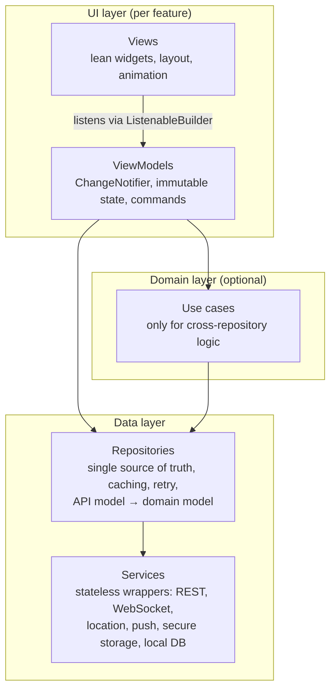

# 08 — Flutter Architecture (Rider and Captain Apps)

Status: Draft for client review — Phase 1

| | |
|---|---|
| Scope | The two native mobile apps: **MASHWAR Rider** and **MASHWAR Captain** (iOS + Android), built with Flutter from one monorepo |
| Inputs | `DESIGN_SYSTEM.md` (tokens, components, RTL rules, Flutter mapping), `HANDOFF.md` §7, `src/Passenger.tsx`, `src/Driver.tsx`, `src/config/market.ts`, backend contract in 07 |
| Architecture guidance | Official Flutter layered architecture (UI → optional domain → data; MVVM + repositories + services) |
| Implementation state | **Not built.** The current rider and captain experiences exist only as screens in the React prototype with simulated data. |

Legend: **[Decided]** agreed direction · **[Proposal]** recommended, needs sign-off · **[Open]** see section 16.

---

## 1. Goals

1. Two separate store apps (different users, permissions and store listings) that share one design system, one API client, one set of domain models and one localisation package. **[Decided]**
2. **Arabic-first, RTL by default**, English fully supported and switchable in-app. **[Decided]**
3. The server is the source of truth for trip state, prices and fees; the apps render server state and send intents. No local timers drive the ride lifecycle (`HANDOFF.md` §7). **[Decided]**
4. Robust on poor mobile networks: reconnecting socket, idempotent retries, clear "reconnecting" states.
5. Captain location tracking that is reliable in the background, battery-aware and compliant with Apple and Google store policies.

## 2. Monorepo and packages **[Proposal]**

Dart **pub workspaces** (Dart 3.6+) for dependency resolution, with **Melos** for scripts (analyse, test, codegen across packages).

| Package | Contents | Used by |
|---|---|---|
| `apps/rider` | Rider app: onboarding/OTP, home map, booking sheet, live trip, rating, trips, wallet/payment methods, account, support | — |
| `apps/captain` | Captain app: sign-in, onboarding/KYC upload, online toggle, offers, navigation to pickup/drop-off, trip flow, earnings, history, account | — |
| `packages/mashwar_design_system` | `ThemeData`, `ThemeExtension`s (status colours, elevations, radii), typography, shared widgets (`MButton`, `MCard`, `StatusBadge`, `RideStatusTimeline`, `MSheet`, `Stars`, `Segmented`, toasts) | both apps |
| `packages/mashwar_l10n` | ARB files (`app_ar.arb` default, `app_en.arb`), generated `AppLocalizations`, number/money/date formatters | both apps |
| `packages/mashwar_models` | Immutable domain models (`freezed`): `Trip`, `RideStatus` (sealed), `Money`, `MarketConfig`, `VehicleCategory`, `Captain`, `Vehicle`, `Coupon`, `Ticket`, `AppNotification` | both apps |
| `packages/mashwar_api` | OpenAPI-generated Dart client (raw API models) + thin hand-written services: `AuthService`, `TripService`, … ; interceptors (auth, idempotency, language, tracing) | both apps |
| `packages/mashwar_realtime` | WebSocket client with reconnection, auth refresh, room resubscription, typed event stream | both apps |
| `packages/mashwar_maps` | Map widget abstraction (markers, route polyline, camera helpers) so the provider can be swapped | both apps |
| `packages/mashwar_core` | `Result<T>` type, error mapping, logger, environment/flavor config, connectivity, secure storage wrapper, Command helpers | all packages |
| `packages/mashwar_location` | Captain-only background location service wrapper, batching and offline buffer | captain app |

Dependency rule: apps → feature code → packages; packages never import apps; `mashwar_models` depends on nothing app-specific.

## 3. Layered architecture (per app) **[Decided — follows the Flutter architecture skill]**



| Layer | Rules |
|---|---|
| **Views** | No business logic, no direct service or repository calls. Only UI concerns: layout, animation, simple navigation. Receive everything from the ViewModel. |
| **ViewModels** | Extend `ChangeNotifier`. Expose immutable state snapshots (e.g. a `freezed` `BookingState`) and command methods (`requestRide()`, `cancel()`). Repositories / use cases injected through the constructor. One ViewModel per screen or sheet state. |
| **Use cases** | Only when logic spans repositories or is reused, e.g. `RequestRideUseCase` (validate quote freshness + coupon + payment method + create trip with idempotency key), `GoOnlineUseCase` (check documents, permissions, start location service, open socket). |
| **Repositories** | Single source of truth for a data type. Combine REST snapshots and WebSocket events (e.g. `TripRepository.watchActiveTrip()` returns a `Stream<Trip?>`), cache, retry, and map API models to domain models. |
| **Services** | Stateless wrappers around external APIs and plugins. Return raw API models or `Result` values. |

Feature workflow for every new feature follows the skill's sequence: domain models → services → repositories → (use case if needed) → ViewModel → View → dependency registration → ViewModel and repository unit tests.

### 3.1 Ride status model

```dart
sealed class RideStatus { const RideStatus(); }
final class Requested  extends RideStatus { const Requested(); }
final class Accepted   extends RideStatus { const Accepted({required this.captain, required this.vehicle, required this.etaSeconds}); /* ... */ }
final class Arrived    extends RideStatus { const Arrived({required this.arrivedAt}); /* ... */ }
final class InProgress extends RideStatus { const InProgress({required this.startedAt}); /* ... */ }
final class Completed  extends RideStatus { const Completed({required this.fare}); /* ... */ }
final class Cancelled  extends RideStatus { const Cancelled({required this.by, this.fee}); /* ... */ }
```

`TripRepository` applies server events only if `event.tripVersion > current.version`; on a version gap or reconnect it re-fetches `GET /v1/trips/{id}`. Exhaustive `switch` on the sealed class makes every sheet state explicit (matches `RideStatusTimeline` in the design system).

## 4. State management and dependency injection

**Choice [Proposal]:** `ChangeNotifier` ViewModels + `ListenableBuilder` for UI binding, **`provider`** for dependency injection and scoping, plus a small `Command` helper (running / error / completed) for async actions.

| Option | Assessment |
|---|---|
| **ChangeNotifier MVVM + provider (chosen)** | Matches the official Flutter architecture guidance and the installed skill; no code generation for state; easy to unit test (plain Dart classes); low learning curve for a mixed team. |
| Riverpod | Strong, compile-safe DI and caching; more concepts and code generation; would replace the MVVM pattern described by the guidance. Viable alternative if the team already uses it. |
| Bloc / Cubit | Very explicit event → state flow, good for complex flows; more boilerplate per screen. |

Long-lived objects (API client, `RealtimeClient`, repositories, location service) are created once at app start in a composition root (`app/di.dart`) per flavor; ViewModels are created per route.

## 5. Routing **[Proposal]**

- **`go_router`** with typed routes (`go_router_builder`).
- `redirect` driven by an `AuthRepository` listenable: signed-out → onboarding/OTP; captain not approved → onboarding status screen; active trip → live trip screen (restored after app restart).
- `StatefulShellRoute.indexedStack` for the four-tab bottom bar (Rider: Home, Trips, Wallet, Account; Captain: Home, Trips, Earnings, Account — `DESIGN_SYSTEM.md` §7), preserving each tab's stack.
- Deep links and push taps: `/trip/:id`, `/offer/:id` (captain), `/support/tickets/:id`, `/notifications`. Universal Links / App Links configured per flavor.
- Back navigation and transitions are mirrored automatically under RTL.

## 6. Localisation and RTL **[Decided direction]**

- `flutter_localizations` + `gen-l10n` (ARB) in `mashwar_l10n`; **Arabic is the default locale**; English selectable in-app and persisted, also sent to the backend as `preferred_lang` and in `Accept-Language`.
- Layout direction comes from the locale (`Directionality` via `MaterialApp.locale`); widgets use `EdgeInsetsDirectional`, `AlignmentDirectional`, `PositionedDirectional`, `start/end` only — mirroring the prototype's logical CSS properties.
- Directional icons (back, chevrons, send) mirror (`Icon` with `matchTextDirection` or `Directionality`-aware assets); the brand, maps, media and star ratings do **not** mirror (`DESIGN_SYSTEM.md` §9).
- **Latin digits** for fares, times and distances in both languages (market setting in `market.ts`); formatters live in one place (`MoneyFormatter`, `DistanceFormatter`) and are tested in both locales. Phone numbers, plates, codes and IDs render inside an LTR `Directionality`/bidi isolate.
- Fonts **IBM Plex Sans Arabic** and **Inter** bundled as assets (offline, no runtime font fetching), Arabic with line height ≈ 1.55 and no letter spacing.
- Server-sourced labels (categories, zones, cancellation reasons) arrive with both `name_ar` and `name_en`.
- Widget tests run each key screen in `ar` and `en`, and at large text scale.

## 7. Design system mapping **[Proposal]**

| `DESIGN_SYSTEM.md` | Flutter |
|---|---|
| Colour tokens (`navy #101B2E`, `emerald #0FAF92`, `gold #D7A867`, `mint`, `ink`, `muted`, `line`, `bg`) | `ColorScheme` + `MashwarColors extends ThemeExtension` |
| Status colours (requested amber, arrived/in-progress blue, completed emerald, cancelled red) | `MashwarStatusColors` extension; always paired with a text label |
| Radius sm 8–12 / md 16 / lg 24 / sheet 28–30 | `MashwarRadii` extension; `FilledButton` shape radius 16 |
| Elevation (card, sheet, primary glow) | `MashwarShadows` extension (`BoxShadow` lists) |
| Spacing 4-pt base, mobile gutter 20 | `MashwarSpacing` constants |
| `Btn` (min height 44, primary CTA 56) | `MButton` variants: primary, dark, outline, soft, ghost, danger |
| `Sheet` | `DraggableScrollableSheet` (max 64–68 % height, safe-area padding) |
| `Segmented` / `Toggle` | `SegmentedButton` / `Switch` themed |
| Motion (450 / 420 / 380 / 300 ms, `cubic-bezier(.2,.8,.2,1)`) | `MashwarMotion` durations + `Cubic(0.2, 0.8, 0.2, 1)`; disabled when `MediaQuery.disableAnimations` |
| Captain app dark surfaces (`navy`, `navy-2`) | Captain app uses a dark `ThemeData` built from the same tokens |

Tokens are defined once in Dart; if the admin dashboard and apps must stay in sync automatically, a shared JSON token file can generate both Tailwind theme and Dart constants **[Open]**.

## 8. Maps **[Open — candidates]**

| Criterion | Google Maps (`google_maps_flutter` + Places/Routes APIs) | Mapbox (`mapbox_maps_flutter` + Search/Directions) |
|---|---|---|
| Riyadh road and POI coverage, Arabic place names | Typically strong; to be validated with local test addresses | To be validated |
| Custom styling to match `MapCanvas` look | Cloud-based map styling | Very flexible styles |
| Turn-by-turn for captains | Hand-off to Google Maps / Waze app, or Navigation SDK (separate licensing) | Navigation SDK (separate licensing) |
| Pricing model | Per request / per map load | Per map load / MAU |
| Data processing location | To review for PDPL | To review for PDPL |

`mashwar_maps` exposes a provider-neutral `MashwarMap` widget (markers: pickup emerald dot, destination navy/gold pin, car with heading; route polyline with progress) so the choice can change without touching features. Car marker movement is interpolated between location updates (≈500 ms linear, as in the prototype). Routing, ETA and geocoding calls go through the **backend** where possible, so API keys with billing power are not embedded in the apps (map display keys are restricted by bundle ID / SHA-1).

## 9. Background location (captain app) **[Proposal]**

| Platform | Requirements and constraints |
|---|---|
| **Android** | Foreground service of type `location` while online, with a persistent notification ("You are online"); permissions `ACCESS_FINE_LOCATION`, `FOREGROUND_SERVICE`, `FOREGROUND_SERVICE_LOCATION` (Android 14+), `POST_NOTIFICATIONS` (13+). Background location (`ACCESS_BACKGROUND_LOCATION`) only if strictly needed beyond the foreground service; it requires a Google Play declaration and prominent in-app disclosure. OEM battery optimisers (Xiaomi, Huawei, Oppo, Samsung) can kill services — in-app guidance to exempt the app. |
| **iOS** | "When In Use" plus Background Modes → Location updates with `allowsBackgroundLocationUpdates` and the blue background indicator; "Always" only if required. Clear `NSLocation*UsageDescription` strings in Arabic and English. App Review must see a legitimate continuous-use reason (active driving for ride-hailing). |
| **Both** | Tracking runs **only while the captain is online**; it stops on going offline, on sign-out and when the account is suspended. |

Plugin candidates: `geolocator` (with Android foreground-notification config) as baseline, or `flutter_background_geolocation` (commercial licence, motion detection, robust batching) — **[Open]**, decided after a field spike on real Android devices in Riyadh.

Battery and data strategy:

| Captain state | Update rate (proposal) | Distance filter |
|---|---|---|
| Offline | none | — |
| Online, available | every 10–15 s | 25–50 m |
| En route to pickup / on trip | every 3–5 s | 10 m |

Points are batched (e.g. up to 5 per message) over the socket. During connectivity loss, on-trip points are kept in a bounded local buffer (SQLite) and flushed on reconnect; available-state points are dropped (stale positions are useless for dispatch and minimising stored location data supports PDPL). Mock-location / developer-mode detection is reported to the backend as a fraud signal.

The **rider app** uses foreground "When In Use" location only, for pickup suggestion.

## 10. Push notifications **[Proposal]**

- `firebase_messaging` (FCM for Android, FCM → APNs for iOS); token registered with `POST /v1/devices` and refreshed on change.
- Android notification channels: `trip_offers` (high importance, custom sound, full-screen intent where allowed), `trip_updates`, `promotions` (opt-in), `account`.
- Captain offers: delivered primarily over WebSocket while the app is foregrounded or the foreground service is running; FCM high-priority message as fallback. Data-only pushes are not guaranteed on iOS when the app is terminated, so offers also carry a visible notification.
- Rider: accepted, arrived, receipt ready, support replies.
- Push taps route through `go_router` deep links.
- Devices without Google Play services (some Huawei models) — HMS Push support is **[Open]**.

## 11. WebSocket client (`mashwar_realtime`)

- Single connection per app session, owned by `RealtimeClient` service; repositories subscribe to typed streams (`Stream<TripEvent>`, `Stream<OfferEvent>`).
- Reconnection with exponential backoff + jitter (e.g. 1 s → 30 s cap), triggered also by connectivity changes and app resume.
- Before reconnecting, refresh the access token if near expiry; on `unauthorised`, run the refresh flow once, then sign out.
- After reconnect: re-join rooms (`trip:{id}`) and **resync** state over REST (`GET /v1/trips/{id}`, pending offer) — the socket is never assumed to have delivered every event.
- Heartbeat / ping timeout detection; UI exposes a `ConnectionState` (connected, reconnecting, offline) shown as a non-blocking banner.
- Events are de-duplicated by `eventId` and ordered by `tripVersion`.
- Socket.IO client vs plain WebSocket follows the backend decision (07 B6).

## 12. Offline and poor-network handling

| Situation | Behaviour |
|---|---|
| Request ride / cancel / accept offer / trip transitions | Sent with an `Idempotency-Key` generated once per user intent; retried safely with backoff; button shows progress and is disabled to avoid double taps. |
| No network at app start | Cached profile, market config and last trips shown; booking disabled with a clear message. |
| Network drop during a live trip | Last known trip and captain position stay on screen with a "reconnecting" banner; state reconciled on reconnect. |
| Offer arrives while connection is flaky | Countdown uses server `expiresAt` corrected by measured clock offset; accept returns `OFFER_EXPIRED` if too late, handled gracefully. |
| Captain completes trip while offline | Action queued locally and replayed with the same idempotency key; UI shows "pending sync". |

Local persistence: `flutter_secure_storage` (Keychain/Keystore) for tokens and device id; `drift` (SQLite) for caches and the captain location buffer; `shared_preferences` only for trivial settings (language, onboarding flags).

## 13. Folder structure

```text
mashwar_mobile/                     # or apps/ + packages/ inside the main monorepo (see 11)
├── pubspec.yaml                    # pub workspace root
├── melos.yaml
├── analysis_options.yaml           # shared lints (flutter_lints / very_good_analysis)
├── apps/
│   ├── rider/
│   │   ├── lib/
│   │   │   ├── main_dev.dart
│   │   │   ├── main_staging.dart
│   │   │   ├── main_prod.dart
│   │   │   ├── app/
│   │   │   │   ├── app.dart              # MaterialApp.router, theme, locale
│   │   │   │   ├── di.dart               # composition root (providers)
│   │   │   │   └── router.dart           # go_router config, redirects, deep links
│   │   │   ├── data/
│   │   │   │   ├── models/               # app-specific API models (if any beyond mashwar_api)
│   │   │   │   ├── repositories/         # auth, trip, quote, payment_method, coupon, support, notification
│   │   │   │   └── services/             # app-specific services (e.g. psp_sdk_service)
│   │   │   ├── domain/
│   │   │   │   ├── models/               # app-specific domain models
│   │   │   │   └── use_cases/            # request_ride, apply_coupon
│   │   │   └── ui/
│   │   │       ├── core/                 # app-level shared widgets
│   │   │       └── features/
│   │   │           ├── onboarding/   { view_models/, views/ }
│   │   │           ├── auth_otp/     { view_models/, views/ }
│   │   │           ├── home_booking/ { view_models/, views/ }
│   │   │           ├── live_trip/    { view_models/, views/ }
│   │   │           ├── rating/       { view_models/, views/ }
│   │   │           ├── trips/        { view_models/, views/ }
│   │   │           ├── wallet/       { view_models/, views/ }
│   │   │           ├── support/      { view_models/, views/ }
│   │   │           └── account/      { view_models/, views/ }
│   │   ├── test/                         # unit + widget tests mirror lib/
│   │   ├── integration_test/
│   │   ├── android/  (flavors: dev, staging, prod)
│   │   └── ios/      (schemes/xcconfigs: dev, staging, prod)
│   └── captain/
│       └── lib/ ... same layout; features: sign_in, onboarding_kyc, home_online,
│                  offer, trip_navigation, trip_flow, earnings, history, account, support
└── packages/
    ├── mashwar_core/
    ├── mashwar_design_system/
    │   └── lib/{tokens/, theme/, widgets/}
    ├── mashwar_l10n/
    │   └── lib/l10n/{app_ar.arb, app_en.arb}
    ├── mashwar_models/
    ├── mashwar_api/
    │   └── lib/{generated/, services/, interceptors/}
    ├── mashwar_realtime/
    ├── mashwar_maps/
    └── mashwar_location/
```

## 14. Testing

| Level | Scope | Tools |
|---|---|---|
| Unit | ViewModels (with fake repositories), repositories (with fake services), use cases, formatters (money/digits in ar and en), `RideStatus` event reconciliation, reconnection backoff | `flutter_test`, `mocktail` |
| Widget | Each screen in `ar` (RTL) and `en`, large text scale, loading/error/empty states, sheet states per `RideStatus` | `flutter_test`; golden tests for design-system widgets (`alchemist` or similar) |
| Integration | Full flows on emulators/simulators against a staging backend or a local mock server: OTP sign-in, request → accept → track → complete → rate; captain online → offer → accept → complete | `integration_test`; `patrol` candidate for native permission dialogs |
| Contract | Generated `mashwar_api` client compiles against the published OpenAPI; WebSocket event fixtures shared with backend tests | CI |
| Device / field | Background location on real Android (several OEMs) and iPhones, battery drain over a shift, poor-network drives in Riyadh | Manual test plan, internal builds |
| Accessibility | Semantics labels, contrast (tokens are AA at specified sizes), touch targets ≥ 44, status never by colour alone | Widget tests + manual |

## 15. Flavors and release process **[Proposal]**

| Flavor | Backend | Bundle / application id | Firebase project | Notes |
|---|---|---|---|---|
| `dev` | dev API | `sa.mashwar.rider.dev` / `sa.mashwar.captain.dev` (placeholder ids) | dev | Debug menu, verbose logging |
| `staging` | staging API, PSP/SMS sandboxes | `.staging` | staging | Distributed to client testers |
| `prod` | production API | final ids (client to confirm) | prod | Store builds |

- Configuration via `--flavor` + `--dart-define-from-file=env/<flavor>.json` (no secrets in the app; only public identifiers and endpoints).
- CI builds (Codemagic, GitHub Actions + fastlane, or Bitrise — **[Open]**): analyse, test, build both apps per flavor, sign, upload.
- Distribution: TestFlight and Google Play internal testing for staging; production via phased rollout (Play staged rollout, App Store phased release).
- Semantic versioning per app; build number from CI.
- **Forced/soft update:** `GET /v1/config` returns `minSupportedVersion`; the app blocks or nudges accordingly (important because the API contract evolves).
- Crash and performance reporting (Crashlytics or Sentry) with PII scrubbing.
- Store listings, screenshots and privacy labels (App Store privacy details, Play Data safety, location disclosures) in Arabic and English.
- Release checklist includes RTL visual check, background-location review notes, and permission strings in both languages.

## 16. Open questions and decisions

| # | Question | Owner |
|---|---|---|
| F1 | Confirm ChangeNotifier MVVM + provider (vs Riverpod / Bloc). | Mobile lead |
| F2 | Maps provider (Google Maps vs Mapbox) after Riyadh address/POI test; in-app navigation or hand-off to external navigation apps. | Client / mobile lead |
| F3 | Background location plugin (`geolocator` vs commercial `flutter_background_geolocation`). | Mobile lead after spike |
| F4 | Huawei / non-GMS device support (HMS push and location). | Client |
| F5 | Final app names, bundle ids, Apple/Google developer accounts owned by the client entity. | Client |
| F6 | PSP mobile SDK (Apple Pay, mada, STC Pay) and in-app payment UX. | Client / backend |
| F7 | Shared token source (JSON) for Flutter and admin dashboard, or Dart-only tokens. | Design / mobile lead |
| F8 | Minimum OS versions (proposal: iOS 15+, Android 8.0 / API 26+, to validate with market device data). | Client / mobile lead |
| F9 | In-app chat and calling in launch scope (affects realtime and permissions). | Product |
| F10 | Mobile CI/CD service. | Tech lead |
