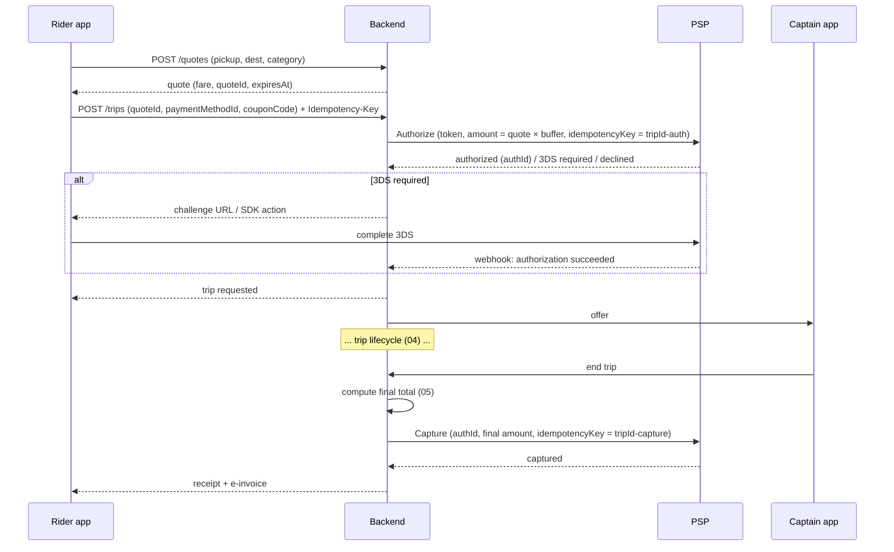

# 10 — Payment Gateway Plan

**Status:** Draft for client review — Phase 1

> **Payments in the prototype are fully simulated.** No real card, wallet, top-up, refund or payout transaction happens. The screens say so ("Simulated payment — no real transaction is made", "Demo only — no real card data is stored or processed", "Demo payout requested"). Card brands, balances and transaction lists are placeholder data. The prototype's *Add card* form takes a raw card number into browser memory for demonstration only. **This form must not be carried into production.**

Provider names below are **candidates to evaluate**. This document makes no claims about their pricing, certifications, licensing status or feature support. All of these must be verified directly with each provider during selection.

---

## 1. Saudi payment landscape (for MVP scoping)

| Method | Notes for MASHWAR | MVP priority (proposed) |
|---|---|---|
| **mada** (مدى) | National debit card scheme. Most Saudi cardholders have one. Support for card-not-present, tokenization and **pre-authorization / capture** must be confirmed with the chosen PSP | Must have |
| **Apple Pay** | Widely used in KSA, including with mada cards. Requires an Apple merchant ID and the PSP's Apple Pay support | Must have (iOS) |
| **Visa / Mastercard** | Credit and debit, local and international (visitors, airport trips) | Must have |
| **Google Pay** | Availability and mada support in KSA to be confirmed with the PSP | Evaluate |
| **STC Pay** | Popular local wallet. The current product and API (including its transition to stc Bank) and PSP support must be confirmed | Evaluate |
| **Cash** | Shown in the prototype as "Always available". Needs the captain cash-balance process (section 5) | Must have (client to confirm) |
| BNPL (for example Tabby, Tamara) | Low relevance for ride fares | Out of scope |

**Candidate licensed PSPs / gateways to evaluate:** HyperPay, Moyasar, PayTabs, Checkout.com. Others may be added (for example the client's acquiring bank).

**Selection criteria:**

| Criterion | What to verify |
|---|---|
| Licensing | Licensed or authorised by SAMA for the services used. Contracting entity in KSA |
| Methods | mada, Apple Pay, Visa / MC, STC Pay, Google Pay coverage |
| Ride-hailing flows | Pre-authorization, partial / incremental capture, void, delayed capture window, merchant-initiated transactions on saved cards |
| Tokenization | Network or PSP tokens. Card-on-file. Mobile SDKs for Flutter (or native SDKs we can bridge) |
| 3-D Secure | 3DS2 support, frictionless flow, exemptions for MIT |
| Payouts | Payout / disbursement API to Saudi IBANs, or none (then the bank does payouts) |
| Marketplace / split | Split settlement between platform and captains, if the commercial model needs it |
| Webhooks | Signed webhooks, retries, event catalogue |
| Sandbox | Full sandbox with test cards for every method, including mada |
| Commercials | MDR per method, fixed fees, settlement time, chargeback fees (from the PSP's quote; not assumed here) |
| Support | Arabic and English support, SLA, incident communication |
| Reporting | Settlement reports, reconciliation files / API |

## 2. PCI-DSS scope minimisation

**Principle:** MASHWAR systems never see, store, process or transmit the full card number (PAN), CVV or track data.

| Rule | Implementation |
|---|---|
| Card entry | Only through the PSP's **hosted fields, hosted payment page or mobile SDK**. Card data goes straight from the device to the PSP |
| Storage | Store only the PSP **token**, plus display metadata: brand, last 4 digits, expiry month / year, funding type (mada / credit), issuer country |
| Logs | No card data or PSP secrets in logs, analytics, crash reports or support tools. Automated scanning for PAN patterns |
| Backend | Server-to-server calls use tokens only. PSP API keys live in a managed vault and rotate |
| Apple Pay / wallets | Use the PSP's decryption, or the network-token flow, so encrypted payment data is not decrypted by MASHWAR |
| Compliance | Target the smallest applicable PCI-DSS self-assessment. Confirm the SAQ type with the PSP and, if needed, a QSA, based on the final integration method |

## 3. Card payment flow for a ride (pre-authorization + capture)

| Case | Handling |
|---|---|
| Final total ≤ authorized amount | Capture the final total. The remainder is released automatically or by a void |
| Final total > authorized amount (waiting fee, route change) | Incremental authorization if supported, otherwise a second charge on the saved token (merchant-initiated). Rule set to be agreed |
| Rider cancels with no fee | Void the authorization |
| Rider cancels with a fee | Capture the fee amount only (partial capture), void the rest |
| No captain found / expired | Void |
| Authorization declined | Ask for another method, or offer cash (if allowed for this rider) |
| Capture fails after the trip | Retry with backoff. Mark the trip `payment_due`. Notify the rider. Block new card trips until it is resolved (policy decision) |
| Authorization hold buffer | % or fixed buffer above the quote (decision). Check scheme rules on hold amounts and hold duration with the PSP |

**Open point:** pre-authorization support and hold behaviour for **mada** must be confirmed with the PSP. If it is not available, the alternative is **charge at the end of the trip** on the saved token, with a card-verification step at card-add time.

## 4. Refunds and adjustments

| Type | Trigger | Rules |
|---|---|---|
| Full refund | Admin, from a support ticket (for example "charged for a cancelled trip", seen in the prototype's ticket TK-1040) | Refund to the original method through the PSP. Reason code. Audit log. Credit note / adjusted e-invoice |
| Partial refund | Fare dispute, route issue | Same, with an amount ≤ captured amount |
| Fee waiver | Cancellation or waiting fee waived by support | Partial refund, or void if not yet captured |
| Captain clawback | A refund caused by captain fault (policy) | Debit the captain's earnings ledger. Visible in the captain's earnings |
| Promotional credit | Goodwill | Rider credit balance, if a wallet or credit feature is approved (section 7) |

Refund timelines depend on the issuer and method. The FAQ text in the prototype ("up to 3 business days") is placeholder copy and must be confirmed against the PSP.

## 5. Cash handling and captain cash-balance reconciliation

With cash, the captain holds the whole fare, and the platform's commission becomes **money the captain owes the platform**.

**Captain ledger (double-entry, per captain):**

| Event | Captain earnings | Platform receivable from the captain |
|---|---|---|
| Card trip completed | + captain net | — |
| Cash trip completed (captain collected the total) | + captain net | + (total − captain net), i.e. the commission owed |
| Cash cancellation fee collected | Per policy | Per policy |
| Payout to the captain | − payout | — |
| Netting at payout | − commission owed | − commission owed |
| Captain settles debt (pays the platform) | — | − amount |

**Rules to agree:**

| # | Rule | Proposal |
|---|---|---|
| CB1 | Net cash commission against card earnings at each payout | Yes, automatically |
| CB2 | Maximum outstanding debt before the captain is blocked from **cash** trips (still allowed card trips) | Client to set a SAR threshold |
| CB3 | Maximum before the captain is blocked from going online | Client to set |
| CB4 | How captains pay down debt | Card payment in the captain app through the PSP, bank transfer with a reference, or deduction only |
| CB5 | Rider cash short-payment or no-pay | Captain reports in-app. Support case. Rider flagged and possibly restricted to card |
| CB6 | Cash rounding / change | Decision (see 05, D18) |

**Reconciliation:** a daily job compares (a) PSP settlement reports with captured card transactions, (b) the captain ledger with trip settlements, and (c) payouts with bank confirmations. Mismatches open a finance exception queue in admin.

## 6. Payouts to captains

| Item | Proposal |
|---|---|
| Destination | Captain's Saudi IBAN, verified at onboarding (name match with the national ID / iqama where possible) |
| Frequency | Weekly batch (default), optional on-demand with a fee (decision) |
| Rails | PSP payout API, or a bank bulk-transfer file / API from the client's bank. Instant-payment rails if offered by the bank or PSP |
| Amount | Available balance = earnings − commission owed − clawbacks − holds |
| Holds | New captains, disputed trips, fraud review |
| Statements | Captain earnings statement per period. Commission invoices to captains, if required by the tax model (see 05, D5) |
| Controls | Maker-checker approval for payout batches in admin. Audit log |

The prototype's "Available payout" figure and *Payout* button are simulated.

## 7. Wallet / stored value

The prototype shows a "MASHWAR balance" with a *Top up* button. These are static placeholders.

| Option | Notes |
|---|---|
| **A. No wallet at MVP** (recommended starting point) | Simplest. Cards + cash only |
| **B. Non-withdrawable promo credits** | Issued by MASHWAR (refunds, goodwill, referrals) and spent on rides only. Usually simpler than stored value, but still needs legal confirmation |
| **C. Rider-funded, top-up stored value** | Likely to fall under SAMA rules for e-money / stored value. Must be assessed by counsel, and may require a licensed partner to hold the funds |

Decision needed from the client (see 03, Q8).

## 8. Webhooks and idempotency

| Rule | Detail |
|---|---|
| Verify | Check the webhook signature (HMAC / public key) and timestamp tolerance. Reject unsigned events |
| Idempotent processing | Store `provider_event_id` with a unique constraint. A duplicate delivery is acknowledged without being re-processed |
| Ordering | Do not assume order. Each payment object has a state machine (`pending → authorized → captured → refunded / voided / failed`), and events that are not allowed in the current state are ignored or queued |
| Outbound idempotency | Every PSP call carries an idempotency key derived from the business operation (`trip-{id}-auth`, `trip-{id}-capture`, `refund-{id}`) |
| Respond fast | Return 2xx after persisting the event. Process asynchronously |
| Reconcile | A polling job fetches the status of payments stuck in `pending` past a threshold |
| Observability | Alerts on webhook failure rate, capture failure rate, and the auth-to-capture gap |

## 9. ZATCA e-invoicing for receipts

| Item | Plan |
|---|---|
| Document type | B2C rides: **simplified tax invoice** per completed trip and per charged cancellation fee. Credit / debit notes for refunds and adjustments |
| Content | Seller name and VAT number, invoice number and date-time, line items (fare, waiting fee, cancellation fee, discount), VAT amount and rate, total, QR code, in Arabic (English optional), per ZATCA requirements |
| Integration | FATOORA phase 2 (integration) via an e-invoicing solution or SDK: cryptographic stamp, UUID, hash chain, and reporting of simplified invoices to ZATCA within the required time. The client's integration wave and deadline must be confirmed |
| Supplier model | Depends on decision D5 in 05: whether the platform or the captain is the supplier of transport, and how commission to captains is invoiced |
| Delivery | Receipt screen in the app (designed as the trip completion summary), PDF / email on request, and history in Trips |
| Corporate riders | Standard (B2B) tax invoices are out of MVP scope (see 03) |

Legal and tax confirmation is required before the invoice templates are finalised.

## 10. Testing in sandbox

| Area | Test |
|---|---|
| Methods | Successful payments with each method: mada, Visa, MC, Apple Pay, STC Pay if selected. Use only the PSP's published test cards |
| 3-D Secure | Frictionless, challenge-success, challenge-fail, timeout |
| Declines | Insufficient funds, expired card, do-not-honour, network errors |
| Flows | Auth → capture (lower, equal, higher amount); auth → void on cancel; partial capture for a cancellation fee; refund full / partial |
| Idempotency | Repeated client requests, duplicate webhooks, out-of-order webhooks, PSP timeouts with retry |
| Cash | Ledger entries for cash trips, netting at payout, debt thresholds blocking cash trips |
| Payouts | Batch creation, approval, PSP / bank confirmation, failure and retry |
| Invoices | ZATCA sandbox / compliance checks for simplified invoices, QR validation, credit notes |
| Reconciliation | Settlement-file import, mismatch detection |
| Security | No PAN in logs or DB (automated scan). Token-only API traffic. Secret rotation |

A sandbox go-live checklist and PSP certification (if the PSP requires one) are completed before production keys are issued. Production keys are stored only in the vault, never in apps or repositories.

## 11. Decisions and open questions

| # | Question |
|---|---|
| P1 | Which PSP(s) to shortlist and contract? Is there an existing banking relationship? |
| P2 | Payment methods at launch (mada, Apple Pay, Visa / MC, STC Pay, Google Pay, cash)? |
| P3 | Pre-auth + capture, or charge at trip end? (Depends on mada support.) |
| P4 | Authorization buffer and policy when the final amount exceeds the hold |
| P5 | Cash enabled at launch? Debt thresholds (CB2, CB3)? |
| P6 | Payout frequency, on-demand payouts, and the payout provider (PSP or bank) |
| P7 | Wallet option A / B / C (section 7) |
| P8 | Invoice supplier model and VAT treatment (with a tax advisor) |
| P9 | Refund approval limits by admin role |
| P10 | Chargeback handling ownership and captain clawback policy |
