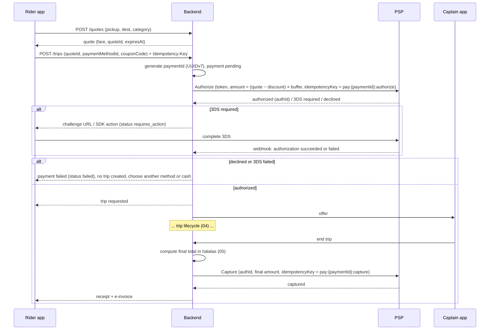
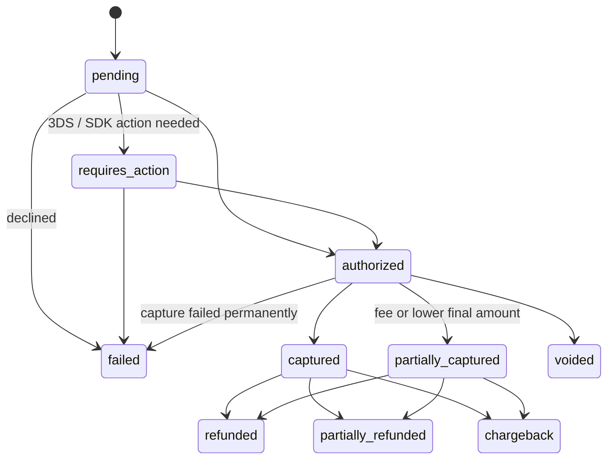

# 10 — Payment Gateway Plan

**Status:** Draft for client review — Phase 1

> **Payments in the prototype are fully simulated.** No real card, wallet, top-up, refund or payout transaction happens. The screens say so ("Simulated payment — no real transaction is made", "Demo only — no real card data is stored or processed", "Demo payout requested"). Card brands, balances and transaction lists are placeholder data. The prototype's *Add card* form takes a raw card number into browser memory for demonstration only. **This form must not be carried into production.**

**Contract scope.** Phase 3 delivers integration with the selected PSP's **sandbox** only (mada, Apple Pay, cards; cash handled in the ledger). Activation of the production gateway later is a configuration change with the client's live keys and is **included at no additional programming fee** (section 11). No real payment is processed during the contract unless the client completes the production prerequisites.

**Required payment methods (client requirement):** mada, Apple Pay, credit / debit cards (Visa / Mastercard) and **cash at launch**. STC Pay and Google Pay are optional extras to confirm with the client (P2).

Provider names below are **candidates to evaluate**. This document makes no claims about their pricing, certifications, licensing status or feature support. All of these must be verified directly with each provider during selection.

---

## 1. Saudi payment landscape (for MVP scoping)

| Method | Notes for MASHWAR | MVP priority |
|---|---|---|
| **mada** (مدى) | National debit card scheme, widely held by Saudi cardholders (to verify market figures). Support for card-not-present, tokenization and **pre-authorization / capture** must be confirmed with the chosen PSP | **Required** (client requirement) |
| **Apple Pay** | Reported to be in common use in KSA, including with mada cards (to verify). Requires an Apple Pay merchant ID owned by the client and the PSP's Apple Pay support | **Required** (iOS, client requirement) |
| **Visa / Mastercard** | Credit and debit, local and international (visitors, airport trips) | **Required** (client requirement) |
| **Google Pay** | Availability and mada support in KSA to be confirmed with the PSP | Optional extra (ask client, P2) |
| **STC Pay** | Local wallet. The current product and API (including its transition to stc Bank) and PSP support must be confirmed (to verify) | Optional extra (ask client, P2) |
| **Cash** | Shown in the prototype as "Always available". Needs the captain cash-balance process (section 5) | **Required at launch** (client requirement) |
| BNPL (for example Tabby, Tamara) | Low relevance for ride fares | Out of scope |

**Candidate licensed PSPs / gateways to evaluate:** HyperPay, Moyasar, PayTabs, Checkout.com. Others may be added (for example the client's acquiring bank).

**Selection criteria:**

| Criterion | What to verify |
|---|---|
| Licensing | Licensed or authorised by SAMA for the services used. Contracting entity in KSA |
| Methods | Required: mada, Apple Pay, Visa / MC. Optional: STC Pay, Google Pay |
| Ride-hailing flows | Pre-authorization, partial / incremental capture, void, delayed capture window, merchant-initiated transactions on saved cards |
| Tokenization | Network or PSP tokens. Card-on-file. Mobile SDKs for Flutter (or native SDKs we can bridge) |
| 3-D Secure | 3DS2 support, frictionless flow, exemptions for MIT |
| Payouts | Payout / disbursement API to Saudi IBANs, or none (then the bank does payouts) |
| Marketplace / split | Split settlement between platform and captains, if the commercial model needs it |
| Webhooks | Signed webhooks, retries, event catalogue |
| Sandbox | Full sandbox with test cards for every method, including mada |
| Commercials | MDR per method, fixed fees, settlement time, chargeback fees (from the PSP's quote; not assumed here). Who bears the MDR is open decision **05 D20** |
| Support | Arabic and English support, SLA, incident communication |
| Reporting | Settlement reports, reconciliation files / API |

### 1a. Account ownership

| Item | Owner |
|---|---|
| PSP merchant account (sandbox and live) | The client's legal entity |
| Apple Pay merchant ID and its certificates (payment processing, merchant identity) | The client's Apple Developer account |
| Settlement bank account | The client's legal entity |
| Live API keys and webhook secrets | The client; placed in the production secret store by the client or under the client's supervision |

The delivery team only receives **scoped sandbox / API credentials** needed for development and testing. It does not hold the merchant account, live keys or settlement account.

### 1b. Per-method behaviour (to confirm with the PSP)

Every cell below is **to confirm with the selected PSP**; nothing here is assumed.

| Behaviour | mada | Apple Pay | Visa / Mastercard |
|---|---|---|---|
| Pre-authorization | To confirm with PSP | To confirm with PSP (depends on the underlying card, including mada) | To confirm with PSP |
| Capture (full / partial) | To confirm with PSP | To confirm with PSP | To confirm with PSP |
| Overage (final > authorized): incremental auth or second MIT charge | To confirm with PSP | To confirm with PSP | To confirm with PSP |
| Void of an uncaptured authorization | To confirm with PSP | To confirm with PSP | To confirm with PSP |
| 3-D Secure | To confirm with PSP | Device authentication; 3DS handling to confirm with PSP | To confirm with PSP |
| Fallback if pre-auth is unavailable | Charge at trip end on the saved token | Charge at trip end | Charge at trip end |

## 2. PCI-DSS scope minimisation

**Principle:** MASHWAR systems never see, store, process or transmit the full card number (PAN), CVV or track data.

| Rule | Implementation |
|---|---|
| Card entry | Only through the PSP's **hosted fields, hosted payment page or mobile SDK**. Card data goes straight from the device to the PSP |
| Storage | Store only the PSP **token**, plus display metadata: brand, last 4 digits, expiry month / year, funding type (mada / credit), issuer country |
| Logs | No card data or PSP secrets in logs, analytics, crash reports or support tools. Automated scanning for PAN patterns |
| Backend | Server-to-server calls use tokens only. PSP API keys live in a managed vault and rotate |
| Apple Pay / wallets | Use the PSP's decryption, or the network-token flow, so encrypted payment data is not decrypted by MASHWAR |
| Compliance | Target the smallest applicable PCI-DSS self-assessment. Confirm the SAQ type with the PSP and, if needed, a QSA, based on the final integration method |

## 3. Card payment flow for a ride (pre-authorization + capture)

**Authorization amount** = (quote fare − coupon discount) × buffer, in halalas, rounded half-up once (05 §0). The buffer covers a possible waiting fee; its value is decision P4. When the authorization is declined, no trip is created.

| Case | Handling |
|---|---|
| Final total ≤ authorized amount | Capture the final total. The remainder is released automatically or by a void |
| Final total > authorized amount (waiting fee, route change) | Incremental authorization if supported, otherwise a second charge on the saved token (merchant-initiated). Rule set to be agreed |
| Rider cancels with no fee | Void the authorization |
| Rider cancels with a fee | Capture the fee amount only (partial capture), void the rest |
| No captain found / expired | Void |
| Authorization declined | Ask for another method, or offer cash (if allowed for this rider) |
| Capture fails after the trip | Retry with backoff. Mark the trip `payment_due`. Notify the rider. Block new card trips until it is resolved (policy decision) |
| Partial capture fails (for example a cancellation fee) | Retry with backoff; if it still fails, record the fee as a rider debt and void the authorization; support can waive it (policy decision) |
| Capture attempted after the authorization has expired | The PSP rejects the capture; fall back to a merchant-initiated charge on the saved token for the final amount, if the PSP and scheme allow it (to confirm with PSP); otherwise `payment_due` as above |
| Authorization hold buffer | % or fixed buffer above the quote (decision P4). Check scheme rules on hold amounts and hold duration with the PSP |

**Open point:** pre-authorization support and hold behaviour for **mada** must be confirmed with the PSP (see 1b). If it is not available, the alternative is **charge at the end of the trip** on the saved token, with a card-verification step at card-add time.

### 3a. Payment state machine

The `finance.payments.status` values (06 §5.5):

`pending` is the state between generating the payment id (from which the PSP idempotency key is derived) and the PSP's first answer. The stored `finance.payments.status` column holds the six values `requires_action`, `authorized`, `captured`, `partially_captured`, `voided`, `failed` (06 §5.5). `refunded`, `partially_refunded` and `chargeback` are derived from `finance.refunds` and dispute records attached to a captured payment, not stored in the payment's status column.

## 4. Refunds and adjustments

| Type | Trigger | Rules |
|---|---|---|
| Full refund | Admin, from a support ticket (for example "charged for a cancelled trip", seen in the prototype's ticket TK-1040) | Refund to the original method through the PSP. Reason code. Audit log. Credit note / adjusted e-invoice |
| Partial refund | Fare dispute, route issue | Same, with an amount ≤ captured amount |
| Fee waiver | Cancellation or waiting fee waived by support | Partial refund, or void if not yet captured |
| Captain clawback | A refund caused by captain fault (policy) | Debit the captain's earnings ledger. Visible in the captain's earnings |
| Promotional credit | Goodwill | Rider credit balance, if a wallet or credit feature is approved (section 7) |

Refund timelines depend on the issuer and method. The FAQ text in the prototype ("up to 3 business days") is placeholder copy and must be confirmed against the PSP.

## 5. Cash handling and captain cash-balance reconciliation

With cash, the captain holds the whole fare, and the platform's commission becomes **money the captain owes the platform**.

**Captain ledger (double-entry, per captain):**

| Event | Captain earnings | Platform receivable from the captain |
|---|---|---|
| Card trip completed | + captain net | — |
| Cash trip completed (captain collected the total) | + captain net | + (total − captain net), i.e. the commission owed |
| Cash cancellation fee collected | Per policy | Per policy |
| Payout to the captain | − payout | — |
| Netting at payout | − commission owed | − commission owed |
| Captain settles debt (pays the platform) | — | − amount |

**Rules to agree:**

| # | Rule | Proposal |
|---|---|---|
| CB1 | Net cash commission against card earnings at each payout | Yes, automatically |
| CB2 | Maximum outstanding debt before the captain is blocked from **cash** trips (still allowed card trips) | Client to set a SAR threshold |
| CB3 | Maximum before the captain is blocked from going online | Client to set |
| CB4 | How captains pay down debt | Card payment in the captain app through the PSP, bank transfer with a reference, or deduction only |
| CB5 | Rider cash short-payment or no-pay | Captain reports in-app. Support case. Rider flagged and possibly restricted to card |
| CB6 | Cash rounding / change | Decision (see 05, D18) |

**Reconciliation:** a daily job compares (a) PSP settlement reports with captured card transactions, (b) the captain ledger with trip settlements, and (c) payouts with bank confirmations. Mismatches open a finance exception queue in admin.

## 6. Payouts to captains

| Item | Proposal |
|---|---|
| Destination | Captain's Saudi IBAN, verified at onboarding (name match with the national ID / iqama where possible) |
| Frequency | Weekly batch (default), optional on-demand with a fee (decision) |
| Rails | PSP payout API, or a bank bulk-transfer file / API from the client's bank. Instant-payment rails if offered by the bank or PSP |
| Amount | Available balance = earnings − commission owed − clawbacks − holds |
| Holds | New captains, disputed trips, fraud review |
| Statements | Captain earnings statement per period. Commission invoices to captains, if required by the tax model (see 05, D5) |
| Controls | Maker-checker approval for payout batches in admin. Audit log |

The prototype's "Available payout" figure and *Payout* button are simulated.

## 7. Wallet / stored value

The prototype shows a "MASHWAR balance" with a *Top up* button. These are static placeholders.

| Option | Notes |
|---|---|
| **A. No wallet at MVP** (recommended starting point) | Simplest. Cards + cash only |
| **B. Non-withdrawable promo credits** | Issued by MASHWAR (refunds, goodwill, referrals) and spent on rides only. Usually simpler than stored value, but still needs legal confirmation |
| **C. Rider-funded, top-up stored value** | Likely to fall under SAMA rules for e-money / stored value. Must be assessed by counsel, and may require a licensed partner to hold the funds |

Decision needed from the client (see 03, Q8).

## 8. Webhooks and idempotency

| Rule | Detail |
|---|---|
| Verify | Check the webhook signature (HMAC / public key) and timestamp tolerance. Reject unsigned events |
| Idempotent processing | Store each event in `finance.psp_webhook_events` with `unique (psp, event_id)` (06 §5.5). A duplicate delivery is acknowledged without being re-processed |
| Ordering | Do not assume order. Each payment follows the state machine in §3a. An event that arrives before its prerequisite state (for example a capture event before the authorization is recorded) is **queued and retried until the prerequisite state arrives**; after a timeout, the backend **fetches the payment status from the PSP** and applies it. Events that are no longer applicable are recorded and ignored |
| Outbound idempotency | Every PSP call carries an idempotency key derived from the `finance.payments` (or `finance.refunds`) row id: `pay:{paymentId}:authorize`, `pay:{paymentId}:capture`, `pay:{paymentId}:void`, `refund:{refundId}`. Same rule as 06 and 07 |
| Respond fast | Return 2xx after persisting the event. Process asynchronously |
| Reconcile | A polling job fetches the status of payments stuck in `pending` or `requires_action` past a threshold |
| Observability | Sentry alerts on webhook processing errors and capture failures (contract scope); dashboards are post-contract |

## 9. ZATCA e-invoicing for receipts

| Item | Plan |
|---|---|
| Document type | B2C rides: a **simplified tax invoice** per completed trip and per charged cancellation fee is the expected document type (to verify with the client's tax advisor). Credit / debit notes for refunds and adjustments |
| Content | Expected fields (to verify): seller name and VAT number, invoice number and date-time, line items (fare, waiting fee, cancellation fee, discount), VAT amount and rate, total, QR code, in Arabic (English optional), per ZATCA requirements. VAT placement: 05 §5a |
| Integration | FATOORA phase 2 (integration) via an e-invoicing solution or SDK: cryptographic stamp, UUID, hash chain, and reporting of simplified invoices to ZATCA within the required time (to verify). The client's integration wave and deadline must be confirmed. **ZATCA production integration is a post-contract item** (see 11) |
| Supplier model | Depends on decision D5 in 05: whether the platform or the captain is the supplier of transport, and how commission to captains is invoiced |
| Delivery | Receipt screen in the app (designed as the trip completion summary), PDF / email on request, and history in Trips |
| Corporate riders | Standard (B2B) tax invoices are out of MVP scope (see 03) |

Legal and tax confirmation is required before the invoice templates are finalised.

## 10. Testing in sandbox

| Area | Test |
|---|---|
| Methods | Successful payments with each required method: mada, Visa, MC, Apple Pay (plus STC Pay / Google Pay if selected). Use only the PSP's published test cards |
| 3-D Secure | Frictionless, challenge-success, challenge-fail, timeout |
| Declines | Insufficient funds, expired card, do-not-honour, network errors |
| Flows | Auth → capture (lower, equal, higher amount); auth → void on cancel; partial capture for a cancellation fee; refund full / partial |
| Idempotency | Repeated client requests, duplicate webhooks, out-of-order webhooks, PSP timeouts with retry |
| Cash | Ledger entries for cash trips, netting at payout, debt thresholds blocking cash trips |
| Payouts | Batch creation, approval, PSP / bank confirmation, failure and retry |
| Invoices | ZATCA sandbox / compliance checks for simplified invoices, QR validation, credit notes |
| Reconciliation | Settlement-file import, mismatch detection |
| Security | No PAN in logs or DB (automated scan). Token-only API traffic. Secret rotation |

Rows for payouts and ZATCA invoices apply only if those features are in scope; ZATCA production integration is post-contract.

## 11. Production activation

**Included in the contract at no additional programming fee.** The code delivered in Phase 3 runs against the PSP sandbox. Switching to the live gateway is a **configuration-only** change:

1. Replace the sandbox PSP keys and webhook secret with the client's **live** keys in the production secret store.
2. Configure the client's **Apple Pay merchant ID** and live certificates.
3. Point the PSP's live webhook to the production endpoint.
4. Run a smoke test with a small real transaction and a void / refund, agreed with the client.

**Prerequisites the client supplies:** a live merchant account with the selected PSP, completed **KYC / onboarding approval** by the PSP (and any PSP certification it requires), the Apple Pay merchant ID under the client's Apple Developer account, and the live keys placed in the secret store. The timing of activation depends on the PSP's approval of the client, which is outside the delivery team's control. Production keys are never stored in apps or repositories.

## 12. Decisions and open questions

| # | Question |
|---|---|
| P1 | Which PSP(s) to shortlist and contract? Is there an existing banking relationship? |
| P2 | STC Pay and / or Google Pay in addition to the required mada, Apple Pay, cards and cash? |
| P3 | Pre-auth + capture, or charge at trip end? (Depends on mada support, see 1b.) |
| P4 | Authorization buffer and policy when the final amount exceeds the hold |
| P5 | Cash-debt thresholds for captains (CB2, CB3) |
| P6 | Payout frequency, on-demand payouts, and the payout provider (PSP or bank) |
| P7 | Wallet option A / B / C (section 7) |
| P8 | Invoice supplier model and VAT treatment (with a tax advisor) |
| P9 | Refund approval limits by admin role |
| P10 | Chargeback handling ownership and captain clawback policy |
