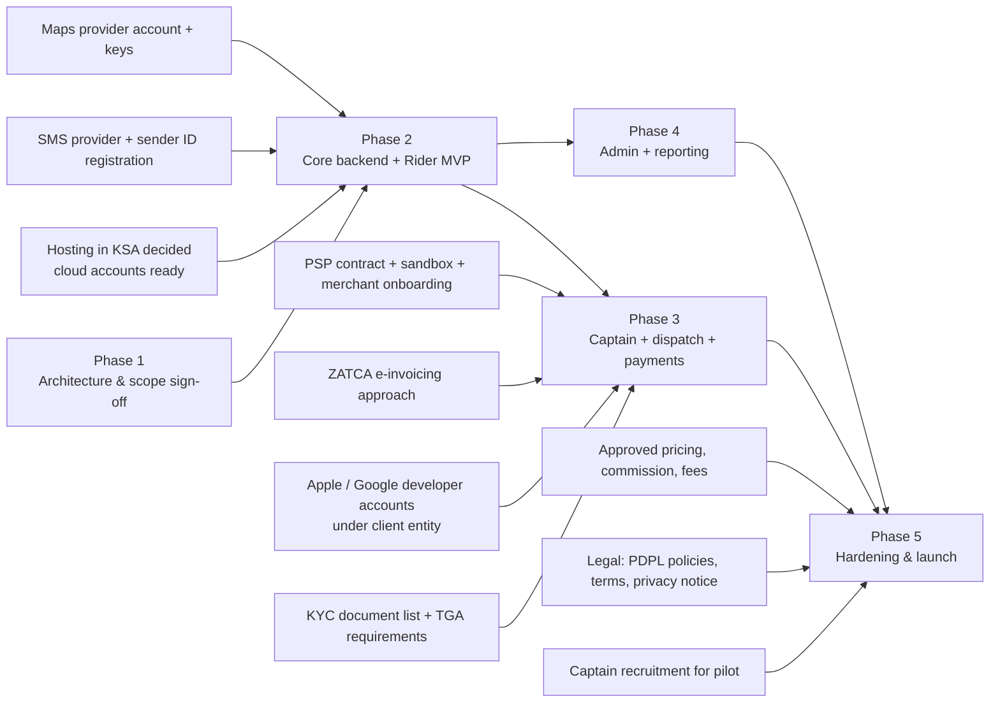

# 11 — Project Structure and Roadmap

Status: Draft for client review — Phase 1

| | |
|---|---|
| Scope | Repository layout, environments, branching, definition of done, and the phased delivery plan after Phase 1 |
| Related | 06 — Database, 07 — Backend, 08 — Flutter |
| Current state | Phase 1 (discovery, design and architecture) is in progress. The **only implemented artifact is the React prototype** (this repository, simulated data, no backend). No production code exists yet. |

Legend: **[Decided]** agreed direction · **[Proposal]** recommended, needs sign-off · **[Open]** see section 8.

All durations below are **rough estimates to be validated** once scope, team size and third-party dependencies are confirmed. No dates are committed in this document.

---

## 1. Repository layout **[Proposal]**

One monorepo containing all first-party code, with two toolchains side by side: **pnpm workspaces + Turborepo** for TypeScript (backend, admin, shared TS packages) and **Dart pub workspaces + Melos** for Flutter.

```text
mashwar/
├── apps/
│   ├── rider/                    # Flutter — MASHWAR Rider (iOS, Android)
│   ├── captain/                  # Flutter — MASHWAR Captain (iOS, Android)
│   └── admin/                    # Next.js (React, TypeScript) — admin dashboard
├── services/
│   └── api/                      # NestJS modular monolith (process roles: api, realtime, worker)
│       ├── src/modules/          # auth, riders, captains, vehicles, markets, dispatch, trips,
│       │                         # tracking, realtime, payments, promotions, ratings, support,
│       │                         # notifications, admin, reporting
│       ├── src/platform/         # config, logging, tracing, outbox, idempotency, errors
│       ├── migrations/           # versioned SQL migrations (PostgreSQL + PostGIS)
│       ├── seeds/                # dev/staging seed data (non-personal)
│       └── test/                 # integration and e2e tests
├── packages/
│   ├── flutter/
│   │   ├── mashwar_core/
│   │   ├── mashwar_design_system/
│   │   ├── mashwar_l10n/
│   │   ├── mashwar_models/
│   │   ├── mashwar_api/          # generated Dart client from contracts/openapi
│   │   ├── mashwar_realtime/
│   │   ├── mashwar_maps/
│   │   └── mashwar_location/
│   └── ts/
│       ├── api-client/           # generated TypeScript client for admin
│       ├── design-tokens/        # token source shared with admin (and optionally Flutter)
│       ├── i18n/                 # admin ar/en dictionaries
│       └── eslint-config/, tsconfig/
├── contracts/
│   ├── openapi/                  # published OpenAPI spec (generated, versioned)
│   └── events/                   # JSON Schemas for WebSocket and domain events
├── infra/
│   ├── docker/                   # Dockerfiles, docker-compose for local (PostGIS, Redis, mail/SMS mocks)
│   ├── k8s/ or platform/         # deployment manifests / IaC modules
│   └── terraform/                # cloud resources per environment (provider to confirm)
├── prototype/                    # the existing React prototype (this repository), kept as UX reference
├── docs/
│   ├── phase1/                   # these documents
│   ├── adr/                      # architecture decision records
│   └── runbooks/                 # incidents, releases, data subject requests
├── .github/ (or CI config)       # pipelines per path filter
├── package.json, pnpm-workspace.yaml, turbo.json
├── pubspec.yaml, melos.yaml      # Dart workspace root
└── CODEOWNERS
```

Notes:

- Path-filtered CI: a change in `apps/rider` does not rebuild the backend, and vice versa; a change in `contracts/` triggers both client regenerations.
- The prototype stays read-only as a UX and behaviour reference (state machine, fee rules, screen flows). Whether it moves into the monorepo or stays in its own repository is **[Open]**.
- Every significant decision from the open-question lists in 06/07/08 is captured as an ADR in `docs/adr/` when closed.

## 2. Environments **[Proposal]**

| Environment | Purpose | Data | Integrations | Access |
|---|---|---|---|---|
| `local` | Developer machines | Synthetic seeds | Docker Compose (PostGIS, Redis), mocked SMS/PSP/push | Developers |
| `dev` | Continuous integration target, every merge to `main` | Synthetic seeds, resettable | Provider sandboxes | Team |
| `staging` | Production-like; client UAT; release candidates; load and security tests | Synthetic / anonymised only — **never real personal data** | PSP and SMS sandboxes, test FCM/APNs, maps with restricted keys | Team + client testers |
| `production` | Live service (Riyadh pilot, then launch) | Real data under PDPL controls | Live providers | Restricted, audited, MFA |

Each environment has its own cloud account/project, network, secrets, keys, Firebase project, and app flavor (see 08 §15). Production hosting location in the Kingdom is to be confirmed (07 §11).

## 3. Branching and versioning **[Proposal]**

- **Trunk-based development:** short-lived feature branches (`feat/…`, `fix/…`) → pull request → `main`. `main` is always deployable to `dev`.
- **Protected `main`:** required reviews (CODEOWNERS per area), green CI, no direct pushes, linear history (squash merge).
- **Conventional Commits** for readable history and changelogs.
- **Backend and admin:** release by tag (`api-vX.Y.Z`, `admin-vX.Y.Z`) → staging → approval → production.
- **Mobile apps:** `release/rider-X.Y` and `release/captain-X.Y` branches cut for store submissions; hotfixes cherry-picked; tags per store build.
- **Feature flags** (server-driven via `/v1/config`) to merge incomplete work safely and to enable features per city.
- **API compatibility:** additive changes only within `/v1`; breaking changes need a new version or a deprecation window aligned with `minSupportedVersion` in the apps.

## 4. Definition of Done **[Proposal]**

A work item is done when all applicable points hold:

| Area | Criteria |
|---|---|
| Functionality | Acceptance criteria met and demonstrated on `staging`; behaviour matches the approved design and prototype flow, or the deviation is agreed |
| Code quality | Reviewed and approved; lint, format and typecheck/analyser clean; no new high/critical static-analysis findings |
| Tests | Unit tests for logic (ViewModels, repositories, services, state machine, pricing); integration tests for new database or API behaviour; existing suites green |
| Contracts | OpenAPI / event schemas updated; generated clients regenerated; no unplanned breaking changes |
| Data | Migrations reversible or expand/contract; indexes for new query paths checked with `EXPLAIN`; FKs indexed; PII fields classified |
| Security | Authorisation checks on every new endpoint (object level); input validation; secrets not in code; admin actions audited |
| Localisation | All user-facing strings in Arabic and English; verified in RTL and LTR; Latin digits for amounts |
| Accessibility | Touch targets, semantics labels, contrast and "not colour alone" rules from `DESIGN_SYSTEM.md` |
| Observability | Logs (PII-redacted), metrics and traces for new flows; alerts for new critical paths |
| Documentation | README/ADR/runbook updated where behaviour or operations changed |
| Deployment | Deployed to `staging` through the pipeline; feature flag state documented |

## 5. Roadmap after Phase 1

Phase 1 output (this set of documents, approved designs, open decisions closed) is the entry gate for Phase 2.

| Phase | Goal | Main scope | Exit milestone | Rough duration (estimate, to validate) |
|---|---|---|---|---|
| **1. Discovery & architecture** (current) | Agree what to build and how | Requirements, UX/UI and prototype, architecture docs (06, 07, 08, 11 and companions), provider shortlists, open decisions | M1: Architecture and scope sign-off | in progress |
| **2. Core backend + Rider MVP** | A rider can sign in, get a quote and book against a working backend | Monorepo + CI/CD + `dev`/`staging`; auth/OTP; markets, zones and pricing; quotes; trips state machine; realtime gateway skeleton; rider app (onboarding, booking, live trip screen fed by a **dispatch stub/test captain tool**, history, rating); design system + l10n packages | M2: Rider books and completes a trip end-to-end on staging with a simulated captain | ~8–12 weeks |
| **3. Captain app + dispatch + payments** | Real two-sided marketplace with money movement | Captain app (onboarding/KYC upload, online/offline, background location, offers, trip flow, earnings); dispatch (Redis GEO, ETA ranking, 30 s offers, reassignment); tracking; PSP integration (card/mada/Apple Pay/STC Pay as contracted), cash flow, ledger, receipts / e-invoicing; push notifications | M3: Real captain and rider complete paid trips on staging; settlement ledger balances | ~10–14 weeks |
| **4. Admin dashboard + reporting** | Operations can run the service | Admin auth + MFA + RBAC; captain review/approval/suspension; rider blocking; trips and live operations map; pricing plans with approval; zones editor; coupons; support tickets and refunds; reports and exports; audit log viewer | M4: Operations team runs a full UAT day on staging using only the dashboard | ~6–10 weeks (can start partly in parallel with Phase 3) |
| **5. Hardening & launch** | Safe, compliant go-live in Riyadh | Load and soak tests, resilience drills, penetration test and fixes, PDPL review (retention, rights handling, residency), regulatory/TGA readiness as applicable, store submissions, monitoring/on-call, runbooks, closed pilot with real captains, then public launch | M5: Pilot go/no-go → M6: Public launch go/no-go | ~6–10 weeks |

Phases 3 and 4 overlap where team capacity allows; the critical path runs through dispatch, payments and store/regulatory approvals.

### 5.1 Dependencies



### 5.2 Long-lead external items (start during Phase 1)

| Item | Why it is long-lead | Needed by |
|---|---|---|
| Hosting provider and in-Kingdom region | Contracts, account setup, residency review | Phase 2 start |
| SMS/OTP provider and sender-ID registration | Registration processes with providers/regulators take time | Phase 2 (OTP) |
| PSP selection, contract, merchant onboarding (mada, Apple Pay, STC Pay) | Commercial and compliance onboarding | Phase 3 |
| ZATCA e-invoicing approach | Tax advisor input, possible integration provider | Phase 3 |
| Apple and Google developer accounts under the client's legal entity | Organisation verification (D-U-N-S etc.) | First TestFlight / Play internal build |
| TGA and regulatory requirements for ride-hailing platforms and captains | Determines KYC data, vehicle rules, possibly reporting | Phase 3 design |
| Approval of commercial values (fares, fees, commission — all provisional in `config/market.ts`) | Business decision | Before pilot |
| Legal documents (terms, privacy notice, captain agreement) in Arabic and English | Counsel review | Before pilot |

### 5.3 Milestone acceptance (summary)

| Milestone | Accepted when |
|---|---|
| M1 | Client signs off scope, designs and architecture; open decisions have owners and dates |
| M2 | Demo on staging: OTP sign-in, quote, booking, live status updates, completion, rating, history — in Arabic and English |
| M3 | Demo on staging with two physical phones: captain online → offer (30 s) → accept → tracking → complete → card and cash payment → ledger and receipt correct |
| M4 | Ops UAT: approve a captain from submitted documents, change a pricing plan through approval, create a coupon, resolve a ticket with refund, export a report; all actions visible in the audit log |
| M5 | Load, security and PDPL checks passed; store builds approved; pilot runbook ready |
| M6 | Pilot KPIs (dispatch success, crash-free sessions, payment success) meet agreed thresholds |

## 6. Team shape assumed by the estimates **[Proposal — to validate]**

| Role | Indicative allocation |
|---|---|
| Tech lead / architect | 1 |
| Backend (NestJS, PostgreSQL) | 2 |
| Flutter | 2 |
| Admin frontend (Next.js) | 1 (from Phase 3/4) |
| QA (manual + automation) | 1 |
| DevOps / platform | 0.5–1 |
| Product / UX | 1 (client side or shared) |

A smaller team stretches the ranges above; a larger team does not shorten the critical path proportionally (provider onboarding, store review and regulatory steps are fixed lead times).

## 7. Risks

| Risk | Impact | Mitigation |
|---|---|---|
| Third-party onboarding delays (PSP, SMS, stores) | Phase 3/5 slip | Start in Phase 1; sandbox-first development behind interfaces |
| Background location reliability on Android OEMs | Poor tracking, missed offers | Early field spike in Phase 2; plugin decision with data |
| Regulatory requirements discovered late (TGA, PDPL, ZATCA) | Rework of data model or flows | Compliance review gates at M1 and before M3 |
| Unapproved commercial values | Launch blocked | Values are configuration (`pricing_plans` with approval state), not code |
| Scope growth (scheduled rides, wallet, multi-city) before launch | Delays | Explicit post-launch backlog; change control |

## 8. Open questions and decisions

| # | Question | Owner |
|---|---|---|
| R1 | Single monorepo (proposed) vs separate repositories per app/service. | Tech lead / client |
| R2 | Keep the prototype inside the monorepo or in its own repository. | Tech lead |
| R3 | Source control and CI platform (GitHub, GitLab, Azure DevOps…). | Client IT |
| R4 | Team size and composition for Phases 2–5 (drives the duration ranges). | Client / vendor |
| R5 | MVP scope confirmation: payment types at launch (cash, card, wallet), in-app chat, masked calling, scheduled rides. | Client (product) |
| R6 | Pilot format: closed group of captains/riders, zones of Riyadh, duration. | Client (operations) |
| R7 | Launch KPIs and thresholds for go/no-go. | Client |
| R8 | Support model after launch (SLA, on-call, maintenance phase). | Client / vendor |
