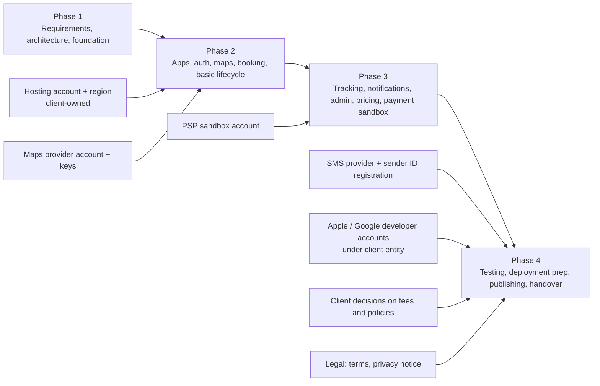

# 11 — Project Structure and Roadmap

Status: Draft for client review — Phase 1

| | |
|---|---|
| Scope | Repository layout, environments, branching, definition of done, and the contractual delivery plan |
| Related | 06 — Database, 07 — Backend, 08 — Flutter |
| Current state | Phase 1 (requirements, UX/UI, architecture, technical foundations) is in progress. Built so far: the React prototype (`prototype/`, simulated data) and the Phase 1 technical foundation described in §4a. No production feature exists yet. |

Legend: **[Decided]** agreed direction · **[Proposal]** recommended, needs sign-off · **[Proposal — technical, recommended]** technical decision taken by the delivery team, consistent with 04, 06, 07 and 08 · **[Open]** see section 8.

**Contract:** total **$1,200**, **30 days**, four phases (§5). Phase durations are fixed by the contract; **calendar dates are set at kickoff**. Scope beyond the contract is listed in the post-contract backlog (§5.4).

---

## 1. Repository layout **[Proposal — technical, recommended]** (implemented in Phase 1)

One repository containing all first-party code, with two toolchains side by side: a **pnpm workspace** (`prototype`, `backend`, `admin`) and a **Dart pub workspace** (`mobile/`). Turborepo, Melos, Terraform and Kubernetes are not used in the contract scope. The repository is hosted in the **client-owned GitHub repository** when the client provides it.

```text
mashwar/
├── prototype/                    # the React review prototype (moved from the repository root)
│   ├── src/                      # store.tsx, config/market.ts, Passenger.tsx, Driver.tsx, Admin.tsx …
│   └── e2e/                      # Playwright suite (pnpm test:e2e)
├── backend/                      # NestJS modular monolith (REST + Socket.IO + in-process BullMQ worker)
│   ├── src/                      # health/, trips/ (state machine), auth/ (RBAC map), platform/
│   ├── db/migrations/            # 0001_initial_schema.sql, 0002_reference_data.sql
│   ├── test/                     # unit and migration tests
│   └── .env.example              # environment template
├── admin/                        # React + Vite + TypeScript SPA shell (no SSR needed, so no Next.js)
├── mobile/                       # Dart pub workspace
│   ├── apps/rider/               # Flutter — MASHWAR Rider (iOS, Android)
│   ├── apps/captain/             # Flutter — MASHWAR Captain (iOS, Android)
│   └── packages/
│       ├── mashwar_core/         # models, ride status + transitions, money in halalas
│       └── mashwar_ui/           # design tokens, theme, l10n
├── infra/
│   └── docker-compose.yml        # local PostGIS + Redis
├── docs/
│   └── phase1/                   # these documents
├── .github/workflows/            # CI
├── HANDOFF.md, DESIGN_SYSTEM.md  # stay at the repository root
├── package.json, pnpm-workspace.yaml
└── README.md
```

Notes:

- The prototype stays as a UX and behaviour reference (state machine, fee rules, screen flows). All prototype paths in these documents are `prototype/src/…` and `prototype/e2e/…`.
- Decisions closed from the open-question lists in 06/07/08 are recorded in these documents (and in `CLIENT-DECISIONS.md` for client decisions).

## 2. Environments **[Proposal]**

| Environment | Purpose | Data | Integrations | Access |
|---|---|---|---|---|
| `local` | Developer machines | Synthetic seeds | `infra/docker-compose.yml` (PostGIS, Redis), mocked SMS/PSP/push | Developers |
| `staging` | Client UAT; release candidates | Synthetic / anonymised only — **never real personal data** | PSP and SMS sandboxes, test FCM/APNs, maps with restricted keys | Team + client testers |
| `production` | Live service | Real data under PDPL controls | Live providers once the client activates them (10 §11) | Restricted, audited, MFA |

Each environment has its own secrets, keys, Firebase project and app flavor (see 08 §15), all under client-owned accounts. Production hosting location in the Kingdom is to be confirmed (07 §11). A separate `dev` environment is a post-contract option.

## 3. Branching and versioning **[Proposal]**

- **Trunk-based development:** short-lived feature branches (`feat/…`, `fix/…`) → pull request → `main`. `main` is always deployable to `staging`.
- **Protected `main`:** green CI, no direct pushes, linear history (squash merge).
- **Conventional Commits** for readable history and changelogs.
- **Backend and admin:** release by tag (`api-vX.Y.Z`, `admin-vX.Y.Z`) → staging → approval → production.
- **Mobile apps:** `release/rider-X.Y` and `release/captain-X.Y` branches cut for store submissions; hotfixes cherry-picked; tags per store build.
- **Feature flags** (server-driven via `/v1/config`) to merge incomplete work safely and to enable features per city.
- **API compatibility:** additive changes only within `/v1`; breaking changes need a new version or a deprecation window aligned with `minSupportedVersion` in the apps.

## 4. Definition of Done **[Proposal]**

A work item is done when all applicable points hold:

| Area | Criteria |
|---|---|
| Functionality | Acceptance criteria met and demonstrated on `staging`; behaviour matches the approved design and prototype flow, or the deviation is agreed |
| Code quality | Reviewed and approved; lint, format and typecheck/analyser clean; no new high/critical static-analysis findings |
| Tests | Unit tests for logic (ViewModels, repositories, services, state machine, pricing); integration tests for new database or API behaviour; existing suites green |
| Contracts | API and event shapes documented; no unplanned breaking changes |
| Data | Migrations reversible or expand/contract; indexes for new query paths checked with `EXPLAIN`; FKs indexed; PII fields classified |
| Security | Authorisation checks on every new endpoint (object level); input validation; secrets not in code; admin actions audited |
| Localisation | All user-facing strings in Arabic and English; verified in RTL and LTR; Latin digits for amounts |
| Accessibility | Touch targets, semantics labels, contrast and "not colour alone" rules from `DESIGN_SYSTEM.md` |
| Observability | Logs (PII-redacted) for new flows; errors reach Sentry |
| Documentation | README / docs updated where behaviour or operations changed |
| Deployment | Deployable to `staging`; configuration documented in the env templates |

## 4a. Phase 1 "technical foundation" deliverable

Phase 1 includes a technical foundation, accepted when the following exist in the repository and CI is green:

| Item | Content |
|---|---|
| Repository layout | As in §1: `prototype/`, `backend/`, `admin/`, `mobile/`, `infra/`, `docs/`; pnpm and Dart workspaces |
| Backend scaffold | NestJS app with a health endpoint |
| Domain rules with unit tests | Trip state machine (04) and RBAC permission map, as pure TypeScript with unit tests |
| Database migrations | `backend/db/migrations/0001_initial_schema.sql` and `0002_reference_data.sql`, verified by migration tests against PostgreSQL + PostGIS in Docker |
| Flutter scaffolds | `mobile/apps/rider` and `mobile/apps/captain` (`flutter create`), shared packages `mashwar_core` (ride status and transitions, money in halalas) and `mashwar_ui` (design tokens, theme), with tests |
| Admin shell | `admin/` React + Vite + TypeScript SPA shell |
| Local infrastructure | `infra/docker-compose.yml` (PostGIS + Redis) |
| Environment templates | `.env.example` files, no secrets committed |
| CI | GitHub Actions: lint, typecheck and tests for backend, admin and the Dart workspace; migration tests |

Results of the Phase 1 checks are recorded in `PHASE1-AUDIT-REPORT.md` and the acceptance items in `PHASE1-ACCEPTANCE-CHECKLIST.md` (see README).

## 5. Contractual roadmap **[Decided — contract]**

| Phase | Price | Duration | Scope (from the contract) | Exit milestone |
|---|---|---|---|---|
| **1. Requirements, UX/UI, architecture, technical foundations** (current) | $240 | 6 days | Requirements and scope (03), design approval checklist (01), architecture documents (04–11), technical foundation (§4a) | M1: Phase 1 acceptance (`PHASE1-ACCEPTANCE-CHECKLIST.md`) |
| **2. Rider and captain apps, authentication, maps, booking, basic ride lifecycle** | $360 | 9 days | Rider **and** captain Flutter apps; OTP authentication; maps display; quote and booking; basic ride lifecycle (request → offer → accept → arrive → start → complete, cancel, `expired`) against the backend | M2: rider and captain complete a trip end to end on staging |
| **3. Real-time tracking, notifications, admin dashboard, pricing, payment sandbox** | $360 | 8 days | Live captain tracking over Socket.IO; push and in-app notifications; administration dashboard; pricing, waiting and cancellation fees, commission (provisional values); coupons, ratings, support / complaints; **payment sandbox** integration (mada, Apple Pay, cards) and cash ledger | M3: paid (sandbox) and cash trips complete on staging; admin operates the main sections |
| **4. Testing, fixes, deployment preparation, documentation, handover** | $240 | 7 days | Automated tests plus the **real-device test matrix** (iOS / Android); fixes; production deployment preparation; **App Store and Google Play publishing under the client's accounts**; documentation; handover of code, design and assets to the client | M4: both apps published; handover complete. The **45-day implementation-defect warranty** starts after both apps are published |
| **Total** | **$1,200** | **30 days** | | |

**Realistic Phase 2 in 9 days requires these scope choices** **[Proposal — technical, recommended]:**

- OTP through a **sandbox or mock** SMS provider until the client's SMS account is live.
- **No KYC document upload**; captains are created and approved by admin.
- **Nearest-captain dispatch** (straight-line distance from Redis GEO, sequential offers, 30 s timeout, search timeout → `expired`); road-ETA ranking is later.
- **Maps display** in the apps plus **directions through the backend**; no in-app turn-by-turn navigation.

Production activation of the payment gateway (10 §11) happens when the client supplies live credentials; it is included at no additional programming fee and is not tied to a phase.

### 5.1 Dependencies



### 5.2 Long-lead external items (start during Phase 1)

| Item | Why it is long-lead | Needed by |
|---|---|---|
| Hosting provider and in-Kingdom region (client-owned account) | Contracts, account setup, residency review | Phase 2 start |
| SMS/OTP provider and sender-ID registration (client-owned) | Registration processes with providers / regulators take time | Before publishing (Phase 4); sandbox / mock OTP until then |
| PSP selection, sandbox account; later live merchant onboarding and KYC (mada, Apple Pay, cards) | Commercial and compliance onboarding | Sandbox: Phase 3. Live: production activation (10 §11) |
| Apple and Google developer accounts under the client's legal entity | Organisation verification (D-U-N-S etc., to verify) | First TestFlight / Play internal build, at the latest Phase 4 |
| Approval of commercial values (fares, fees, commission — all provisional in `prototype/src/config/market.ts`) | Business decision | Before publishing |
| Legal documents (terms, privacy notice, captain agreement) in Arabic and English | Counsel review | Before publishing |

### 5.3 Milestone acceptance (summary)

| Milestone | Accepted when |
|---|---|
| M1 | Client accepts Phase 1 per `PHASE1-ACCEPTANCE-CHECKLIST.md`; open client decisions listed in `CLIENT-DECISIONS.md` |
| M2 | Demo on staging with two phones: rider OTP sign-in (sandbox / mock), quote, booking; captain online → offer (30 s) → accept → arrive → start → complete; cancellation and `expired` paths — in Arabic and English |
| M3 | Demo on staging: live tracking, push notifications, admin dashboard main sections, pricing and fee settings, coupon, rating, complaint; card payment in the PSP sandbox and a cash trip with correct ledger entries |
| M4 | Real-device matrix executed and results recorded; both apps published on the App Store and Google Play under the client's accounts; source code, design and assets handed over; documentation delivered |

### 5.4 Post-contract backlog / options

Not included in the $1,200 contract; can be quoted separately:

| Item | Notes |
|---|---|
| Independent penetration test | Recommended before scale-up |
| Closed pilot with real captains, load and soak tests, resilience drills | Operations-led |
| ZATCA e-invoicing production integration (FATOORA) | Depends on tax advisor decisions (05 D5) |
| Captain KYC document upload and review workflow | Phase 2 uses admin-created captains |
| Road-ETA dispatch ranking, broadcast offers, fairness signals | Phase 2 uses nearest-captain dispatch |
| In-app turn-by-turn navigation, masked calling, in-app chat persistence | Hand-off to external navigation in scope |
| Wallet / stored value, payouts automation | 10 §6–7 |
| Table partitioning, read replica, RLS | 06 §8, §10 |
| Kubernetes, Terraform, autoscaling, separate process roles, WAF | 07 §11 |
| OpenTelemetry, Prometheus / Grafana, on-call alerting, SBOM, SAST / image scanning | 07 §9–10, §12 |
| Multi-city / multi-country activation | 09 |

**Not post-contract:** activation of the production payment gateway with the client's live keys (10 §11) is included at no additional programming fee.

## 6. Team **[Proposal — technical, recommended]**

The contract is delivered by **1–2 developers** covering backend, Flutter and admin, with the client providing product decisions and test devices / accounts as agreed. Scope has been cut to match this team and the 30-day budget: the simplifications in §5 (Phase 2 choices) and the post-contract backlog in §5.4 are the result. Provider onboarding, store review and the client's decisions remain fixed lead times outside the team's control.

## 7. Risks

| Risk | Impact | Mitigation |
|---|---|---|
| Third-party onboarding delays (PSP, SMS, stores, client accounts) | Phase 3/4 slip; publishing blocked | Start in Phase 1; sandbox / mock first behind interfaces; client opens accounts early |
| Tight 30-day schedule with 1–2 developers | Quality or scope pressure | Scope cuts in §5; post-contract backlog §5.4; change control |
| Background location reliability on Android OEMs | Poor tracking, missed offers | Covered in the Phase 4 real-device matrix; plugin decision with data |
| Regulatory requirements discovered late (TGA, PDPL, ZATCA) | Rework of data model or flows | Client's counsel / tax advisor input before Phase 4 |
| Unapproved commercial values | Launch blocked | Values are configuration (`pricing_plans` with approval state), not code |
| Scope growth (scheduled rides, wallet, multi-city) | Delays | Post-contract backlog; change control |

## 8. Open questions and decisions

| # | Question | Owner |
|---|---|---|
| R1 | Single repository — implemented (§1). | Closed |
| R2 | Prototype inside the repository under `prototype/` — implemented. | Closed |
| R3 | GitHub repository owned by the client: when will it be provided? | Client |
| R4 | Kickoff date (sets the calendar dates of the 30-day plan). | Client / vendor |
| R5 | MVP scope confirmation: in-app chat, masked calling, scheduled rides. (Payment methods: mada, Apple Pay, cards and cash are required; wallet is post-MVP.) | Client (product) |
| R6 | Real-device test matrix: device models and OS versions for Phase 4. | Client / vendor |
| R7 | Pilot format and launch KPIs (post-contract). | Client |
| R8 | Support model after the 45-day warranty (SLA, maintenance). | Client / vendor |
